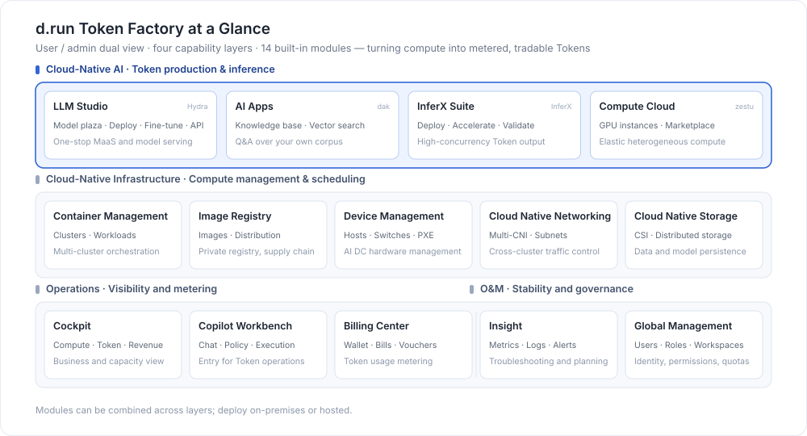

---
hide:
  - toc
---

# d.run Token Factory

d.run Token Factory is an integrated platform built by DaoCloud for AI intelligent computing scenarios, providing end-to-end capabilities around large model inference, compute scheduling, and cluster operations. The platform adopts a dual-view architecture of **User** and **Admin**: the user view serves end users, providing large model service invocation, cost management, and intelligent application access capabilities; the admin view serves operations and management teams, providing unified management of model hosting, inference engines, infrastructure, and global operations.

  

    
CNAI

    

      <a class="tf-arch-card tf-arch-card--model" href="hydra/">
        LLM Studio
        Model serving and O&M management
      </a>
      <a class="tf-arch-card tf-arch-card--model" href="dak/">
        AI Apps
        Intelligent Q&A and other application capabilities
      </a>
      <a class="tf-arch-card tf-arch-card--model" href="inferx/">
        InferX Suite
        Inference acceleration and engine management
      </a>
      <a class="tf-arch-card tf-arch-card--model" href="zestu/">
        Compute Cloud
        Heterogeneous compute management and scheduling
      </a>
    

  

  
▲

  

    
CN Infra

    

      <a class="tf-arch-card tf-arch-card--compute" href="kpanda/intro/">
        Container Management
        Cluster and workload management
      </a>
      <a class="tf-arch-card tf-arch-card--compute" href="kangaroo/intro/">
        Container Registry
        Image hosting and integration
      </a>
      <a class="tf-arch-card tf-arch-card--compute" href="topohub/intro/">
        Device Management
        Unified hardware device management
      </a>
      <a class="tf-arch-card tf-arch-card--compute" href="network/intro/">
        Cloud Native Network
        Multi-CNI converged network
      </a>
      <a class="tf-arch-card tf-arch-card--compute" href="storage/">
        Cloud Native Storage
        Container storage and CSI
      </a>
    

  

  
▲

  

    
Ops

    

      <a class="tf-arch-card tf-arch-card--ops" href="copilot/">
        Copilot
        Intelligent O&M assistant
      </a>
      <a class="tf-arch-card tf-arch-card--ops" href="crane/intro/">
        Cockpit
        Operations data visualization
      </a>
      <a class="tf-arch-card tf-arch-card--ops" href="leopard/">
        Billing Center
        Billing and invoice analysis
      </a>
    

  

  
▲

  

    
OAM

    

      <a class="tf-arch-card tf-arch-card--ops" href="insight/intro/">
        Insight
        Metrics, logs, and tracing
      </a>
      <a class="tf-arch-card tf-arch-card--ops" href="ghippo/intro/">
        Global Management
        User permissions and platform settings
      </a>
    

  

As a high-efficiency AI Token production and management system built for intelligent computing centers, Token Factory helps traditional computing centers upgrade to an efficient, profitable Token production and operations model. The platform uniformly manages NVIDIA and domestic heterogeneous computing power, relying on intelligent scheduling and inference optimization to transform distributed GPU resources into low-cost, highly stable, tradable standardized token services. Through the Token Factory manager and unified operations system, it achieves global management of resources, production, costs, and supply-demand, providing capabilities to end users, administrators, operators, and O&M personnel, and driving the intelligent computing center's business positioning to upgrade from "providing compute power" to "producing and operating tokens."

## Learning Path

  <a class="tf-path-step" style="--path-c:#2196f3" href="install/">
    1
    Deploy the Platform
    Install Token Factory offline, complete initialization and licensing
    Go →
  </a>
  <a class="tf-path-step" style="--path-c:#00acc1" href="kpanda/intro/">
    2
    Onboard Compute
    Attach GPU nodes and create worker clusters
    Go →
  </a>
  <a class="tf-path-step" style="--path-c:#43a047" href="hydra/">
    3
    Deploy Models
    Pick models from the catalog and deploy inference services in one click
    Go →
  </a>
  <a class="tf-path-step" style="--path-c:#fb8c00" href="dak/">
    4
    Build Applications
    Set up corpus libraries and intelligent Q&A applications
    Go →
  </a>
  <a class="tf-path-step" style="--path-c:#8e24aa" href="crane/intro/">
    5
    Operate &amp; Settle
    Cockpit for operations, Billing Center for metering
    Go →
  </a>

[Download Center](https://docs.daocloud.io/en/download/){ .md-button .md-button--primary }
[Learn about d.run Token Factory](https://docs.daocloud.io/en/tf/){ .md-button .md-button--primary }
[Learn about d.run AI OS](https://docs.daocloud.io/en/drun/){ .md-button .md-button--primary }
