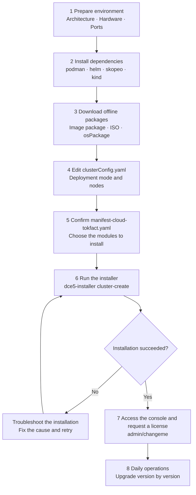

---
hide:
  - toc
---

# Token Factory Installation Guide

This page is the main entry point for installing d.run Token Factory (hereinafter "Token Factory"): it outlines the
full installation chain, the document for each stage, and the initialization order after installation.

Token Factory is installed offline: the installer `dce5-installer` runs on a machine called the
[Bootstrap Node](./commercial/deploy-arch.md), uses Kubean to initialize the operating system and create a Kubernetes
cluster, and then deploys the product modules declared in `manifest-cloud-tokfact.yaml` to the global service cluster.
Therefore, four types of offline packages must be prepared beforehand: the offline image package, ISO operating system
images, osPackage offline packages, and optionally Addon offline packages.

!!! tip "Version note"

    Using installer v0.46.0 as an example: the versions of the installer, the offline image package, and the
    osPackage packages must match each other. For version changes, see the
    [installer Release Notes](./release-notes.md).

## Installation Workflow

There are eight stages from environment preparation to daily operations. If the installation fails, locate the cause
first, then retry from the corresponding stage. Click a stage in the diagram to jump to its document.

## Next Steps

Once installed and logged in with `admin/changeme`, initialize the platform in this order; business data can be reviewed in [Cockpit](../crane/user-guide/singlepage.md) and [Billing Center](../leopard/index.md):

  <a class="tf-path-step" style="--path-c:#2196f3" href="../ghippo/intro/">
    1
    Plan Permissions
    Create users, user groups, and workspaces in Global Management, and plan roles and permissions
    Go →
  </a>
  <a class="tf-path-step" style="--path-c:#00acc1" href="../kpanda/intro/">
    2
    Create Clusters
    Create worker clusters in Container Management to host inference workloads; use GPU nodes
    Go →
  </a>
  <a class="tf-path-step" style="--path-c:#43a047" href="../hydra/">
    3
    Deploy Models
    Deploy or connect models in LLM Studio, and configure Tokens and API access
    Go →
  </a>
  <a class="tf-path-step" style="--path-c:#fb8c00" href="../insight/intro/">
    4
    Observe &amp; Operate
    Verify metrics and log collection in Insight, and review business data in Cockpit as well as metering and billing in Billing Center
    Go →
  </a>

[Download Center](https://docs.daocloud.io/en/download/){ .md-button }
[Learn about d.run Token Factory](https://docs.daocloud.io/en/tf/){ .md-button }
[Learn about d.run AI OS](https://docs.daocloud.io/en/drun/){ .md-button }
