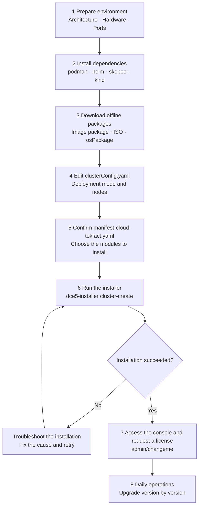

---
hide:
  - toc
---

# Token Factory Installation Guide

This page is the main entry point for installing d.run Token Factory (hereinafter "Token Factory"): it outlines the
full installation chain, the document for each stage, and the initialization order after installation.

Token Factory is installed offline: the installer `dce5-installer` runs on a machine called the
[Bootstrap Node](./commercial/deploy-arch.md), uses Kubean to initialize the operating system and create a Kubernetes
cluster, and then deploys the product modules declared in `manifest-cloud-tokfact.yaml` to the global service cluster.
Therefore, four types of offline packages must be prepared beforehand: the offline image package, ISO operating system
images, osPackage offline packages, and optionally Addon offline packages.

!!! tip "Version note"

    This page uses installer v0.45.0 as an example. The versions of the installer, the offline image package, and the
    osPackage packages must match each other. For version changes, see the
    [installer Release Notes](./release-notes.md). To install d.run AI OS instead, see the
    [d.run AI OS installation guide](../../drun/install/index.md); the manifest file and default modules differ.

There are eight stages from environment preparation to daily operations. If the installation fails, locate the cause
first, then retry from the corresponding stage. Click a stage in the diagram to jump to its document.

Once installed and logged in with `admin/changeme`, initialize the platform in this order:

1. Create users, user groups, and workspaces in [Global Management](../ghippo/intro/index.md), and plan roles and permissions.
2. Create worker clusters in [Container Management](../kpanda/intro/index.md) to host inference workloads; use GPU nodes.
3. Go to [LLM Studio](../hydra/index.md) to deploy or connect models, and configure Tokens and API access.
4. Verify metrics and log collection in [Insight](../insight/intro/index.md), and check business data in
   [Cockpit](../crane/user-guide/singlepage.md) as well as metering and billing in [Billing Center](../leopard/index.md).

[Download Center](https://docs.daocloud.io/en/download/){ .md-button }
[Learn about d.run Token Factory](https://docs.daocloud.io/en/tf/){ .md-button }
[Learn about d.run AI OS](https://docs.daocloud.io/en/drun/){ .md-button }
