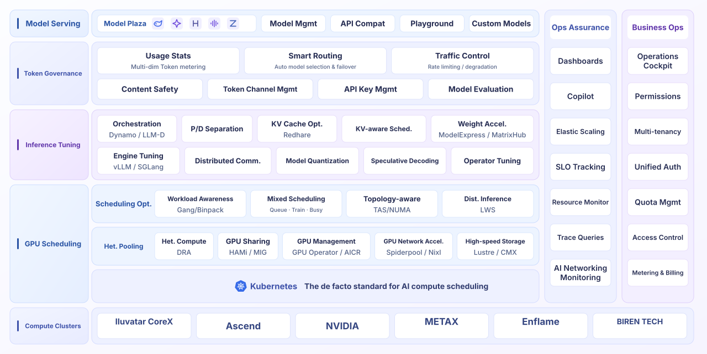
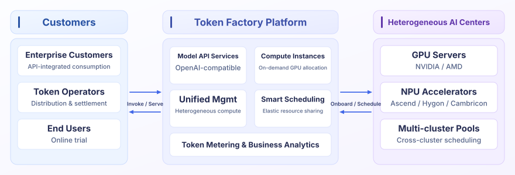
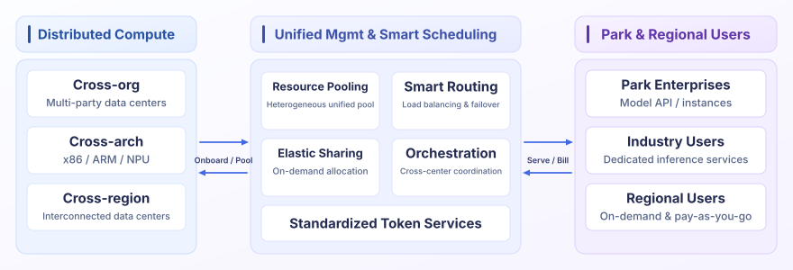
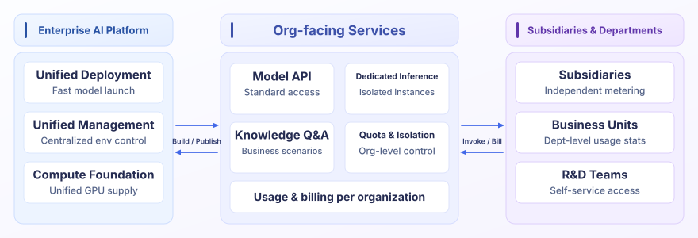

---
hide:
  - toc
---

# d.run Token Factory

**d.run Token Factory** is an AI Token production and operation system built for AI compute centers. Facing AI compute centers and compute holders, it converts fragmented GPU compute into efficient, stable, meterable, and operable standardized Token services through unified heterogeneous compute management, intelligent scheduling, and full-stack inference optimization.

The platform focuses on Token production efficiency and operations management. Through inference engine optimization, P/D separation, KV Cache management, smart routing, and operator tuning, it continuously improves Token output efficiency; through unified management and intelligent scheduling, it enables efficient utilization and elastic sharing of heterogeneous compute. It also provides Token metering and billing, an operations cockpit, and business analytics, helping AI compute centers upgrade from "providing compute" to "producing and operating Tokens", realizing compute value conversion and building an efficient, sustainable, and profitable Token factory.

The Token Factory is built on heterogeneous compute clusters, managing and scheduling GPU resources in a unified manner based on Kubernetes, and improving model inference efficiency through P/D separation, KV Cache optimization, and distributed orchestration. Upward, the platform provides model deployment, management, and API access capabilities, and implements Token governance through usage statistics, smart routing, and traffic control. It also offers ops assurance and business operations capabilities covering service SLO tracking, resource monitoring, elastic scaling, permission quotas, and metering and billing, ensuring the efficient and stable operation of the Token factory.

## Use Cases

=== "AI Center Operations"

    Provide model APIs and compute instance services based on GPU clusters, with unified management of service supply, customer consumption, billing and settlement, and business performance.

    

=== "Park & Regional Token Services"

    Manage and schedule compute resources across organizations, architectures, and data centers within a region in a unified manner, converting compute into standardized Token services and providing on-demand, pay-as-you-go model services for park enterprises and regional users.

    

=== "Enterprise AI Service Buildout"

    Deploy and manage model services in a unified manner, providing model APIs, dedicated inference services, and knowledge Q&A apps to subsidiaries and business units, with usage metered and billed per organization.

    

## Product Advantages

| Product Advantages | Description |
| :--- | :--- |
| Efficient Token production | Combines heterogeneous GPU scheduling, resource sharing, and inference optimization to increase effective Token throughput and compute utilization while reducing per-Token cost |
| Rapid model service delivery | Unified management of models and deployment environments, curated deployment templates to accelerate model launch, and standard model interfaces and AI apps to shorten business integration time |
| Full-link operation assurance | Continuous monitoring of inference performance and GPU resources, correlated with logs, traces, and runtime events, helping ops teams detect anomalies early and locate faults quickly |
| Fine-grained Token operations | Unified management of usage metering, consumption billing, and account funds, combined with capacity, customer usage, revenue, and cost analysis to support budgeting and business decisions |
