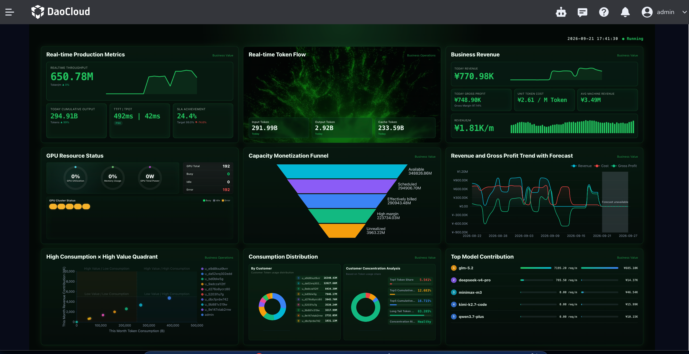
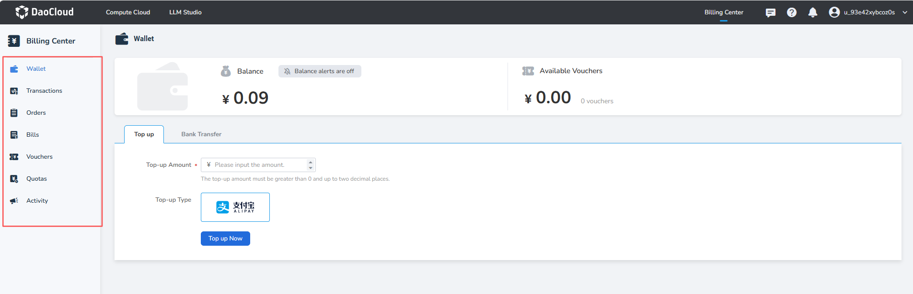
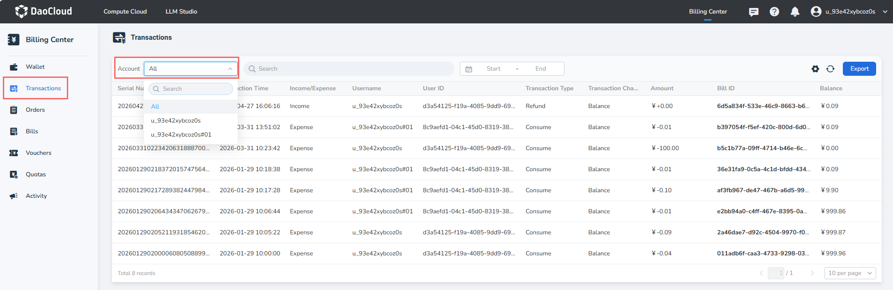

# Operations and Billing - User

Once the model is up and running, operators care most about two things: how the platform business is doing, and how Token consumption is billed.
This tutorial shows you how to view operational data in the [Dashboard](../crane/intro/index.md) and manage the wallet and bills in the [Cost Center](../leopard/index.md).

## Prerequisites

- You have completed [Deploy a Model Service](deploy-model.md) or [Try Out and Call Models](call-model.md), and the platform has generated real Token consumption.
- Sign in to the console with a user that has the Dashboard and Cost Center permissions.

## View the Dashboard

1. Open **Dashboard** in the product navigation. You land on the [Business Overview panel](../crane/user-guide/singlepage.md) by default.

2. In the business overview, view core metrics such as revenue, cost, gross profit, capacity monetization, and customer spending structure,
   and keep track of compute capacity, Token output, and production health.

    

3. To view department quota consumption and organization usage distribution, switch to the enterprise mode view;
   to review business performance, switch to the operations mode view.

## Manage the Wallet and Bills

1. Open **Cost Center** in the product navigation and go to the [Wallet](../leopard/index.md) page to view the cash balance and vouchers.

    {width=900px}

2. Top up the wallet via [online payment](../leopard/index.md) or offline bank transfer. Invoices can only be issued after the topped-up amount is consumed.

3. Check top-up and payment records as needed in [Transactions](../leopard/transactions.md).

    {width=900px}

4. In [Bills](../leopard/bills.md), view the metering results of Token and resource consumption by module and time dimension, and reconcile the cost of model invocations.

## Verification

The Dashboard shows Token output and consumption data matching the actual invocations, and the Cost Center bills contain the corresponding metering records, which means the operations and billing loop is connected end to end.

## Next Step

For more about operational metrics and billing rules, see the [Operations Dashboard](../crane/intro/index.md) and the [Cost Center](../leopard/index.md).
