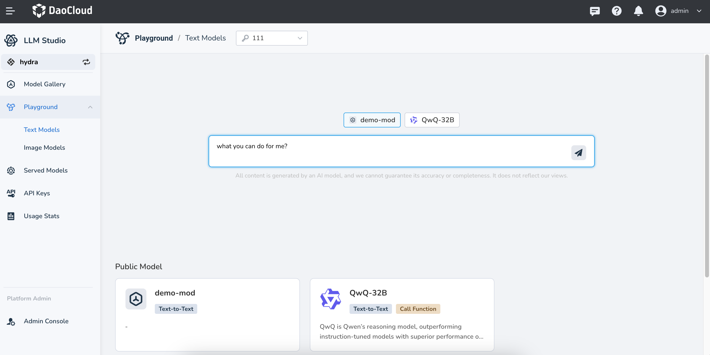

# Try Out and Call Models - User

After deploying a model or choosing a platform preset model, you can use the model in two ways: chat online in the **Playground**, or create an API Key and call the model through the OpenAI-compatible API.

## Prerequisites

- You have signed in to the console with a user that has the LLM Studio permission.
- A usable model is available: a platform preset public model, or a [deployed model service](deploy-model.md).

## Try It Online

1. In the left navigation, click **Playground** and select the model type (text models or image models).

    You can also go to the [Model Gallery](../hydra/index.md) and click **Try Out** on the target model card to enter the playground.

2. Select a model in the playground: public models can be tried out directly; deployed model services can be picked from the **Model Services** list.

3. Enter a question in the dialog box to chat with the model and experience its capabilities firsthand.

    

## Create an API Key

1. In the left navigation, click **API Keys**, then click **Create** in the upper right corner.

2. Enter the API Key name (e.g. `test-key`) and click **OK** to generate a new API Key.

    !!! note

        The API Key is only fully displayed when it is first created. Save it immediately. If it leaks, delete it and generate a new one promptly.

## Call Models via API

Use the OpenAI-compatible API. Take Python as an example:

=== "MaaS by Token (shared resources, billed by token)"

    ```python
    import openai

    openai.api_key = "your-api-key" # Replace with your API Key
    openai.api_base = "https://chat.d.run"

    response = openai.Completion.create(
      model="public/deepseek-r1",
      prompt="What is your name?"
    )

    print(response.choices[0].text)
    ```

=== "Standalone Model Service (dedicated instance)"

    ```python
    import openai

    openai.api_key = "your-api-key" # Replace with your API Key
    openai.api_base = "https://sh-02.d.run" # Replace with the region of your model service

    response = openai.Completion.create(
      model="u-1100a15812cc/qwen2", # Replace with the access name of your model service
      prompt="What is your name?"
    )

    print(response.choices[0].text)
    ```

## Verification

Online chat returns responses normally, or an API call returns text generated by the model, which means the model is available.

## Next Step

Connect the model to an intelligent Q&A app — see [Build an Intelligent App](build-app.md). To learn about invocation methods and client integration, see [Model Invocation](../hydra/api-call.md).
