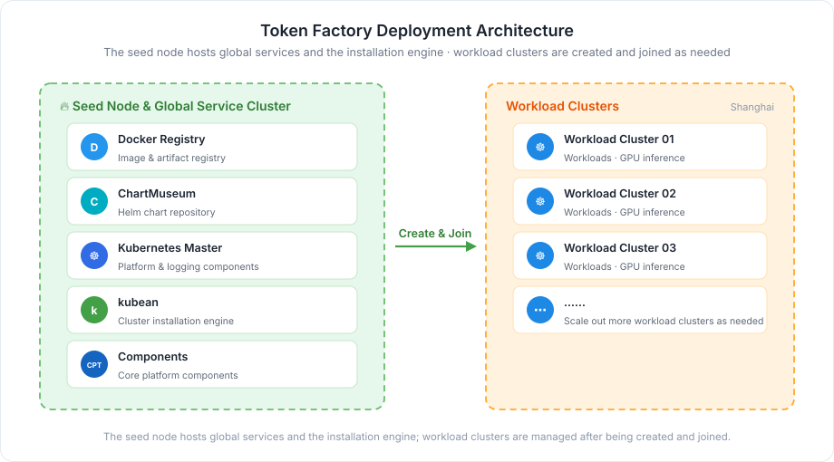

# Install Token Factory - Admin

This tutorial walks you through installing Token Factory in an offline environment and signing in to the console with the default account.

## Prerequisites {: #prereq }

- A machine that meets the [deployment requirements](../install/commercial/deploy-requirements.md) to serve as the seed node, with IPv4 forwarding enabled and the firewall disabled.
- The [offline image package](../install/start-install.md) (e.g. `offline-v0.46.0-amd64.tar`) has been downloaded and uploaded to the seed node.
- The osPackage offline package for the seed node OS has been downloaded.



## Steps

1. Extract the offline image package on the seed node:

    ```bash
    tar -xvf offline-v0.46.0-amd64.tar
    ```

2. Edit [clusterConfig.yaml](../install/commercial/cluster-config.md) in the extracted `offline/sample` directory
   to configure the deployment mode, cluster nodes, and ISO image path. To adjust the modules to install, edit [manifest-cloud-tokfact.yaml](../install/commercial/manifest.md).

3. Run the following command to start the installation:

    ```bash
    ./offline/dce5-installer cluster-create \
      -c ./offline/sample/clusterConfig.yaml \
      -m ./offline/sample/manifest-cloud-tokfact.yaml
    ```

    !!! note

        - `-c` specifies the cluster configuration file (required)
        - `-m` specifies the product manifest; for Token Factory use `manifest-cloud-tokfact.yaml`
        - `-z` performs a minimal installation
        - `-d` enables debug mode

    The installation takes about 30 minutes, depending on the number of nodes and network conditions.

4. When the installation completes, the command line reports success. Access the console via the URL shown on the screen and sign in with the default username and password `admin/changeme`.

5. Contact DaoCloud for authorization: email info@daocloud.io or call 400 002 6898. After authorization, go to the console home page and confirm that all modules are in normal status.

## Verification

Sign in to the console as `admin`. You can see the module entries such as Global Management, Container Management, and LLM Studio in the left navigation, which means the installation succeeded.

## Next Step

After the installation, continue with [Create Users and Workspaces](init-users.md).

For the complete installation workflow and configuration details, see the [Installation Guide](../install/index.md). If you run into problems, see [Installation FAQs](../install/faq.md).
