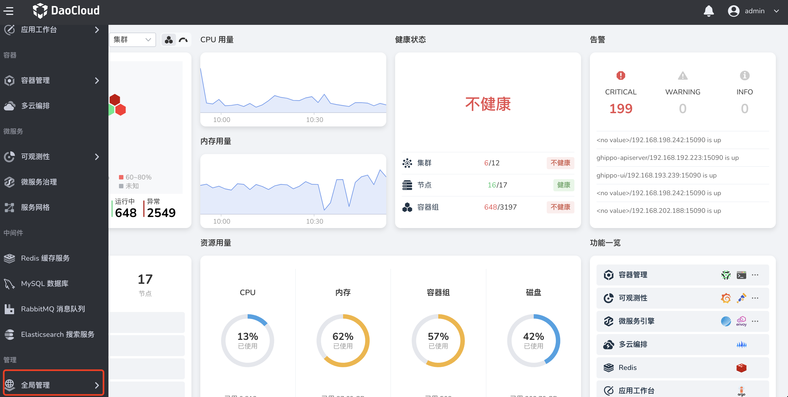
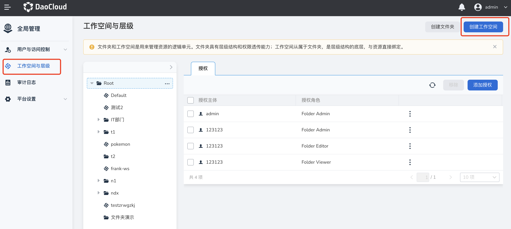

# Create Users and Workspaces - Admin

Token Factory adopts a multi-tenant system: admins create users and workspaces, then allocate resources to different project teams.
This tutorial creates one user and one workspace with the minimal configuration, and binds the user to that workspace.

## Prerequisites

- You have signed in to the Token Factory console with the `admin` account.

## Steps

1. In the left navigation, click **Global Management** -> **Users and Access Control** -> **Users**, then click **Create User** in the upper right corner.

2. Enter the username and login password (e.g. `tf-user`), then click **OK**.
   To create users in batch, you can create up to 5 users at a time.

    

    !!! note

        The username and password set here are used to sign in to the platform. Keep them safe.

3. In the user list, find the new user, click **┇** -> **Authorize**, grant the role permissions (e.g. Container Management module admin), then click **OK**.
   New users have no permissions by default and must be authorized before using the corresponding modules.

    

4. In the left navigation, click **Global Management** -> **Workspaces and Folders**, then click **Create Workspace** in the upper right corner.

    

5. Enter the workspace name (e.g. `tf-demo`) and the folder it belongs to, then click **OK**.

    

6. Open the workspace details and add the user to the workspace in **Groups** or **Members**, so the user can access resources within the workspace.

## Verification

Sign in to the console with the new user `tf-user`. You can see the authorized module entries and the workspace, which means the configuration succeeded.

## Next Step

Continue with [Create a Work Cluster](join-cluster.md) to onboard GPU compute.

For the complete usage of users, permissions, and workspaces, see [Access Control](../ghippo/user-guide/access-control/index.md) and [Workspaces and Folders](../ghippo/user-guide/workspace/index.md).
