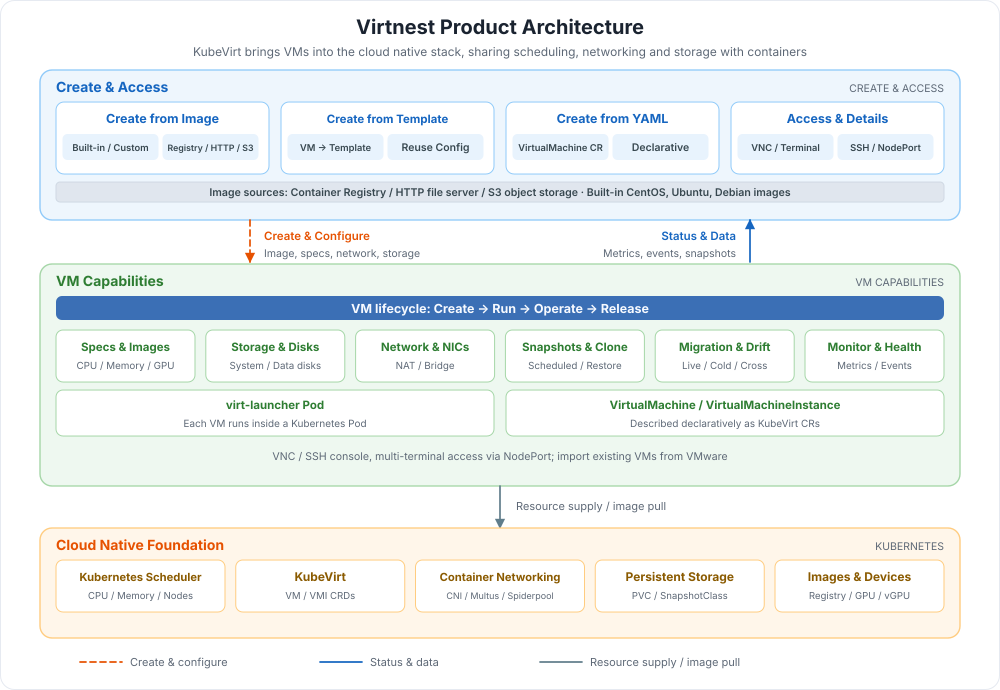

# What is Virtual Machine (Virtnest)?

Virtnest, built on KubeVirt, manages virtual machines as cloud native applications so that VMs and containers share the same Kubernetes scheduling, networking, storage and image system. You can create VMs quickly from an image, a template or YAML, log in over VNC / SSH, and handle day-to-day operations such as start/stop/restart, spec changes, snapshots and cloning, migration and monitoring on the same platform. Typical use cases include migrating traditional applications to the cloud, importing VMware VMs, development and test environments, and GPU workloads.

!!! note

    The Virtual Machine, __Virtnest__ , is a feature exclusive to the DCE Enterprise Package (Standard, Advanced, and Platinum editions).

## Product Architecture

The architecture consists of three layers, from top to bottom: creation and access, VM capabilities, and the cloud native foundation:

| Layer | Component | Responsibility | In the diagram |
| --- | --- | --- | --- |
| **Creation & Access** | Image / Template / YAML creation | Three ways to create VMs; VNC, SSH and NodePort multi-terminal access, plus VM details | Blue area |
| **Creation & Access** | VM images | Container registries, HTTP file servers and S3 object storage; built-in CentOS, Ubuntu and Debian images | Blue bar |
| **VM Capabilities** | Lifecycle and operations | Start/stop/restart, spec changes, snapshots and scheduled snapshots, cloning, live / cold / cross-cluster migration, monitoring and health checks | Green area |
| **VM Capabilities** | Specs, networking and storage | CPU / memory hot-plug and Nvidia GPU / vGPU; Masquerade (NAT) and Bridge networking; system disks, data disks and PVCs | Green cards |
| **Cloud Native Foundation** | KubeVirt + Kubernetes | VMs described by VirtualMachine / VMI custom resources and hosted by virt-launcher Pods; reuses cluster scheduling, CNI, storage and image services | Orange area |

## Key Capabilities

Virtnest provides complete capabilities for creating, running and operating virtual machines. Compared with maintaining a separate virtualization platform, it reuses Kubernetes scheduling, image and networking: container images serve as the basis for VM creation and share the host kernel and hardware resources, improving resource utilization; image-based distribution shortens VM startup time and supports fast, on-demand deployment and scaling; start/stop, configuration and monitoring use the same cluster management tools, simplifying day-to-day operations; applications and their configurations can be packaged into images for flexible release, and can directly reuse container networking, service discovery and load balancing to work seamlessly with existing containerized applications.

-   :material-cube-outline:{ .lg .middle } __Cloud Native Virtual Machines__

    ---

    Manages VMs as cloud native applications with KubeVirt, sharing Kubernetes scheduling, service discovery and networking with containers, and reducing the cost of running virtualization and containerization side by side.

    [:arrow_forward: Virtual Machine Features](features.md)

-   :material-view-grid-outline:{ .lg .middle } __Three Ways to Create VMs__

    ---

    Create VMs from an image, a template or YAML. Images can come from a container registry, an HTTP file server or S3 object storage, and custom images are supported.

    [:arrow_forward: Create Virtual Machine](../quickstart/index.md)

-   :material-file-image-outline:{ .lg .middle } __Images and Templates__

    ---

    Built-in CentOS, Ubuntu and Debian images, plus custom image builds; convert an existing VM into a template to reuse configurations in bulk.

    [:arrow_forward: Build Virtual Machine Images](../vm-image/index.md)

-   :material-content-save-move:{ .lg .middle } __Snapshots, Cloning and Migration__

    ---

    Snapshots and scheduled snapshots, VM cloning, live migration, cold migration, cross-cluster migration and automatic node drift.

    [:arrow_forward: Snapshot Management](../vm/snapshot.md)

-   :material-access-point-network:{ .lg .middle } __Networking and Storage__

    ---

    Masquerade (NAT) and Bridge networking, multiple NICs and fixed IPs; PVC-based system disks, data disk attachment and expansion.

    [:arrow_forward: Virtual Machine Networking](../vm/vm-network.md)

-   :material-monitor-eye:{ .lg .middle } __GPU and Observability__

    ---

    Nvidia GPU / vGPU passthrough, metrics, events, health checks and console access for full visibility into VM status.

    [:arrow_forward: Configure GPU Passthrough](../gpu/vm-gpu.md)

## Learning Path

Complete the following steps in order to create and operate a virtual machine from scratch:

  <a class="vn-path-step" style="--path-c:#2196f3" href="../install/">
    1
    Install
    Install the VM module and virtnest-agent
    Go →
  </a>
  <a class="vn-path-step" style="--path-c:#00acc1" href="../vm-image/">
    2
    Prepare Images
    Build or import VM images
    Go →
  </a>
  <a class="vn-path-step" style="--path-c:#43a047" href="../quickstart/">
    3
    Create a VM
    From an image, template or YAML
    Go →
  </a>
  <a class="vn-path-step" style="--path-c:#fb8c00" href="../quickstart/access/">
    4
    Connect to the VM
    Log in via VNC / terminal, view details
    Go →
  </a>
  <a class="vn-path-step" style="--path-c:#8e24aa" href="features/">
    5
    Day-2 Operations
    Snapshots, cloning, migration and monitoring
    Go →
  </a>

[Download Center](https://docs.daocloud.io/en/download/){ .md-button }
[Learn about d.run Token Factory](https://docs.daocloud.io/en/tf/){ .md-button }
[Learn about d.run AI OS](https://docs.daocloud.io/en/drun/){ .md-button }
[View User Manual (PDF)](https://harbor-test2.cn-sh2.ufileos.com/docs/download/docs/virtnest.pdf){ .md-button }
