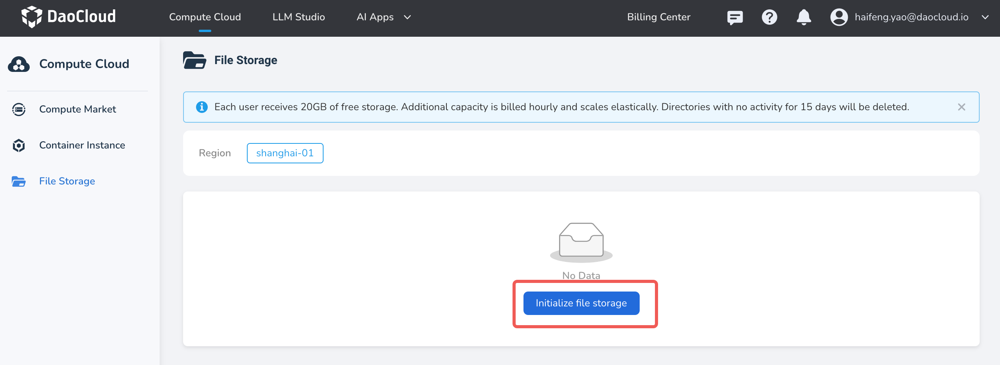
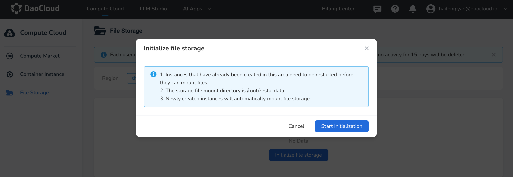
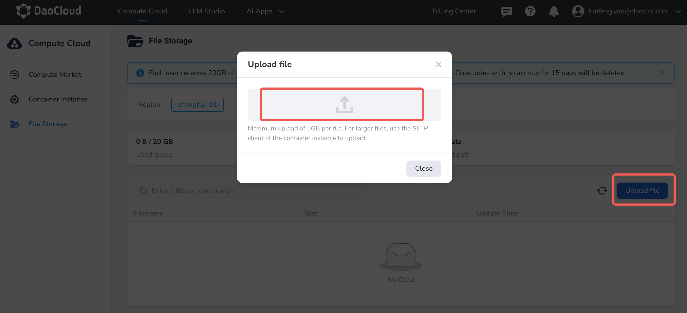
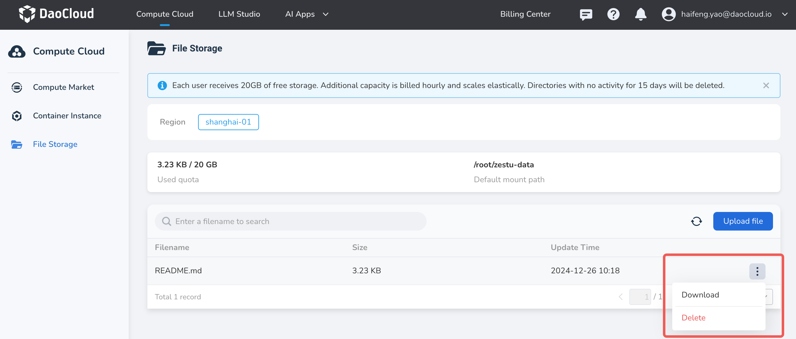

---
hide:
  - toc
---

# Initialize File Storage

File storage in Compute Cloud is an instance-based shared storage service. All container instances created by the same user can access and share the same set of file data.
File storage is mainly used to store data, source code, and other files. You can regularly upload important files to file storage for safekeeping.

!!! note

    d.run provides each user with **20 GB of free space**, with support for elastic scaling. Additional capacity is billed daily. If usage is less than one day, charges are based on actual usage time, accurate to the second.

Initializing file storage means performing the first-time configuration and preparation of file storage resources after they are created, so that container instances or applications can access and use them normally.
This process usually includes allocating the storage path, setting access permissions, mounting to a specified container instance or node, and importing a directory structure or initial data according to business needs.

After initialization is complete, the file storage can serve as a shared data source, accessed by multiple container instances under the same user space at the same time, ensuring data consistency and visibility.
This operation is usually performed when creating a new project, deploying an application, or replacing storage resources, and is a prerequisite step for ensuring the stable operation of subsequent business.

## Prerequisites

- Log in to your d.run account
- Account balance ≥ ¥0

## Steps to Operate

1. Log in to d.run, go to **Compute Cloud** -> **File Storage**, select a nearby region,
   and click **Initialize file storage** to start the initialization.

    

    

2. Upload Files: Click **Upload File** and select local files to upload.
  
    

3. Perform other actions.

    

    - Download Files: Select the file you want to download, click the **┇**
    on the right side of the list, and choose **Download** from the dropdown menu.
    - Delete Files: Select the file you want to delete, click the **┇** on the right side of the list,
    and choose **Delete** from the dropdown menu. Deleted files cannot be recovered,
    so please proceed with caution!
