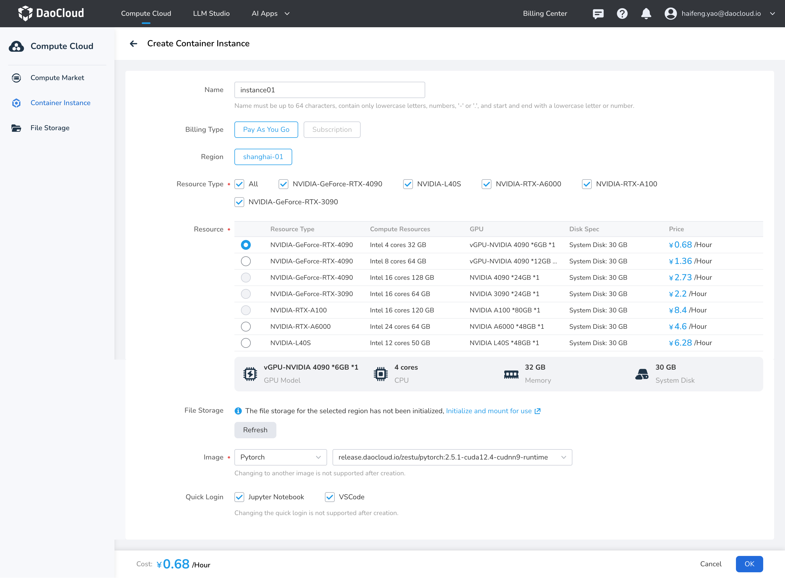

---
hide:
  - toc
---

# Create Container Instance

Container instances are lightweight, elastically scalable compute units that are widely used for algorithm development, model training, and inference.
With container instances, users can quickly launch an independent runtime environment and achieve on-demand allocation and efficient use of computing power.

When creating a container instance, multiple GPU types are available to meet different computing needs, covering everything from entry level to high-performance computing.
Instances are automatically associated with file storage, making it easier to manage data and model files in a unified way and improving data processing efficiency.

In addition, container instances support using the system's built-in standard images, helping users quickly set up a development environment and reducing environment configuration time.
Developers can access instances in a variety of ways, such as Jupyter Notebook, the VSCode remote plugin, and SSH,
making it easy to debug code and run algorithm experiments and greatly improving development efficiency.

In short, container instances provide a flexible, convenient, and efficient computing platform for algorithm development and inference, and are important infrastructure in modern AI and data science workflows.

## Prerequisites

- Log in to your d.run account
- Account balance must be greater than or equal to the unit price of the selected resource type

## Steps

1. Log in to d.run, which defaults to the **Compute Market** .
   You can choose the required GPU type and click **Buy Now** ; 
   or switch to **Container Instances** and click the **Create** button to create a new instance.

2. Fill in the basic information according to the requirements below and click **OK**

    

    | Name | Description |
    |------|------------- |
    | Instance Name | Up to 64 characters; can only contain lowercase letters, numbers, separators ("-"), and dots ("."). Must start and end with a lowercase letter or number. Optional. |
    | Billing Type | - Pay-as-you-go: Cost = Duration * Unit Price. Duration = Shutdown Time - Startup Time, accurate to the second; no charges during startup or waiting periods. Hourly billing is supported; if usage is less than an hour, charges will be based on actual usage time, accurate to the second.   - Annual and Monthly Packages: Reserve resources by month or year, paid in full at rental time. If you select this billing mode, you need to configure parameters such as the subscription duration, whether to auto-renew, and the renewal duration. |
    | Region | It is recommended to choose a region close to your location to create instances and initialize file storage for faster upload and download speeds. |
    | Resource Type | GPU model |
    | Resource | Supports full GPU and vGPU resources; select based on demand. |
    | System Disk | Free capacity is 30 GB, and expansion is not supported. The system disk can be saved to My Images. |
    | Data Disk | - Free capacity is 50 GB, with support for paid expansion. Billing continues even when the instance is shut down.   - The default maximum expandable capacity is 200 GB. For a larger quota, contact 400-002-6898. The disk cannot be shrunk after expansion.   - Strongly bound to the lifecycle of the container instance: it is automatically mounted when the instance is created and automatically deleted when the instance is deleted.   - Data sharing between instances is not supported. |
    | File Storage | After initializing file storage, it will be automatically mounted to the instance, with the default mount path being: /root/data |
    | Image | - Basic images: Supports Pytorch, TensorFlow, Paddle, vLLM, SGLang, and more.   - Application images: Supports popular AI application images such as DeepSeek and ComfyUI.   - My Images: Supports creating container instances from images saved in My Images.   - Image Address: A public or user private image address. For a private image, enter the username and password. |
    | Access Tools | You can choose to access the container instance via Jupyter Notebook and VSCode. If unchecked, the related components will not be installed, and the access tools cannot be changed after creation. |
    | Scheduled Shutdown | Supports shutdown at a specified time. |
  
3. Click **OK** to complete the instance creation.

!!! note

    - No charges will be incurred while the container is in a starting, queuing, shut down, or deleting state; normal charges apply only when it is running or shut down.
    - The unit price for on-demand billed resources is the cost incurred for running that instance per hour; if actual usage is less than an hour, charges will be based on actual usage time, accurate to the second.
