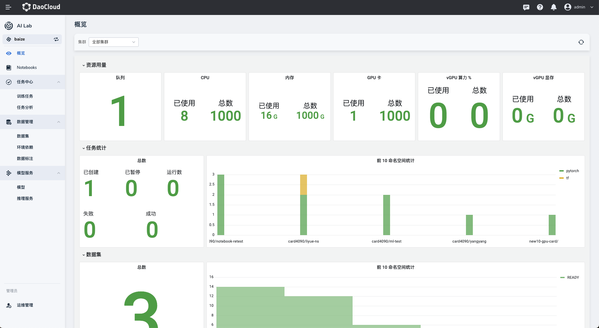

---
hide:
  - toc
---

# 开发控制台

开发控制台是开发者日常执行 AI 推理、大模型训练等任务的控制台。

方便用户通过概览快速了解，当前工作空间的资源及用量情况，包含了GPU资源、Notebook、任务以及数据集的数量信息。

[下载中心](https://docs.daocloud.io/download/){ .md-button .md-button--primary }
[了解 Token 工厂效能平台](https://docs.daocloud.io/tf/){ .md-button .md-button--primary }
[了解 d.run AI 操作系统](https://docs.daocloud.io/drun/){ .md-button .md-button--primary }
