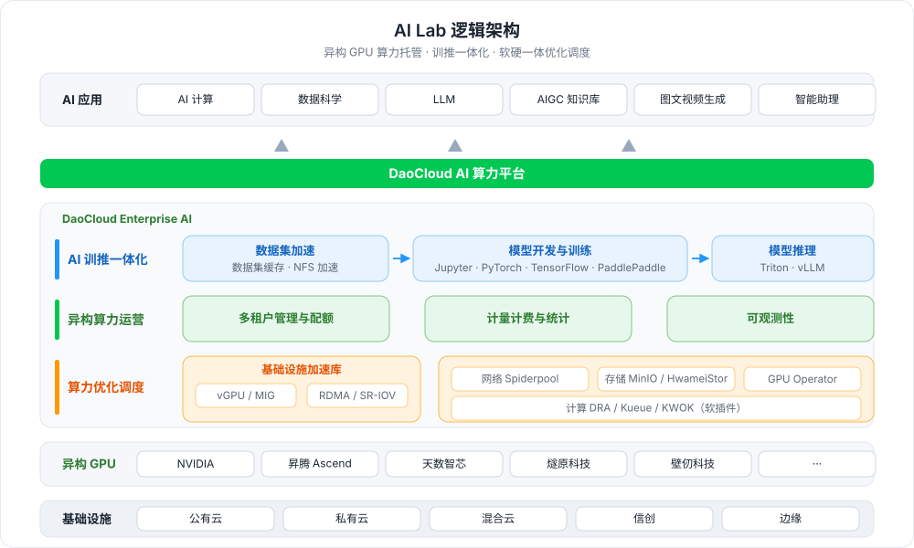
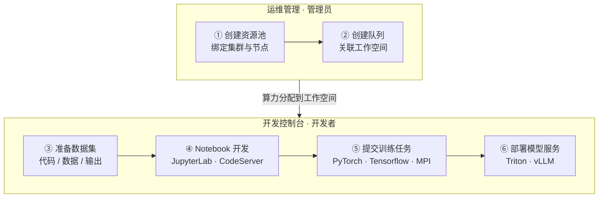

---
hide:
  - toc
---

# 什么是 AI Lab

AI Lab（曾用名智能算力）是基于云原生操作系统打造的 AI 算力平台，提供软硬一体的 AI 智算体验。
平台依托 DCE 整合异构算力、优化 GPU 性能，实现算力资源的统一调度与运营，最大化算力效用并降低算力开销；
同时提供优化的 AI 开发框架，覆盖 Notebook 开发、训练任务、数据管理与模型服务的完整链路，简化 AI 开发与部署，加速各行业 AI 应用场景落地。

## 核心能力

- :material-server-network:{ .lg .middle } __算力资源全托管__

    ---

    依托 DCE 强大的基础设施能力，支持超大规模算力集群、异构 GPU 一站式托管，并提供 vGPU 等软硬一体加速方案，资源池化管理 CPU、内存与 GPU。

    [:arrow_forward: 创建资源池](../oam/resource/create.md)

- :material-database-outline:{ .lg .middle } __数据编排与管理__

    ---

    面向模型开发全流程的数据管理能力，支持数据集管理、多数据源接入、数据集预热与数据标注，从底层容器存储引擎优化，保证数据访问高效稳定。

    [:arrow_forward: 管理数据集](../developer/dataset/index.md)

- :material-notebook-outline:{ .lg .middle } __开发环境管理__

    ---

    满足 MLOps 与 LLMOps 工程师的开发需求，提供 JupyterLab、CodeServer 等多种开发环境，支持自定义镜像，一键挂载 GPU、数据集等资源。

    [:arrow_forward: 创建 Notebook](../developer/notebooks/index.md)

- :material-run-fast:{ .lg .middle } __训练任务管理__

    ---

    训练任务全生命周期管理，支持 PyTorch、TensorFlow、PaddlePaddle、MPI 等主流框架，天然支持单机、分布式、多节点、多卡等多种任务调度。

    [:arrow_forward: 创建训练任务](../developer/jobs/index.md)

- :material-expansion-card:{ .lg .middle } __模型推理服务__

    ---

    内置 Triton、vLLM 等主流推理引擎，从训练产出的模型一键创建推理服务，加速模型从训练到上线服务的最后一步。

    [:arrow_forward: 部署模型服务](../developer/inference/index.md)

- :material-view-dashboard-outline:{ .lg .middle } __队列与 GPU 治理__

    ---

    通过队列关联工作空间，统筹与隔离各集群的队列资源；全局汇总 GPU 资源与使用情况，支持当前和历史任务查看，方便 GPU 压力评估。

    [:arrow_forward: 查看 GPU 信息](../oam/gpu.md)

## 使用流程

AI Lab 的使用分为 **运维准备** 与 **开发使用** 两个阶段：管理员先创建资源池和队列，把算力资源分配给工作空间；
开发者在开发控制台完成数据准备、Notebook 开发、训练任务与模型服务的完整闭环。

| 步骤 | 角色 | 说明 |
| --- | --- | --- |
| [① 创建资源池](../oam/resource/create.md) | 管理员 | 定义集群中可用的 CPU、内存、GPU 等计算资源，绑定工作负载与节点类型 |
| [② 创建队列](../oam/queue/create.md) | 管理员 | 创建队列并关联工作空间，保障各集群队列资源的统筹与隔离 |
| [③ 准备数据集](../developer/dataset/index.md) | 开发者 | 创建训练代码、训练数据与输出数据集，支持多数据源接入与预热 |
| [④ Notebook 开发](../developer/notebooks/index.md) | 开发者 | 在 JupyterLab / CodeServer 中开发调试，支持 SSH 访问与自定义镜像 |
| [⑤ 提交训练任务](../developer/jobs/index.md) | 开发者 | 提交单机或分布式训练任务，用 Tensorboard 进行任务分析 |
| [⑥ 部署模型服务](../developer/inference/index.md) | 开发者 | 将训练产出的模型通过 Triton / vLLM 部署为推理服务 |

## 快速上手

=== ":material-shield-account: 管理员：准备资源环境"

    

      <a class="baize-path-step" style="--path-c:#2196f3" href="install/">
        1
        安装组件
        部署 AI Lab 所需组件
        前往 →
      </a>
      <a class="baize-path-step" style="--path-c:#00acc1" href="first/">
        2
        首次使用
        选择工作空间与集群
        前往 →
      </a>
      <a class="baize-path-step" style="--path-c:#43a047" href="../oam/resource/create/">
        3
        创建资源池
        规划 CPU、内存与 GPU
        前往 →
      </a>
      <a class="baize-path-step" style="--path-c:#fb8c00" href="../oam/queue/create/">
        4
        创建队列
        关联工作空间与配额
        前往 →
      </a>
      <a class="baize-path-step" style="--path-c:#8e24aa" href="../oam/gpu/">
        5
        查看 GPU
        监控负载、功率与温度
        前往 →
      </a>
    

=== ":material-account: 开发者：从训练到推理"

    

      <a class="baize-path-step" style="--path-c:#2196f3" href="../developer/quick-start/">
        1
        快速入门
        走通数据集到训练全流程
        前往 →
      </a>
      <a class="baize-path-step" style="--path-c:#00acc1" href="../developer/notebooks/">
        2
        创建 Notebook
        一键挂载 GPU 与数据集
        前往 →
      </a>
      <a class="baize-path-step" style="--path-c:#43a047" href="../developer/jobs/">
        3
        提交训练任务
        PyTorch / Tensorflow / MPI
        前往 →
      </a>
      <a class="baize-path-step" style="--path-c:#fb8c00" href="../developer/dataset/">
        4
        管理数据集
        多数据源接入与数据标注
        前往 →
      </a>
      <a class="baize-path-step" style="--path-c:#8e24aa" href="../developer/inference/">
        5
        部署模型服务
        Triton / vLLM 推理上线
        前往 →
      </a>
    

## 最佳实践与故障排查

- :material-book-open-page-variant:{ .lg .middle } __最佳实践__

    ---

    微调 ChatGLM3、提交 DeepSpeed 训练任务、拓扑感知调度、Checkpoint 机制、NFS 数据集预热、部署 Label Studio 等实战经验。

    [:arrow_forward: 查看最佳实践](../best-practice/index.md)

- :material-format-list-bulleted:{ .lg .middle } __故障排查__

    ---

    集群下拉列表找不到集群、Notebook 不受队列配额控制、队列初始化失败等常见问题的排查思路与解决方法。

    [:arrow_forward: 查看故障排查](../troubleshoot/index.md)

[下载中心](https://docs.daocloud.io/download/){ .md-button .md-button--primary }
[了解 Token 工厂效能平台](https://docs.daocloud.io/tf/){ .md-button .md-button--primary }
[了解 d.run AI 操作系统](https://docs.daocloud.io/drun/){ .md-button .md-button--primary }
[查阅 AI Lab 用户手册 PDF](https://harbor-test2.cn-sh2.ufileos.com/docs/download/docs/ai-lab.pdf){ .md-button .md-button--primary }
