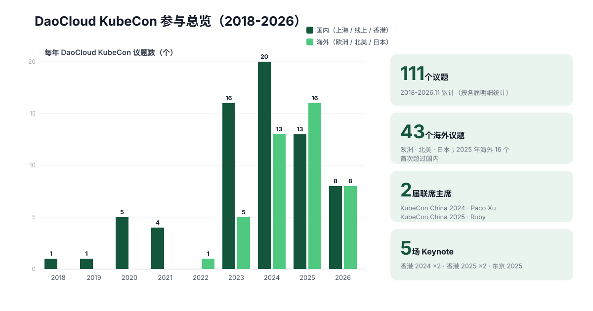
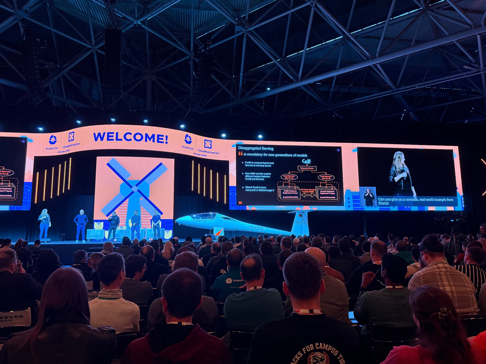
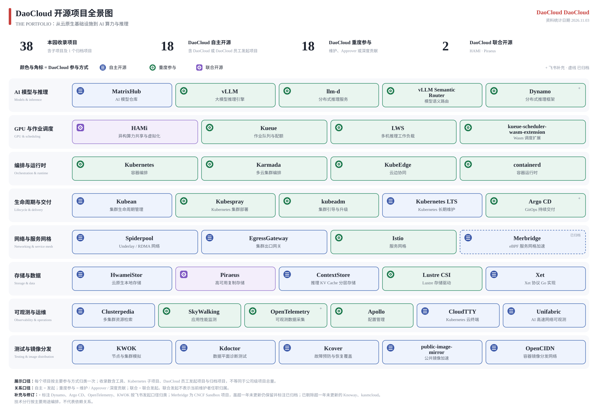

# DaoCloud 开源布道：八年 KubeCon，112 个议题

## KubeCon 是什么

KubeCon + CloudNativeCon 是 CNCF（云原生计算基金会）的旗舰技术大会，名字里的“Kube”就是 Kubernetes 的简称。它是云原生领域规模最大、议程也最“硬”的会：从 Kubernetes 本身，到调度、网络、存储、运行时、可观测性、安全，再到最近两年的 AI 推理与算力调度，都在同一个场子里。

大会每年在北美、欧洲、中国、日本、印度各办一届。2026 年我们走了四站：阿姆斯特丹（3.23-3.26）、横滨（7.28-7.30）、上海（9.7-9.9）、盐湖城（11.9-11.12）。一站通常 3-4 天，形式包括主会场 Keynote、分会场演讲 Session、实战演示 Tutorial、闪电演讲、维护者专场和项目展台。同城往往还会并办一批同场活动——CiliumCon、IstioCon、OpenInfra Summit、PyTorch Conference——2026 年上海站就是四会合一的规模。

规模上，2025 年伦敦站超过 12,500 名参会者，2026 年阿姆斯特丹站接近 13,500 人（据 [CNCF 官方报告](https://www.cncf.io/reports/kubecon-cloudnativecon-europe-2026/)）。这是全球云原生和 AI 基础设施从业者一年里最集中的一次碰面。所以，谁能在 KubeCon 上讲、讲什么，某种程度上就是这个行业的技术议程本身。

## 八年账本

2018 年，DaoCloud 在 KubeCon 上海站讲了 1 个议题。八年之后，截至 2026 年 11 月的盐湖城，这个数字累计到 **112 个**，其中 **44 个** 在海外。

| 年份 | 议题数 | 国内 | 海外 | 当年纪事 |
|---|---|---|---|---|
| 2018 | 1 | 1 | — | 上海站首秀 |
| 2019 | 1 | 1 | — | 上海站 |
| 2020 | 5 | 5 | — | KubeCon China 因疫情转为线上 |
| 2021 | 4 | 4 | — | KubeCon China 因疫情继续线上 |
| 2022 | 1 | — | 1 | 北美站线上维护者专场 |
| 2023 | 21 | 16 | 5 | 上海站 16 个、14 位演讲者 |
| 2024 | 33 | 20 | 13 | 香港站 20 个 + 联席主席 |
| 2025 | 29 | 13 | 16 | 海外首次超过国内 |
| 2026 | 17 | 8 | 9 | 上海站 8 个 + 5 个展台 |
| **合计** | **112** | **68** | **44** | 2 届联席主席 · 5 场 Keynote |

> 统计范围包括 Keynote、分会场演讲、Tutorial、闪电演讲、维护者专场，以及 IstioCon、CiliumCon 等同场活动中的议题；同一议题有多位 DaoCloud 演讲者时计 1 个。“国内”指 KubeCon China，含上海、香港两地及 2020-2021 年的线上会场；2022 年那一个是北美站的 SIG Scheduling 维护者专场，疫情期间线上参与，按举办地计入海外。

## 2018-2024：先讲客户，后讲项目

| 年份 | 活动 | 议题数 | DaoCloud 议题与亮点 |
|---|---|---|---|
| 2018 | KubeCon 上海 | 1 | Windows 容器（Mark Peng） |
| 2019 | KubeCon 上海 | 1 | 运维相关（Lin Ru） |
| 2020 | KubeCon China（因疫情转线上） | 5 | 浦发、超算中心、.NET、Piraeus、服务网格 |
| 2021 | KubeCon China（因疫情转线上） | 4 | 浦发、KubeEdge、SIG Node、优雅关机 |
| 2022 | KubeCon 北美（线上） | 1 | kerthcet 参与 SIG Scheduling 维护者专场 |
| 2023 | KubeCon 欧洲 | 3 | 调度、Kueue、kubeadm |
| 2023 | KubeCon 上海 | 16 | 14 位演讲者：IstioCon ×2、Kubespray、Kueue、浦发、Karmada、containerd、K8sGPT、SIG Instrumentation / Node / Scheduling / Docs、KubeEdge、SAIC、KWOK，还组织了 KCS |
| 2023 | KubeCon 北美 | 2 | Spiderpool、Karmada 另制作了一系列维护者采访视频 |
| 2024 | KubeCon 欧洲 | 11 | KubeEdge、Karmada、Spiderpool、HwameiStor、Kubespray、Structured Logging、SIG Scheduling、Steering |
| 2024 | KubeCon 香港 | 20 | Co-Chair（Paco Xu） Keynote ×2，其一为 wzshiming 与 NVIDIA 合讲的 KWOK 大规模测试 HAMi、Ollama Operator、containerd、Kubernetes、nerdctl、Kubespray、Istio、Keycloak、KWOK、Kueue、KubeEdge、Argo CD、Kuasar、Cilium Gateway |
| 2024 | KubeCon 北美 | 2 | Clusterpedia、Kubean |

前四年是很典型的“跟着客户上台”阶段。2020、2021 两年 KubeCon China 因疫情取消线下会场、整体转线上，DaoCloud 也就在线上讲：浦发银行的云原生演进、超算中心的 HPC 容器化、.NET on K8s、Piraeus 本地持久卷——客户案例和技术分享各占一半，讲的多半是 **我们帮谁把 Kubernetes 跑起来了** 。

2022 年线下场景因疫情停摆，全年唯一一个议题是北美站线上的 SIG Scheduling 维护者专场。讲的内容却悄悄换了主角：不再是客户系统，而是我们参与维护的调度代码。

2023 年这个转向完全显形：上海站的议题里，Kueue、Karmada、containerd、KWOK、SIG Instrumentation / Node / Scheduling / Docs 都是 DaoCloud 深度参与的方向，还承担了 KCS（Kubernetes 贡献者峰会）的组织。议题的主角从客户变成了 **我们自己维护的代码和参与的 SIG** 。

2024 年，DaoCloud 议题覆盖到了整个上游：欧洲站覆盖 KubeEdge、Karmada、Spiderpool、HwameiStor、Kubespray、Structured Logging；香港站 Paco Xu 担任 KubeCon China 联席主席，DaoCloud 第一次参与整届大会的议程编排，而不只是在议程里占几个位置。

## 2025：海外第一次超过国内

| 活动 | 城市 · 日期 | 议题数 | DaoCloud 议题与演讲者 |
|---|---|---|---|
| KubeCon 欧洲 | 伦敦 · 4.1-4.4 | 8 | - 议题：LWS、Spiderpool、KubeEdge、KWOK、Kubernetes、Karpenter - 演讲者：kerthcet、weizhoublue、wzshiming、Hongbing Zhang、liyuerich、Paco Xu、carlory |
| KubeCon China | 香港 · 6.10-6.11 | 13 | - Co-Chair：Roby - Keynote ×2：Roby、kerthcet - 议题：llmaz、Kubernetes、LWS、KubeEdge、K8sGPT、OTel、Kubespray - 演讲者：panpan0000、kebe7jun、Neko、yankay、Hongbing Zhang、liyuerich、kerthcet、cyclinder、jaredTan95、nicole-lihui、Roby、Paco Xu |
| KubeCon Japan | 东京 · 6.16-6.17 | 4 | Hongbing Zhang（Keynote）、yankay、weizhoublue、Paco Xu |
| KubeCon 北美 | 亚特兰大 · 11.10-11.13 | 4 | - Introducing TAG Workloads Foundation（Paco Xu） - KubeEdge Deep Dive + Project Lightning Talk（Hongbing Zhang） - Spiderpool Lightning Talk：拓扑感知的 RDMA 分配（weizhoublue） |

2025 年总计 29 个议题，海外 16 个对国内 13 个，**这是八年来海外第一次超过国内**。同一年 Roby 接棒香港站联席主席，加上香港站 2 场、东京站 1 场，全年 3 场 Keynote。

2025 年是首届 KubeCon Japan，DaoCloud 在东京就有 4 个议题，其中一场是 Keynote，说明 DaoCloud 在东亚的社区存在感已能支撑一个站点的核心议程，而不只是分会场里的一个 slot。

## 2026：重心转向 AI 推理

| 活动 | 城市 · 日期 | 议题数 | DaoCloud 议题与演讲者 |
|---|---|---|---|
| KubeCon 欧洲 | 阿姆斯特丹 · 3.23-3.26 | 4 | - Tutorial：基于 llm-d 的 KV-Cache 感知 LLM 路由（yankay） - TAS（weizhoublue） - KubeEdge 毕业后的工业实践报告（Hongbing Zhang） - CiliumCon 闪电演讲：租户南北向带宽公平管理（weizhoublue） |
| KubeCon Japan | 横滨 · 7.28-7.30 | 2 | llm-d：From Model Serving to Distributed Inference（yankay，与 Microsoft 合讲）；Spiderpool（weizhoublue） |
| KubeCon China | 上海 · 9.7-9.9 | 8 | - LWS：Gang Scheduling 与 Disaggregated Set（yankay） - LWS Preflight：推理任务启动前预检（panpan0000） - 网络（weizhoublue） - JobSet（carlory） - LLM 推理可观测性（jaredTan95、Frapschen） - PD 分离与 TTFT（kebe7jun、nicole-lihui） - DRA（Paco Xu） - KubeEdge（Hongbing Zhang） - 另有 5 个开源项目展台 - 大会期间 CNCF 宣布 Karmada 毕业 |
| KubeCon 北美 | 盐湖城 · 11.9-11.12 | 3 | - Steering the Ship: Ask the Kubernetes Steering Committee（Paco Xu） - Explore TAG Workloads Foundation: Core Runtime, Batch Scheduling, and Moar!（Paco Xu） - Fighting Fire with Fire: Scaling KubeEdge Vulnerability Management in the New AI Era（Hongbing Zhang） |

## 八年三条迁移

把 112 个议题按维度拆开，能看到三条清晰的迁移。

**第一，从国内主场到海外过半。**
2018-2022 五年，海外议题只有 1 个。2023 年起欧洲、北美两站同时铺开，2025 年又赶上首届 KubeCon Japan，当年海外 16 个首次超过国内的 13 个；2026 年海外 9 个、国内 8 个，海外连续两年过半。八年累计下来，海外议题占 39%（44/112）。

**第二，从云原生走到 AI 基础设施。**
早期议题集中在 Kubernetes 本身：调度、存储、网络、Runtime。2024 年起，深度参与的 KubeEdge、Karmada，联合发起的 HAMi，以及自主开源的 Spiderpool 成为主力；2025 年 LWS、llmaz 出现；2026 年的关键词已经是 KV-Cache 感知路由、llm-d、PD 分离与 TTFT、JobSet、DRA、LLM 推理可观测性。同一个大会，议题的语言从“集群怎么管”变成了“模型怎么跑得快”。

**第三，从参会者走到治理者。**
2 届联席主席（2024 Paco Xu、2025 Roby）、5 场 Keynote（香港 2024 ×2、香港 2025 ×2、东京 2025），以及 Steering Committee、TAG Workloads Foundation Chair、CNCF 大使这些常设席位。这条线的价值不在曝光，在于 **议程设置的参与权** ：能提案、能评审、能决定下一年的 Track 长什么样。

## AI 换了几次形态，重做的都是这四层

把议题按时间排开，还有一条比“数量”更值得说的线——每一次 AI 基础设施的形态变化，DaoCloud 都刚好有对应的议题在台上：

| 阶段 | 当年的 DaoCloud 议题 | AI 基础设施正在发生什么 |
|---|---|---|
| 2020 | 超算中心 HPC 容器化 GPU 工作负载 | GPU 开始被塞进 Kubernetes |
| 2023 | Kueue 批处理调度、KubeRay + Kueue 托管 Ray 工作负载 | 训练任务开始排队、抢占、配额管理 |
| 2024 | HAMi 异构 GPU、Kueue、KubeEdge | GPU 从独占走向切分与共享 |
| 2025 | LWS 多机推理、llmaz 推理平台 | 推理从单机能跑走向多机协同 |
| 2026 | KV-Cache 感知路由、llm-d、PD 分离与 TTFT、JobSet、DRA、LLM 推理可观测性 | 推理的延迟、吞吐、成本成为核心指标 |

这不是追热点。AI 每换一次形态，底下这四层就要重做一次：
**算力怎么切、任务怎么排、模型怎么分发、请求怎么走**。

DaoCloud 八年里一直在做的，就是这四层。所以说走在前面，具体是指：
**在每一波浪到来之前，就已经在这层代码里了**。算力怎么切：HAMi 在 GPU 还是整卡独占时就在做切分；任务怎么排：Kueue 在训练任务大规模排队之前就在做队列、配额与抢占；模型怎么分发：MatrixHub 为 vLLM、SGLang、Dynamo 加速模型分发；请求怎么走：llm-d 进入 CNCF 之前，DaoCloud 就已在其中做 P/D 分离与 KV-Cache 感知路由。这些议题能上讲台，是因为代码早就写完了。

## CFP 只认技术

KubeCon 的 CFP 只认技术：展台可以买，顶级赞助商还能买到少量赞助 Keynote 或分会场时段，但 CFP 评审不看赞助商身份——通过 CFP 上台，只取决于提案本身够不够硬。

这一点决定了 112 这个数字的性质：**它主要不是市场投入的产出，而是技术判断一次次被社区认可**。分会场议题要过 CFP 评审，维护者专场和项目闪电演讲则要先成为 CNCF 项目的维护者。一家公司可以靠预算买到展位、买到 Logo、买到酒会，但买不到维护者对“Spiderpool 拓扑感知 RDMA 分配”这类题目的通过票。八年下来，这件事反过来成了最硬的背书——讲台站得住，客户才信你能把活干住。

门槛既然在技术上，DaoCloud 这八年做的事也就不止于“去参会”。

## 会前八个月，会后三个月

讲台只在会期那三四天存在，围绕它的工作却要拉长到一年：

| 阶段 | 时间 | 我们做的事 |
|---|---|---|
| 征稿 | 会前 6-8 个月 | 内部 CFP：面向全公司招募 proposal，从正在写的代码里出题，预审与试讲 |
| 评审 | CFP 截止后 3-4 周 | 维护者进入各 Track 的评审环节 联席主席参与整届议程编排 |
| 筹备 | 会前 2-3 个月 | 展台组织协调、Demo 环境、值班排班、演讲稿打磨与彩排 |
| 会中 | 3-4 天 | Keynote 与分会场演讲、开源项目展台、Contributor Summit |
| 会后 | 1-3 个月 | 中文解读、技术复盘、把现场问题带回 Roadmap |

## DaoCloud 布道：把技术讲出去，也把社区带起来

技术扩散不是单向宣讲，是双向流动——把上游的做法带回国内，也把国内的生产实践送进上游。KubeCon 只是这条线上最显眼的一段，会场之外：

- **KCD** 累计主办或联合组织 **10 场**
  （含 2026 年 11 月的杭州），DaoCloud 主题演讲 **20+ 场**，2025 年北京站报名约 800 人、杭州站到场近 300 人，是国内云原生社区最稳定的线下场子。
- **CNCF 大使 4 位** ：Roby、Iceber、Paco Xu、windsonsea。大使不是荣誉头衔，是要持续做布道、带新人、组织活动。
- **中文社区** ：Kubernetes 官网中文本地化长期维护，SIG Docs 中文 Approver 两人（windsonsea 是其中之一），Kueue Approver 也在其中。文档看起来最不“技术”，却是绝大多数国内开发者接触这些项目的第一入口。
- **会场内的公共产品** ：2023 年北美站制作了一系列维护者采访视频。这类内容不产出议题数，却是项目方和用户真正对话的地方。

社区的价值从来不在于一年讲了多少场，而在于 **讲完之后有没有人接着做** ：KCD 上认识的贡献者后来提交了 PR，展台前聊过的用户后来上了生产。

## 把贡献做进上游，也把项目交回社区

议题是结果，贡献是原因。这八年里更值得说的是两件事：**往上游提交，和把自己的项目交出去**。

往上游：Kubernetes 侧有 Steering Committee（Paco Xu 2023 年当选、2025 年连任至 2027）、kubeadm 维护者、KWOK 创始人、Kubespray 维护者，以及 SIG Node / Scheduling / Storage / Docs 的一批 Reviewer 与 Approver，累计 6 人次拿到 Kubernetes 年度贡献者奖；CNCF 侧有 TAG Workloads Foundation Chair（Paco Xu）和 containerd 维护者。AI 方向这几年投入更重：

- **vLLM**：上游的在线推理接口、请求解析、Pooling 性能这些模块，有 DaoCloud 的代码在里面。
- **llm-d**：2026 年 3 月 12 日进入 CNCF Sandbox（公告在 KubeCon 欧洲站期间发出）。DaoCloud 在 ADOPTERS 名单中以 Contributor 身份在列（2025 年起），方向是 P/D 分离与 KV-Cache，用在 d.run MaaS 平台。
- **Dynamo**：v1.5.0 的 40 位外部贡献者里，DaoCloud 以 8 人排在首位；2026 年起 carlory 转向 Dynamo Operator。
- **HAMi、Kueue、LWS、Karmada、KubeEdge、Spiderpool**：从 Reviewer、Approver 到维护者，覆盖调度、GPU 切分、多机推理、多集群一整条链。

把自己的项目交出去：HAMi 于 2026 年 7 月晋升 CNCF Incubating；Clusterpedia、HwameiStor、Kubean、Spiderpool、Piraeus 都在 CNCF Sandbox；KWOK 作为 kubernetes-sigs 项目，已被多家企业和开源项目用于大规模测试与仿真（见 [KWOK Adopters](https://kwok.sigs.k8s.io/docs/adopters/)）；CloudTTY 进了 CNCF Landscape。此外还有 MatrixHub（企业级自托管 AI 模型仓库，为 vLLM、SGLang、Dynamo 加速模型分发）、Unifabric（AI 高速网络可观测）、KLTS（Kubernetes 长期支持）、kdoctor、egressgateway、miragedebug 等一批项目。

完整清单参阅 [DaoCloud 开源项目页](https://docs.daocloud.io/community/)。这些项目大多不是“内部工具顺手开源一下”，而是按社区规则在跑：公开 Roadmap、接受外部 PR、把提交权限交出去。DaoCloud 从创立之初就设有专门的开源团队，持续建设开源至今。

## 附：2027 年 KubeCon 及 Open Nexus 日程

| 站点 | 城市 | 日期 | 官方页面 |
|---|---|---|---|
| 欧洲 | 西班牙 · 巴塞罗那 | 3.15-3.18 | [KubeCon + CloudNativeCon Europe 2027](https://events.linuxfoundation.org/kubecon-cloudnativecon-europe/) |
| 中国 | 上海 | 5.12-5.13 | [Open Nexus China 2027](https://www.lfopensource.cn/open-nexus-china/) |
| 日本 | 横滨 | 8.25-8.26 | [KubeCon + CloudNativeCon Japan 2027](https://events.linuxfoundation.org/kubecon-cloudnativecon-japan/) |
| 印度 | 班加罗尔 | 9.9-9.10 | [Open Nexus India 2027](https://events.linuxfoundation.org/open-nexus-india/) |
| 北美 | 美国 · 新奥尔良 | 11.8-11.11 | [KubeCon + CloudNativeCon North America 2027](https://events.linuxfoundation.org/kubecon-cloudnativecon-north-america-2027/) |

> 中国、印度两站 2027 年的官方活动名称为 Open Nexus China / Open Nexus India，日期以各官方页面为准。

## 结语

112 个议题拆到每一年、每一站，是一条很朴素的路径：先跟着客户上台，再带着自己维护的项目上台，最后坐到能决定议程的位置上。讲多少不重要，重要的是每次上台都带着新东西：一个新项目、一个新版本，或者一个新问题的解法。

八年里，AI 从“能不能跑”走到“跑得多快、多便宜”，Kubernetes 从容器编排长成了 AI 的操作系统。DaoCloud 一直做的那四层——算力怎么切、任务怎么排、模型怎么分发、请求怎么走——恰好是每一波浪都必须重做的地方。议题、席位、项目、布道，都只是同一件事在不同层面的投影。

期待下一个八年，AI Infra 继续演进。
