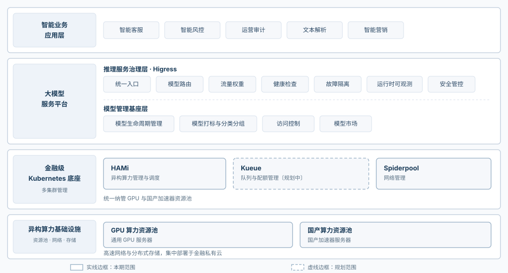

# DaoCloud 助力宁波银行构建云原生 AI 资源管理与推理服务体系

> 英文版已由宁波银行与 DaoCloud 提交至 CNCF 最终用户技术顾问委员会，参见 [cncf/tab#141](https://github.com/cncf/tab/issues/141)。文档以 [CC BY 4.0](https://creativecommons.org/licenses/by/4.0/) 协议分发。
>
> 英文版原文：<https://endusers.cncf.io/architectures/bank-of-ningbo/>

宁波银行与 DaoCloud 联合提交的用户案例，完整阐述了该行以 Kubernetes 为底座、以 HAMi 与 Higress 为核心，构建云原生 AI 资源管理与推理服务治理体系的实践经验。这一来自中国城商行的金融 AI 基础设施案例，将在 **KubeCon + CloudNativeCon North America 2026** 的 **Keynote** 中被提及，向全球云原生社区展示异构算力治理的落地成果。

## 亮相 KubeCon 北美 2026

**KubeCon + CloudNativeCon North America 2026** 将于 **2026 年 11 月 9–12 日** 在美国犹他州 **盐湖城 Salt Palace 会展中心** 举行（11 月 9 日为联合活动日，11 月 10–12 日为主会场，含 Keynote 与分论坛）。

本届大会新增「AI 推理与智能体（AI Inference + Agentic）」赛道，聚焦 GPU 调度、模型服务与生产级 AI 基础设施——宁波银行案例所展示的异构算力纳管、分层模型路由与跨集群推理治理，正是这一议题的典型生产实践。

除 Keynote 提及外，DaoCloud 开源战队负责人 **Paco Xu** 也将在本次大会登台演讲，参与 TAG Workloads Foundation 专题座谈，与来自 NVIDIA、Red Hat、Akamai Cloud、Broadcom 的技术负责人同台交流：

| 项目 | 信息 |
| ---- | ---- |
| 议题 | Explore TAG Workloads Foundation: Core Runtime, Batch Scheduling, and Moar! |
| 时间 | 1:50–2:20 p.m.（美国山地时间 MST） |
| 地点 | Salt Palace, Level 2, 251-A-C |
| 讲师 | Marlow Warnick（NVIDIA）、Yuan Tang（Red Hat）、Stephen Rust（Akamai Cloud）、Paco Xu（DaoCloud）、Rajas Kakodkar（Broadcom） |

以下为宁波银行案例全文。

## 相关开源项目

| 项目 | 介绍 | 备注 |
| ---- | ---- | ---- |
| [Kubernetes](https://kubernetes.io/) | 在银行金融私有云上提供容器编排、资源调度与集群自愈，是跨芯片型号与机型进行资源管理和推理服务治理的标准化底座。 | CNCF 毕业项目，DaoCloud 参与维护且贡献量全球第三 |
| [HAMi](https://project-hami.github.io/HAMi/) | 将 NVIDIA 等 GPU 与国产异构 GPU 纳入 Kubernetes 资源模型，提供相对一致的资源视图、资源申请机制与调度流程，并按设备能力选择整卡分配或细粒度切分。 | CNCF 孵化项目，由 DaoCloud 联合开源和维护 |
| [Higress](https://higress.cn/) | 为推理服务提供统一入口与流量治理，包括基于请求属性的模型路由、后端加权选择、健康检查与不健康后端摘除，以及基础可观测性。 | CNCF Sandbox 项目 |
| [Spiderpool](https://spidernet-io.github.io/spiderpool/) | Underlay 网络 IPAM，为集群内容器提供 IP 地址分配与网络编排，是本方案的支撑性基础组件。 | CNCF Sandbox 项目，由 DaoCloud 开源和维护 |
| [Kueue](https://kueue.sigs.k8s.io/) | Kubernetes 原生队列与配额管理，供未来跨部门算力共享与批量训练负载扩大时启用。 | Kubernetes SIG 子项目，DaoCloud 参与维护 |

## 宁波银行简介

宁波银行是一家区域性城商行，深耕本地普惠金融、零售银行、公司银行与智能风险管理，持续推进数字化与 AI 转型。近年来，该行逐步在私有化环境中部署金融大语言模型（LLM），开展面向场景的微调，并引入智能推理服务。其模型组合目前已涵盖大型通用模型、长上下文业务模型、轻量化问答模型以及金融垂类模型。随着 AI 应用日益进入常态化生产使用，该行同时使用通用 GPU 与国产加速器等异构算力资源。

与大型银行相比，城商行在 AI 建设上普遍优先考虑轻量化落地、增量迭代与实际成效：不追求超大规模集群，而是聚焦于用好现有算力、标准化模型服务并贴合业务场景。本项目正是该行在 AI 基础设施标准化与整合方面的阶段性实践。

## 架构总览与目标

### 背景与问题空间

随着 AI 从试点走向日常银行业务，宁波银行需要在通用 GPU 与国产 NPU 上运维多种类型的模型。各芯片专用的部署栈、整卡分配方式以及各自独立暴露的模型服务，造成了资源孤岛：一些集群负载过高，另一些却闲置，团队不得不人工为每个负载匹配模型、加速器与接入端点。

本方案不再走资本密集型的大规模扩容路线，而是利用开源云原生技术释放现有算力资源与模型资产的价值，实现金融 AI 场景的轻量化、标准化、高效率交付。

### 目标

- 通过统一的、基于 Kubernetes 的资源模型治理异构算力，而不是为每种芯片维护一套部署栈。
- 为业务应用提供单一推理入口，屏蔽芯片类型与集群分布。
- 将每个请求路由到规模适配的模型，让常规问答不再占用高端算力。
- 在 GPU 集群与国产加速器集群之间共享推理算力，并具备基本的溢出与故障转移能力。
- 保持投资可控、推广循序渐进，为其他中小银行提供参考。

### 架构

该行以 Kubernetes 为底座，建立了以「资源管理 + 推理服务治理」为中心的分层架构。自下而上分为四层：异构算力基础设施与资源池、金融 Kubernetes 底座、大模型服务平台、智能业务应用。

整体设计遵循三项原则： **关注点分离** ，让算力层、平台层与服务层独立演进；
**多 Kubernetes 集群统一纳管** 不同资源池，减少重复配置；
**增量扩展** ，按具体场景需要逐步引入 Kueue、Spiderpool 等组件。

#### 异构算力基础设施与资源池

通用 GPU、国产 NPU 及其他加速器，连同配套的高速网络与分布式存储，部署在银行金融私有云中，构成异构算力基础设施。资源按芯片类型划分为 GPU 算力池与国产加速器池，各自由独立的 Kubernetes 集群管理，避免不同厂商设备在驱动、运行时与运维流程上相互干扰。这一层不改动各芯片专用的驱动与运行时环境，而是把多样化资源的管理与配置复杂度下沉到资源管理层解决。

#### 金融 Kubernetes 底座与算力资源管理

金融 Kubernetes 底座以多集群方式纳管 GPU 池与国产加速器池，为模型服务与平台组件提供一致的容器运行环境。在此底座上，针对资源调度、队列与配额管理、网络等方向引入或规划了以下组件：

- **HAMi（异构算力管理与调度）** ：通过适配的 device plugin 与运行时环境，将加速器注册为 Kubernetes 可识别、可申请的资源，形成相对一致的资源视图、申请机制与调度流程；根据硬件能力选择整卡分配或细粒度切分，降低不同硬件类型的管理与配置复杂度。
- **Kueue（队列与配额管理）** ：为后续阶段的规划组件。当跨部门算力共享与批量训练负载扩大时，提供队列优先级与配额控制。
- **Spiderpool（网络管理）** ：为集群内容器提供 IP 地址分配与网络编排，作为支撑性的基础组件。

与 Kubernetes 原生调度配合，这些组件支撑标准化的资源申请模板、调度约束与部署流程，减少同一模型跨集群部署时的重复配置。

#### 大模型服务平台与推理服务治理

大模型服务平台由模型管理基座层与推理服务治理层组成。基座层负责端到端的模型生命周期管理、模型打标、分类分组、访问控制与模型市场，提供模型资产的统一视图和面向各业务部门的申请入口。Higress 承担推理服务治理层，提供统一入口、基于输入属性的模型路由、流量权重分配、健康检查与不健康后端摘除、运营可观测性及安全管控，其职责与行内已有的 API 网关、安全平台保持清晰边界。

##### 基于输入属性的分层多模型路由

为支持大型通用模型、长上下文业务模型、轻量化问答模型与金融垂类模型的混合部署，Higress 通过预配置策略将请求路由到合适的模型服务。路由输入包括：业务来源、API 类型与路径、调用方身份、业务标签、上下文长度、请求优先级、SLA 等级、所请求的模型以及后端服务状态。复杂度更高的负载被路由到更大的模型，而常规问答与轻量场景被路由到更小的模型，避免不必要地消耗高端算力资源。

##### 跨芯片类型推理服务的逻辑池化

HAMi 在部署时分配资源，Higress 在运行时调度流量。当同一规格的模型分别部署在 GPU 集群与国产加速器集群后，Higress 提供相对统一的服务入口，依据预设权重、业务规则与健康状态在新请求之间分发流量，从而实现跨芯片推理服务一定程度的共享使用与基础故障转移能力。

请求通过预配置的流量权重、业务分级策略、服务健康检查与阈值触发机制在推理集群之间分发。当主集群不健康或达到预设负载阈值时，符合条件的新请求会被重定向到备集群，提供基础的流量溢出与故障转移能力。

#### 智能业务应用层

智能风险管理、智能客服、运营审计、文本解析、智能营销等行内 AI 应用通过统一入口调用模型服务。业务系统无需感知底层芯片类型与集群分布。结合模型标签与访问控制，各业务部门可以按需申请模型能力，逐步复用模型、算力与服务能力。

## 为什么选择这些项目/服务？

- **Kubernetes**：契合银行的金融私有云架构。它提供容器编排、资源调度与集群自愈，支持 AI 服务跨多种芯片类型与机型部署，为资源管理与推理服务治理确立了标准化底座。
- **HAMi**：与 Kubernetes 原生集成，无需重构现有技术栈。其主要价值在于把此前已适配的异构加速器纳入 Kubernetes 资源管理体系，提供相对一致的资源视图、资源申请机制与调度流程，降低分别管理、配置不同硬件类型的复杂度。不同芯片的驱动、运行时、模型镜像与 operator 适配仍由相应硬件平台负责。整卡或细粒度资源分配依据各设备能力选择。
- **Higress**：与通用 API 网关相比，Higress 提供面向推理的能力，包括统一入口、基于请求属性的路由、基于流量权重与健康状态的后端选择、不健康后端摘除以及基础可观测性。它是推理服务层的流量治理组件，既不替代底层算力调度，也不做推理引擎的性能优化。
- **Spiderpool**：为集群内容器提供 IP 地址分配与网络编排，作为支撑性的基础组件。
- **Kueue（Kubernetes SIG 子项目）**：该行目前将训练与推理资源分池管理，租户之间资源竞争相对有限，批量作业排队尚无大规模需求。Kueue 作为技术选型保留，供未来跨部门算力共享与批量训练负载扩大时启用；它不属于本架构已落地的成果。

## 哪些方面取得了成效？

### 阶段性成果

该行在统一资源管理与推理服务治理的以下方面取得了初步进展。

**资源管理：**

- 异构资源统一管理的范围逐步扩大，已适配的加速器通过一致的流程完成接入。
- 减少了重复的资源配置与服务接入工作。
- 整卡与细粒度资源分配的适用性已在部分场景中得到验证。

**推理服务治理：**

- 基于输入属性与预配置策略，初步建立了分层多模型路由能力。
- 跨集群流量切换机制，包括基于健康检查的后端摘除与阈值触发的分流，已在部分场景中得到验证。
- 为未来在模型调用成本与服务可靠性方面的改进奠定了技术基础。

### 可复用的经验

- **清晰的分层与明确的组件职责。**
  「HAMi 负责底层资源管理、Higress 负责上层推理服务治理」的两层划分与当前实施范围相匹配，职责边界清晰，避免组件能力被混淆。
- **面向中小银行异构混合环境设计。**
  与围绕单一算力类型和标准化模型构建的架构不同，本方案应对的是多种芯片类型并存、不同规格模型混合部署的情况——这在城商行中十分普遍。方案从资源管理与统一服务入口入手，提供了一条投资可控的轻量化路径。
- **务实地复用开源组件。**
  HAMi 专注资源管理与调度，Higress 专注推理服务流量治理；两者的管理均纳入行内既有的安全管理框架。方案基于开源组件按银行的部署与运维需要做配置与集成，不夸大这些组件的能力边界。
- **以优化存量资源为核心的轻量化路径。**
  该行不单纯依赖硬件扩容，而是通过资源管理与服务治理提升现有算力资源与模型资产的利用率，为中小银行提供了一条可增量推进、切实可行的实施路径。

## 架构的下一步计划？

- **扩大 HAMi 覆盖范围**：在更多型号加速器的 device plugin 与运行时环境完成适配后逐步纳管，同时持续完善整卡与切分资源的分配策略。
- **强化推理服务治理**：完善基于输入属性的路由策略，建立定期及根据运行情况调整流量权重的机制。后续可能引入轻量的分类或意图识别组件，将其输出作为 AI 网关的路由标签，逐步实现面向 AI 智能体场景的语义化模型选择。
- **探索实时动态流量加权**：在推理引擎指标、服务发现、监控系统与权重控制机制就绪后，研究基于实时时延、并发水平与节点健康状态的动态流量分配。
- **引入 Kueue**：当跨部门算力共享与批量训练负载达到足够规模时，增加队列优先级与配额管理。
- **沉淀实践经验**：持续总结城商行异构 AI 集群的经验，将场景化需求回馈 HAMi 与 Higress 社区。
