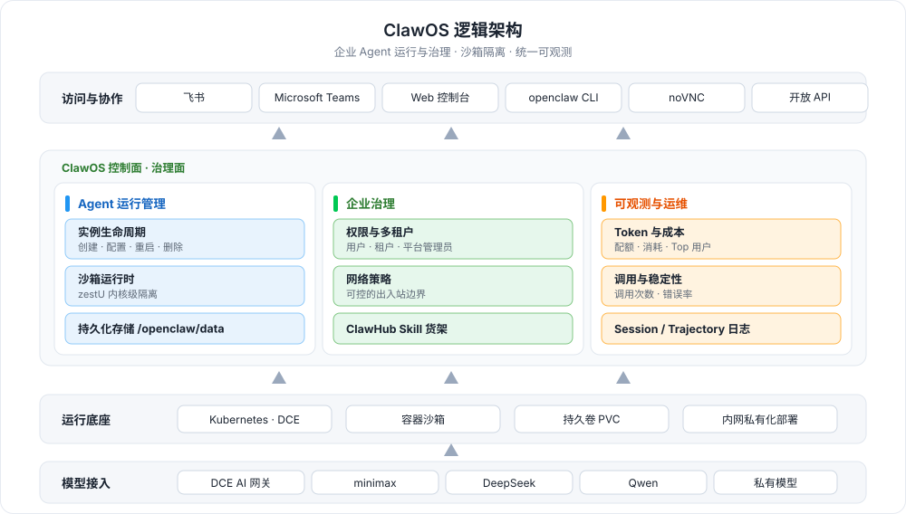
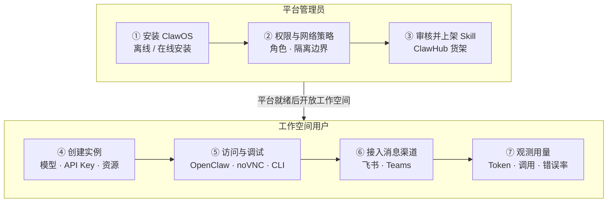
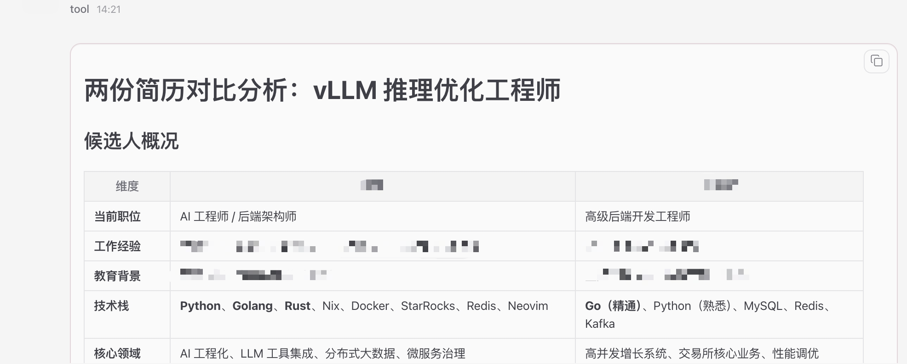
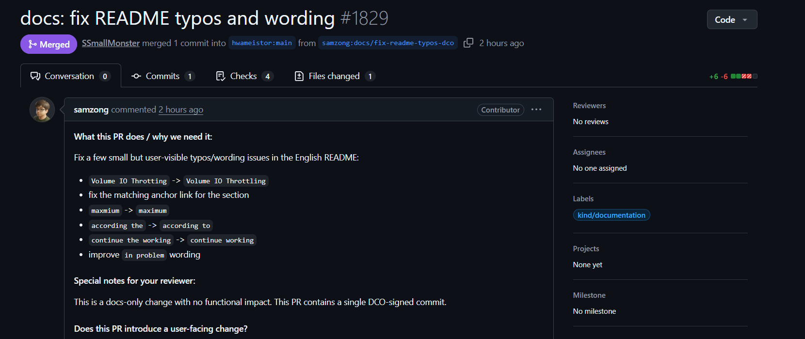

---
hide:
  - toc
---

# 什么是 ClawOS

ClawOS 是面向企业的 Agent 运行与治理平台，用于统一创建、管理、集成、观测和运维企业内部的 AI Agent。当前版本中，ClawOS 管理的 Agent 类型主要为 OpenClaw 实例；后续平台可扩展支持更多类型的企业 Agent。

可以简单理解为：ClawOS 是企业内部运行 AI Agent 的 **控制面** 和 **治理面** 。它不是简单的 Agent 列表管理平台，而是把 Agent 纳入企业已有的权限、网络、协作、审计和运维体系，让 Agent 的执行能力在企业环境中 **可管理、可审计、可集成、可规模化** 地落地。

## 核心能力

- :material-cube-outline:{ .lg .middle } __实例生命周期管理__

    ---

    在控制台中增删改查智能体实例。每个实例对应实际运行的服务资源，运行在 Kubernetes 等云原生底座之上；修改镜像、资源规格、模型、API Key 等关键配置对运行的影响会清晰呈现给用户。

    [:arrow_forward: 管理 OpenClaw 实例](../workspace/openclaw.md)

- :material-shield-account:{ .lg .middle } __权限与多租户隔离__

    ---

    面向企业组织结构划分能力边界：普通用户只能管理自己的实例，租户管理员可以查看工作空间内实例运行情况，平台管理员可以管理全局资源、策略和配置。

    [:arrow_forward: 查看 ClawOS 权限说明](../../ghippo/permissions/clawos.md)

- :material-lan-connect:{ .lg .middle } __网络策略治理__

    ---

    统一管理 Agent 的网络访问边界：哪些实例可以访问内网服务、哪些只能访问指定 API、哪些策略由平台默认强制启用、哪些允许用户自行选择。

    [:arrow_forward: 配置网络策略](../admin/network-manage.md)

- :material-package-variant-closed:{ .lg .middle } __Skill 管理与分发__

    ---

    ClawHub 是企业能力货架：Skill 经过审核、上架、分发、授权、追踪和下架，企业可以把高价值 Skill 沉淀下来，按权限分发给不同团队和实例复用。

    [:arrow_forward: 浏览 Skill 市场](../workspace/skill.md)

- :material-forum-outline:{ .lg .middle } __消息渠道集成__

    ---

    集成飞书、Microsoft Teams 等企业消息渠道，让 OpenClaw 实例在群聊、私信、频道中收发消息、处理文件、响应任务，从「平台里的一个实例」变成「协作系统里的数字员工」。

    [:arrow_forward: 对接飞书](../workspace/feishu.md)

- :material-chart-line:{ .lg .middle } __可观测与运维__

    ---

    提供实例状态、Token 用量、调用次数、错误率、Top 用户与模型分布等指标，以及 Session transcript、Trajectory log 等运行记录，让管理员知道 Agent 是否正常、成本是否失控、某次任务到底执行了什么。

    [:arrow_forward: 查看工作空间概览](../workspace/index.md)

## 使用流程

ClawOS 的使用分为 **平台准备** 与 **工作空间使用** 两个阶段：管理员先完成安装、权限与网络策略规划，并把审核过的 Skill 上架到 ClawHub；
工作空间用户随后创建 OpenClaw 实例，通过 OpenClaw 页面或 noVNC 访问调试，按需接入飞书、Teams 等消息渠道，并在概览页持续观测用量与成本。

| 步骤 | 角色 | 说明 |
| --- | --- | --- |
| [① 安装 ClawOS](install.md) | 平台管理员 | 通过离线包或 Helm 在线安装 ClawOS 组件，接入 d.run 等环境 |
| [② 权限与网络策略](../admin/network-manage.md) | 平台管理员 | 规划角色能力边界，定义实例可访问的内网服务与外部 API |
| [③ 审核并上架 Skill](../admin/skillmanage-admin.md) | 平台管理员 | 审核 Skill 内容后上架到 ClawHub，按权限分发给各团队 |
| [④ 创建实例](quickstart.md) | 工作空间用户 | 选择集群、命名空间、镜像与资源，配置模型、API Key 和消息渠道 |
| [⑤ 访问与调试](quickstart.md) | 工作空间用户 | 通过 OpenClaw 页面、noVNC 远程桌面或 CLI 操作实例 |
| [⑥ 接入消息渠道](../workspace/feishu.md) | 工作空间用户 | 配置飞书自建应用或 Teams，把 Agent 接入日常协作流程 |
| [⑦ 观测用量](../workspace/index.md) | 租户管理员 | 查看 Token 配额与消耗、调用趋势、错误率与模型使用分布 |

## 快速上手

=== ":material-shield-account: 管理员：平台准备与治理"

    

      <a class="clawos-path-step" style="--path-c:#2196f3" href="install/">
        1
        安装 ClawOS
        离线包 / Helm 在线安装
        前往 →
      </a>
      <a class="clawos-path-step" style="--path-c:#00acc1" href="../../ghippo/permissions/clawos/">
        2
        权限规划
        用户 · 租户 · 平台管理员
        前往 →
      </a>
      <a class="clawos-path-step" style="--path-c:#43a047" href="../admin/network-manage/">
        3
        网络策略
        定义出入站访问边界
        前往 →
      </a>
      <a class="clawos-path-step" style="--path-c:#fb8c00" href="../admin/skillmanage-admin/">
        4
        Skill 上架
        审核并发布到 ClawHub
        前往 →
      </a>
      <a class="clawos-path-step" style="--path-c:#8e24aa" href="../admin/">
        5
        全局概览
        全平台用量与风险
        前往 →
      </a>
    

=== ":material-account: 工作空间用户：创建与使用 Agent"

    

      <a class="clawos-path-step" style="--path-c:#2196f3" href="quickstart/">
        1
        快速入门
        创建并访问首个实例
        前往 →
      </a>
      <a class="clawos-path-step" style="--path-c:#00acc1" href="../workspace/openclaw/">
        2
        实例管理
        查看 · 编辑 · 删除实例
        前往 →
      </a>
      <a class="clawos-path-step" style="--path-c:#43a047" href="../workspace/feishu/">
        3
        飞书集成
        让 Agent 进入群聊与私信
        前往 →
      </a>
      <a class="clawos-path-step" style="--path-c:#fb8c00" href="../workspace/teams-info/">
        4
        Teams 配置
        对接 Microsoft Teams
        前往 →
      </a>
      <a class="clawos-path-step" style="--path-c:#8e24aa" href="../workspace/">
        5
        用量观测
        Token · 调用 · 错误率
        前往 →
      </a>
    

## OpenClaw 与 ClawOS 的关系

**OpenClaw**（小龙虾）是新一代开源 AI Agent 运行时，目标是把 AI 从「被动回答问题」升级为「主动规划并执行任务」：它结合模型能力、工具调用、文件系统、终端命令、浏览器控制、API、Skill 和多 Agent 协作，完成更复杂的端到端任务。

| 能力维度 | 传统 AI 助手 | OpenClaw 智能体 |
| --- | --- | --- |
| 交互方式 | 被动问答，单轮响应 | 主动规划，多轮自主执行 |
| 能力边界 | 仅输出文字 | 调用工具、操作系统、执行代码 |
| 适用场景 | 信息查询、简单生成 | 端到端自动化工作流 |

| 对象 | 定位 |
| --- | --- |
| OpenClaw | 运行对象，负责让 Agent 具备执行能力 |
| ClawOS | 运行和治理平台，负责让 Agent 在企业里可控地运行 |

如果每个 OpenClaw 实例都由个人自行配置、维护、接入模型和工具，企业很快会遇到权限不可控、成本不可见、日志不可查、Skill 无法复用等问题。ClawOS 的价值，就是把分散的 Agent **运行起来、管起来、看起来、审起来**，让 Agent 从「个人工具」变成「企业可运营资产」。

## 典型应用场景

### HR 批量简历筛选

面对数十份格式各异的 PDF 简历，让小龙虾自动读取、提取关键技术栈、按岗位要求评分排序，输出结构化评估报告。原来需要半天的筛选工作，几分钟即可完成。

!!! note

    简历包含敏感个人信息（PII）。d.run 私有化部署确保数据不出内网，禁止将简历发送至外部公有云 API。

### 软件开发助手

对接 GitHub 后，配置多 Agent 架构（Main Agent + Research + Reviewer + Codex），让小龙虾分析源码、定位 Bug、创建 Pull Request、执行 CI 规范，打造完全个性化的自动化开发编排器。

### 批量文档审查

将「读取文档 → 提取关键数据 → 校验规则 → 生成审查意见」全流程封装为可复用的自定义 Skill（`createSkill`），一键处理数十份报告并输出汇总 CSV，告别重复劳动。

## 为什么选择 ClawOS

| 优势 | 说明 |
| --- | --- |
| 一键创建，开箱即用 | 无需手动配置环境、接入模型和权限，系统自动完成沙箱创建和 Token 注入，业务人员无需 IT 介入即可立即使用 |
| 安全沙箱隔离 | 每个 OpenClaw 实例运行在独立容器沙箱中，基于 DaoCloud **zestU** 内核级隔离技术，即使被攻破也严格限制在沙箱内，无法入侵内网或篡改宿主机文件 |
| 数据持久化 | `/openclaw/data` 通过持久卷保存，OpenClaw 工作文件和 FileBrowser 上传的文件在 Pod 重启或重建后仍会保留。noVNC 中保存在 `/home/node` 等其他目录的文件不保证保留，详见[常见问题](../faq.md)。 |
| 安全可控的模型访问 | 所有模型调用通过 AI 网关统一转发并执行安全策略，不直接暴露公网，数据和对话在平台内受保护 |
| 完整后台访问能力 | 提供 [SSH 登录和 noVNC 网页访问](quickstart.md#openclaw_2) 两种方式，支持完整 CLI 操作，满足高级调试和自定义需求 |

## 更多资源

- :material-format-list-bulleted:{ .lg .middle } __常见问题__

    ---

    实例创建与访问、数据持久化目录、Token 配额等常见问题的解答。

    [:arrow_forward: 查看 FAQ](../faq.md)

- :material-book-open-page-variant:{ .lg .middle } __升级与兼容性__

    ---

    升级注意事项与版本兼容性说明，升级前请务必阅读。

    [:arrow_forward: 查看升级指引](upgrade-notes.md)

- :material-console:{ .lg .middle } __Gateway API 实例访问__

    ---

    通过 Gateway API 访问 OpenClaw 实例的参考配置。

    [:arrow_forward: 查看参考文档](../reference/gateway-access.md)

[下载中心](https://docs.daocloud.io/download/){ .md-button }
[了解 Token 工厂效能平台](https://docs.daocloud.io/tf/){ .md-button }
[了解 d.run AI 操作系统](https://docs.daocloud.io/drun/){ .md-button }
[查阅 ClawOS 用户手册 PDF](https://harbor-test2.cn-sh2.ufileos.com/docs/download/docs/ClawOS.pdf){ .md-button }
