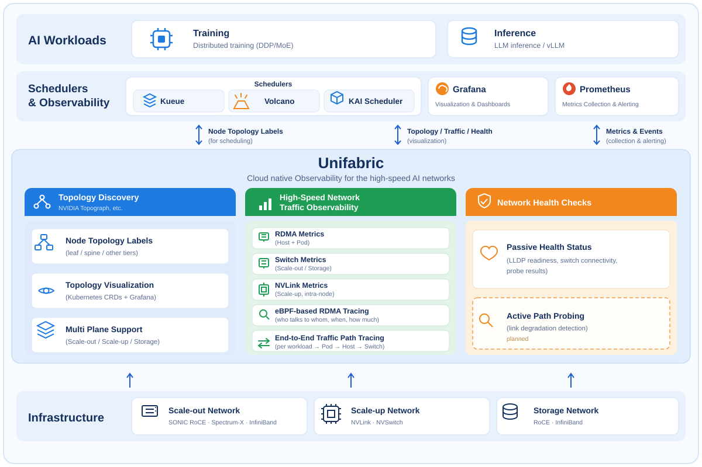
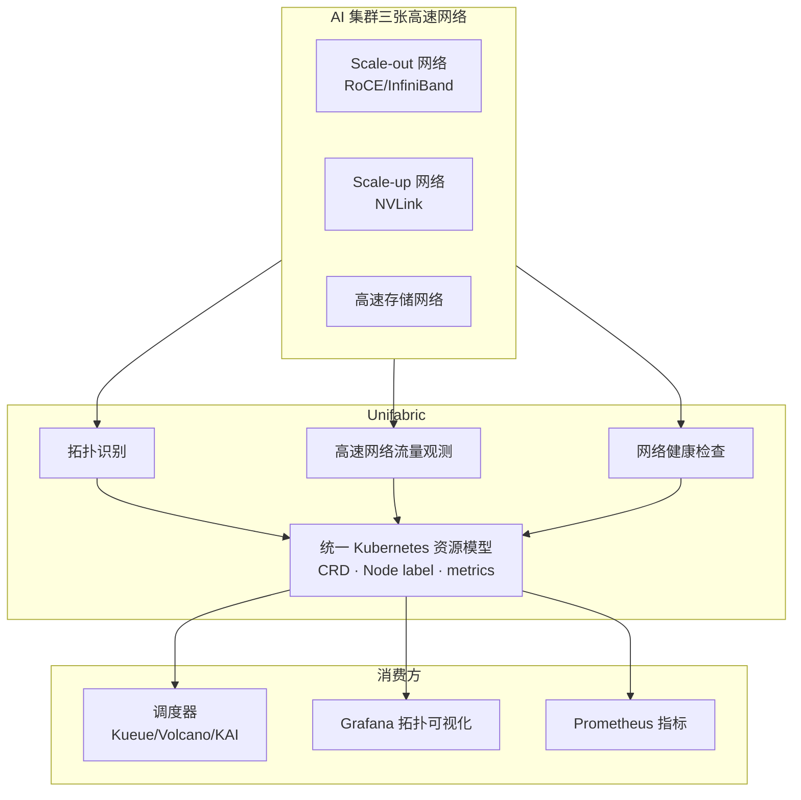

# Unifabric

Unifabric 是由「DaoCloud 道客」开源的 **面向 AI 高速网络的云原生可观测性平台** 。

现代 AI 集群依赖三张高速网络——GPU 跨节点通信的 Scale-out 网络（RoCE/InfiniBand）、
节点内 GPU 互联的 Scale-up 网络（NVLink 等），以及高速存储网络。训练与推理的性能高度依赖这三张网络：
一条链路的拥塞或劣化，足以拖慢整个任务，甚至中断训练。

> **Unifabric 用云原生的方式，补上 AI workload 可观测的“最后一公里”。**
>
> 自动识别三张网络的拓扑，观测 RDMA 流量并归因到 workload，持续采集网络健康状态；NVLink 流量指标与主动路径探测已在规划中。

Unifabric 使用 Go 语言编写，采用 [Apache License 2.0](https://github.com/unifabric-io/unifabric/blob/main/LICENSE) 协议开源，
由「DaoCloud 道客」于 2026-04-19 创建并持续孵化。

## 为什么需要 Unifabric

Scale-out、Scale-up 与存储这三张高速网络，对云原生体系而言几乎是黑盒：

| 典型痛点 | 说明 |
| --- | --- |
| 硬件观测工具互不相通 | 三张网络由多家厂商的交换机、路由器和网卡组成，各自的监控工具彼此孤立，也不与 Kubernetes 的资源模型和监控体系对接 |
| 现有方案不覆盖高速网络 | 社区现有的云原生可观测方案围绕 TCP/IP 构建，不覆盖 RDMA 与 NVLink |
| 异常无法归因到业务 | 网络异常无法归因到具体的 Pod 和训练任务，排障只能逐台设备人工检查 |
| 观测与调度脱节 | 网络拓扑信息没有进入调度决策，通信密集型任务可能被调度到跨交换机的远端节点 |

Unifabric 无论底层是哪家厂商的设备，都以统一的 Kubernetes 资源模型（CRD、Node label、metrics）呈现观测结果；
并且观测不止于看板——拓扑 label 直接被 Kueue、Volcano 等调度器消费，提升 AI 集群的训练与推理效率。

## 架构

Unifabric 构建在 Scale-out、Scale-up 和存储三张网络之上：直接发现这些网络，或从 NVIDIA Topograph、NetQ 导入拓扑，
以统一的 Kubernetes 资源模型对外提供三大核心能力，由调度器、Grafana 和 Prometheus 消费。

## 核心特性

### 拓扑识别

实时探测并识别三张网络中主机、交换机等设备之间的连接关系，把原本散落在各家网络设备里的物理拓扑，
变成 Kubernetes 中可直接消费的标准资源。

- **分层 Node label 发布**：自动把节点在网络中的位置（leaf、spine 等层级）写入 Node label，
  供 Kueue TAS、Volcano、KAI Scheduler 等调度器直接消费，把通信密集的任务收敛在同一交换机域内，
  缩短通信路径，提升训练与推理效率。
- **拓扑可视化**：发布 `Topology` 资源并在 Grafana 中交互式呈现全网拓扑，
  让运维无需登录交换机即可掌握全局连接状态，排障时可快速确认受影响的节点与链路范围。
- **适用环境**：支持通用 SONiC RoCE 交换机（LLDP 自主发现）、NVIDIA Spectrum-X 和
  InfiniBand（从 NVIDIA Topograph 导入）；支持裸金属与云化环境。

### 高速网络流量观测

通过读取网卡计数器、采集交换机指标、挂载 eBPF 探针等方式采集流量数据，
并统一归因到 Pod、namespace、workload 和主机，把设备视角的流量变成业务视角的可观测指标。

- **主机与 Pod 网卡的 RDMA 指标统计**：覆盖吞吐、拥塞与错误指标，为性能分析和故障定位提供端侧数据。
- **交换机流量的 Pod 身份关联**：把 Scale-out 与存储网络中交换机上的 RDMA 流量关联到具体 Pod，
  打通“设备流量”与“业务身份”之间的断层。
- **基于 eBPF 的 RDMA 流观测**：RDMA 通信绕过内核协议栈，抓包和连接跟踪等常规手段全部失效。
  针对 CPU 发起的 RDMA 通信，Unifabric 在 verbs 库的提交路径上挂载 eBPF 探针，
  无需修改应用即可还原出 Pod 级的 RDMA 流——谁在和谁通信、何时通信、每次发送多大，
  让 RDMA 通信像 TCP 连接一样可观测。
- **NVLink 流量指标（规划中）**：采集 Scale-up 网络中 GPU 间 NVLink 通信指标，
  让节点内 GPU 互联这一传统监控盲区变得可观测。

### 网络健康检查

持续对三张高速网络的链路和配置做巡检，主动发现问题，而不是等业务报障后再排查。

- **被动健康状态采集**：持续收集 LLDP 就绪、交换机连接状态与探针结果，实时反映网络基础设施的健康水位。
- **主动网络路径探测与链路退化检测（规划中）**：主动打流探测网络路径，发现尚未触发告警的链路劣化。

## 典型使用场景

- **训练/推理任务变慢时**：在 AI workload 级别关联交换机、Pod 网卡等路径上的 RDMA 指标，
  定位通信热点，找出占用带宽的应用。
- **性能分析与调优时**：分析 Pod RDMA 通信的时序、peer 与报文大小，确认通信模式是否符合预期。
- **网络拥塞或异常排障时**：通过预置 Grafana 仪表盘快速回答“是谁的流量、影响了谁”，确定影响范围。
- **大规模集群日常巡检时**：持续掌握链路和交换机的健康水位，无需逐台设备人工检查。
- **训练任务开跑前**：提前验证网络路径健康，避免长时间训练任务因链路劣化或配置故障中断或降速。

## 快速开始

按照[部署指南](https://github.com/unifabric-io/unifabric/blob/main/docs/getting-started.zh.md)安装 Unifabric。
该文档覆盖默认的 SONiC RoCE 网络，也支持 InfiniBand 和 NVIDIA Spectrum-X 两种环境。

安装完成后，可参阅以下文档使用各项功能：

- 拓扑识别与可视化：[拓扑可视化](https://github.com/unifabric-io/unifabric/blob/main/docs/usage/topology-visualization.zh.md)
- 拓扑感知调度：[Kueue/Volcano/KAI 调度集成](https://github.com/unifabric-io/unifabric/blob/main/docs/usage/workload-tas.zh.md)
- RDMA 指标观测：[RDMA 指标](https://github.com/unifabric-io/unifabric/blob/main/docs/usage/rdma-metrics.zh.md)
- RDMA 流归因：[RDMA 流归因](https://github.com/unifabric-io/unifabric/blob/main/docs/usage/rdma-flow.zh.md)
- 交换机流量观测：[Switch Agent 部署（host proc）](https://github.com/unifabric-io/unifabric/blob/main/docs/usage/switch-agent-host-proc.zh.md)、
  [Switch Agent 部署（systemd）](https://github.com/unifabric-io/unifabric/blob/main/docs/usage/switch-agent-systemd.zh.md)

## 路线图

规划中的功能与未来方向（包括 NVLink 流量指标、主动路径探测等）见
[路线图](https://github.com/unifabric-io/unifabric/blob/main/docs/roadmap.zh.md)。

## 社区与贡献

欢迎参与贡献：

- 通过 [GitHub issue](https://github.com/unifabric-io/unifabric/issues) 报告 bug 或提出功能建议。
- 按照 [NVAIR 开发环境指南](https://github.com/unifabric-io/unifabric/blob/main/docs/development/dev-with-nvair.md)搭建开发环境。
- 提交 pull request 前，运行 `make build`、`make test-unit` 和 `make check-license`。
- 提交 commit 时使用 `git commit -s` 签署 [Developer Certificate of Origin](https://developercertificate.org/)。

[了解 Unifabric GitHub 社区](https://github.com/unifabric-io/unifabric){ .md-button }
