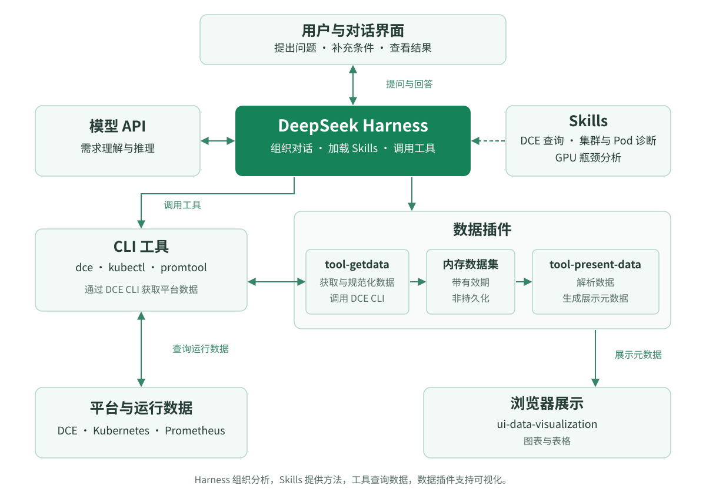
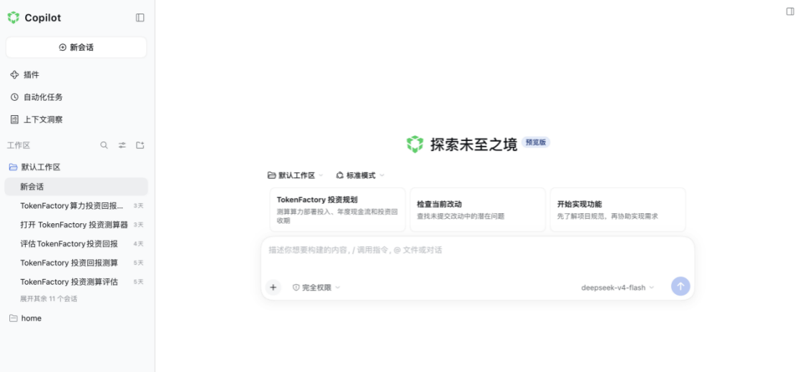

# DCE 小助手

DCE 小助手面向平台管理员、运维人员和 GPU 资源管理人员，支持通过自然语言查询平台信息、检查集群健康状态、排查 Pod 故障和分析 GPU 资源瓶颈，帮助用户了解运行情况、定位问题并制定处理方案。

DCE 小助手基于 DeepSeek Harness，结合模型 API、Skills 和平台工具完成任务。Skills 定义具体任务的处理方法，工具负责访问平台与运行数据，分析结果可以通过文字、表格和图表呈现。

## 核心能力

### 平台信息查询

根据用户需求查询平台资源及相关信息，为运行状态判断和问题分析提供依据。

- **资源查询**：查询集群、命名空间、工作负载等资源，了解资源配置与当前状态。
- **多模块访问**：访问 DCE CLI 已接入的全局管理、容器管理、可观测性、AI Lab、LLM Studio、应用工作台、费用管理等模块接口。

具体可查询的信息取决于目标环境中已安装的模块、接口版本及访问权限。CLI 接入某个模块，表示具备相应的数据访问能力；该模块的专项诊断或业务分析能力还需要对应的 Skills 支持。

### 集群健康检查与诊断

检查集群、节点和 Pod 的运行状态，结合事件识别异常及其影响。

- **集群状态检查**：查看集群是否可访问、运行状态是否正常。
- **节点与 Pod 异常发现**：识别未就绪、禁止调度或存在资源压力的节点，汇总异常 Pod 及其所在命名空间。
- **关联分析**：结合节点条件、Pod 状态和事件分析可能原因，给出问题优先级和处理建议。

### Pod 故障诊断

围绕指定 Pod 收集状态、事件、容器日志及相关配置，分析启动失败或运行异常的原因。

- **常见故障排查**：覆盖 Pending、CrashLoopBackOff、OOMKilled、ImagePullBackOff、Evicted 等异常。
- **相关资源检查**：检查所属工作负载、所在节点、资源限制、节点选择、亲和性与容忍配置等信息。
- **诊断依据说明**：列出支持判断的事件、退出码、容器状态或关键日志，并给出后续处理建议。

### GPU 容量与瓶颈分析

分析一个或多个 GPU 集群的资源容量、分配情况和实际使用情况，估算负载增长后的资源压力。

- **容量与余量分析**：查看 GPU 数量、已分配资源、核心利用率和显存使用情况，区分调度余量与实际计算余量。
- **负载增长估算**：结合当前负载、GPU 工作负载和 HPA 配置，分析流量增长后可能出现的计算、调度或显存瓶颈。
- **方案比较**：根据资源余量和瓶颈类型，提出扩容、限流、调整路由或资源配置的建议，并说明依据与假设。

GPU 瓶颈分析需要实际容量与利用率数据。缺少 QPS 数据时，可以在明确说明假设的前提下进行基于利用率的估算；缺少必要的资源或利用率数据时，需要先补充数据。估算结果用于辅助规划，实际承载能力仍需结合业务负载和性能测试验证。

## 典型使用场景

用户可以直接描述目标、资源范围和关注的问题，无需先查找具体的 API 或命令。例如：

| 场景 | 提问示例 | 主要结果 |
| --- | --- | --- |
| 查询平台资源 | 列出当前环境中我可以访问的集群。 | 集群列表及相关信息 |
| 检查集群健康状态 | 检查 prod 集群的健康状态，指出需要优先处理的问题。 | 关键指标、异常资源、影响及建议 |
| 排查 Pod 故障 | 分析 prod 集群 default 命名空间中 api-xxx Pod 反复重启的原因。 | 状态、事件与日志依据，可能原因及处理建议 |
| 分析 GPU 瓶颈 | 如果推理流量上涨 30%，哪些 GPU 集群可能先出现瓶颈？ | 各集群资源余量、负载估算和瓶颈判断 |
| 比较处理方案 | 针对上面的 GPU 瓶颈，比较扩容、限流和调整路由的适用条件。 | 方案依据、适用条件及预期影响 |

以上集群、命名空间和 Pod 名称为提问示例，使用时应替换为实际对象。提供明确的资源范围、时间范围和负载条件，有助于获得更准确的结果。

## 工作原理

DCE 小助手通过 DeepSeek Harness 组织对话和分析任务。模型 API 负责需求理解与推理，Skills 提供分析方法，CLI 与数据插件负责数据访问和结果展示。

| 组成部分 | 主要职责 |
| --- | --- |
| 对话界面 | 接收用户问题，展示回答及分析结果 |
| DeepSeek Harness | 管理对话上下文，加载 Skills，组织模型交互和工具调用 |
| 模型 API | 理解需求，结合工具返回的数据进行推理并生成回答 |
| Skills | 定义任务的检查步骤、分析方法、输出要求和能力边界 |
| CLI 工具 | 通过 DCE CLI 等工具查询平台及运行数据 |
| 数据插件 | 获取并规范化数据，准备图表和表格所需的展示信息 |

## 界面与结果展示

用户可以在工作区中发起会话、输入问题，并围绕返回结果继续追问。界面中的具体入口、模型名称和示例提示以实际安装版本及配置为准。

## Skills 与能力扩展

DCE 小助手的主要能力依赖于 [daocloud-skills](https://github.com/DaoCloud/daocloud-skills) 提供的 Skills。这些 Skills 定义了平台查询、故障诊断和资源分析的方法，决定小助手能够处理哪些问题。当前主要能力与对应 Skills 如下，实际能力范围以已加载的 Skills 及其版本为准：

| Skill | 能力范围 |
| --- | --- |
| [dce](https://github.com/DaoCloud/daocloud-skills/blob/main/skills/dce/SKILL.md) | 为平台信息查询与数据获取提供支持 |
| [container-management:cluster-diagnosis](https://github.com/DaoCloud/daocloud-skills/blob/main/skills/container-management-cluster-diagnosis/SKILL.md) | 集群健康检查与异常诊断 |
| [container-management:pod-diagnosis](https://github.com/DaoCloud/daocloud-skills/blob/main/skills/container-management-pod-diagnosis/SKILL.md) | Pod 故障诊断 |
| [container-management:gpu-bottleneck-analysis](https://github.com/DaoCloud/daocloud-skills/blob/main/skills/container-management-gpu-bottleneck-analysis/SKILL.md) | GPU 容量与瓶颈分析 |

扩展或更新 Skills，可以增加分析方法与适用场景。新增能力同时需要相应的查询工具、平台接口、数据源和访问权限。数据插件提供展示能力，不替代专项分析所需的业务方法和数据。

## 使用条件与边界

- **环境与权限**：使用前需要配置可用的模型 API、查询工具及 DCE 认证信息；实际可访问的资源与数据受所用身份的权限约束。
- **数据可用性**：诊断与分析依赖平台可返回的状态、事件、日志和指标。数据不足时，需要说明缺失信息及其对结论的影响。
- **判断与建议**：当前小助手仅提供查询、分析、判断与建议，不代用户执行资源变更。重启、删除、扩缩容、路由调整等操作需要用户自行完成。
- **分析与验证**：故障原因判断和容量估算应结合证据、假设及实际业务验证；小助手提供的建议用于辅助运维和资源规划。

[了解 daocloud-skills](https://github.com/DaoCloud/daocloud-skills){ .md-button }
[查看兼容性说明](./compatibility.md){ .md-button }
