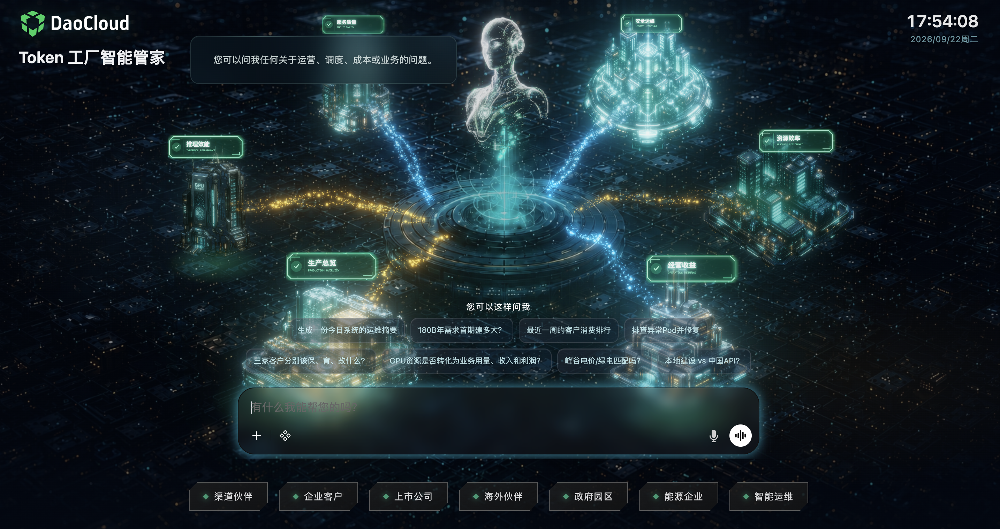

# 安装

本页说明离线和在线安装 Copilot 智能工作台的两种方式。Chart 名称为 `copilot`，发布在 Helm 仓库 `https://release.daocloud.io/chartrepo/agentclaw`。

!!! info

    安装器 v0.45.0 及以上支持安装 Copilot，包括 GitOps 安装和 ExistingSecret。下文说明使用该 Helm Chart 单独安装的步骤。支持的 Kubernetes 版本见 [兼容性](./compatibility.md)。

## 安装参数 {#parameters}

| 项 | 值 |
| -- | -- |
| Chart | `copilot` |
| Helm 仓库 | `https://release.daocloud.io/chartrepo/agentclaw` |
| Release 名称 | `tokenfactory-copilot` |
| 命名空间 | `copilot-system` |
| Deployment / Service | `tokenfactory-copilot` |
| 示例 Chart 版本 | `0.3.0-rc2` |

下文命令使用 Chart `0.3.0-rc2`。安装前执行 `helm search repo agentclaw/copilot --versions --devel`。不带 `--devel` 时，搜索结果不包含 `0.3.0-rc2` 这类预发布版本。把命令和离线导出配置里的版本换成要安装的版本。仓库发布不带 `-rc` 的更高版本后，把下文示例里的 `0.3.0-rc2` 换成该稳定版。三个运行镜像的 tag 为 `v` 加上 Chart 版本，例如 Chart `0.3.0-rc2` 对应 `v0.3.0-rc2`，并且必须一起更换：

- `release.daocloud.io/agentclaw/deepseek-harness:v0.3.0-rc2`
- `release.daocloud.io/agentclaw/copilot-skills:v0.3.0-rc2`
- `release.daocloud.io/agentclaw/copilot-bigscreen:v0.3.0-rc2`

不要只更换其中一个镜像。

### 前置条件 {#prerequisites}

1. 集群 Kubernetes 版本见 [兼容性](./compatibility.md)。

2. 默认通过平台子路径发布入口，集群中需要有 ghippo。`global.gproduct.positionType` 默认为 `header-action`，需要 ghippo v0.48.1 及以上。更早的 ghippo 请改为 `normal`：

    ```yaml
    global:
      gproduct:
        positionType: normal
    ```

3. Chart 默认创建 NetworkPolicy，只允许命名空间 `istio-system` 访问工作负载。平台网关不在该命名空间时，把 `networkPolicy.ingressNamespace` 改成网关所在命名空间，或把 `networkPolicy.enabled` 设为 `false`。

4. 准备模型 API Key。推荐先写入 Secret，不要把密钥放进 Helm values。安装 Chart 之前执行：

    ```shell
    kubectl create namespace copilot-system
    kubectl -n copilot-system create secret generic tokenfactory-copilot-credentials \
      --from-literal=OPENAI_API_KEY='<api-key>'
    ```

    默认模型地址是 `https://api.deepseek.com`，模型 ID 是 `deepseek-flash`。使用该地址时，联网搜索复用同一个 `OPENAI_API_KEY`。改用其他模型地址时，搜索仍请求 DeepSeek 官方接口，需要在同一个 Secret 中增加 `DEEPSEEK_API_KEY`。

5. 把 `dsh.entrypoint` 设为浏览器访问平台时使用的地址。只包含 scheme 和 host，不含路径，例如 `https://platform.example.com`。设置之后，代理只接受来自该地址的浏览器请求，其他来源返回 403。留空时，请求的 `Origin` 必须与 `Host` 一致。

安装时需要填写：

| 参数 | 示例 | 说明 |
| -- | -- | -- |
| `dsh.model.existingSecretRef` | `tokenfactory-copilot-credentials` | 含有 `OPENAI_API_KEY` 的 Secret，优先于内联密钥 |
| `dsh.entrypoint` | `https://platform.example.com` | 平台地址，scheme 加 host |

直接设置 `dsh.model.apiKey` 也可以启动。密钥会保存在 Helm release 中，不推荐这种做法。

## 离线安装

在线安装使用的 Chart 仓库是 `https://release.daocloud.io/chartrepo/agentclaw`，可以匿名读取。下载中心尚未提供 Copilot 离线包。在可以访问该仓库的机器上用 charts-syncer 导出离线包，再拷到目标环境加载。下载中心发布离线包后，改用下载中心的离线包，后面的加载步骤相同。

### 导出离线包

`agentclaw` 仓库里还有其他 Chart。导出时只选择 `copilot`，避免把无关镜像打进离线包。

1. 创建 `save-bundles.yaml`。

    ```yaml title="save-bundles.yaml"
    relocateContainerImages: true
    source:
      repo:
        kind: HARBOR
        url: https://release.daocloud.io/chartrepo/agentclaw
    target:
      intermediateBundlesPath: copilot-offline
    charts:
      - name: copilot
        versions:
          - 0.3.0-rc2
    ```

    拉取镜像如果需要登录，在 `source.containers.auth` 中填写仓库地址、用户名和密码。把 `0.3.0-rc2` 换成要导出的 Chart 版本。

2. 导出离线包。

    ```shell
    charts-syncer sync --config save-bundles.yaml
    ```

    将 `copilot-offline` 目录中的离线包拷到目标环境。该离线包是下一步的输入，不要直接用它执行 `helm install`。

### 从离线包中加载镜像和 Chart

环境中有镜像仓库时，用 charts-syncer 同步。没有 Chart 仓库、且离线包内含 `images.tar` 时，再在节点上用 Docker 或 containerd 加载。

#### charts-syncer 同步到镜像仓库

1. 创建 `load-image.yaml`。

    !!! note

        下列地址、用户名和密码都要换成目标仓库的值。`intermediateBundlesPath` 是执行 charts-syncer 命令时的相对路径。

    === "已安装 Chart 仓库"

        ```yaml title="load-image.yaml"
        source:
          intermediateBundlesPath: copilot-offline # (1)!
        target:
          containerRegistry: 10.16.10.111 # (2)!
          containerRepository: release.daocloud.io/agentclaw # (3)!
          repo:
            kind: HARBOR
            url: http://10.16.10.111/chartrepo/release.daocloud.io # (4)!
            auth:
              username: "admin" # (5)!
              password: "Harbor12345" # (6)!
          containers:
            auth:
              username: "admin" # (7)!
              password: "Harbor12345" # (8)!
        ```

        1. 执行 charts-syncer 命令时的相对路径
        2. 目标镜像仓库地址
        3. 目标镜像仓库中的项目路径
        4. 目标 Chart 仓库地址
        5. Chart 仓库用户名
        6. Chart 仓库密码
        7. 镜像仓库用户名
        8. 镜像仓库密码

    === "未安装 Chart 仓库"

        ```yaml title="load-image.yaml"
        source:
          intermediateBundlesPath: copilot-offline # (1)!
        target:
          containerRegistry: 10.16.10.111 # (2)!
          containerRepository: release.daocloud.io/agentclaw # (3)!
          repo:
            kind: LOCAL
            path: ./local-repo # (4)!
          containers:
            auth:
              username: "admin" # (5)!
              password: "Harbor12345" # (6)!
        ```

        1. 执行 charts-syncer 命令时的相对路径
        2. 目标镜像仓库地址
        3. 目标镜像仓库中的项目路径
        4. Chart 包输出目录
        5. 镜像仓库用户名
        6. 镜像仓库密码

2. 同步镜像和 Chart。

    ```shell
    charts-syncer sync --config load-image.yaml
    ```

    charts-syncer 会改写 Chart 中的镜像地址。安装这份改写后的 Chart 时，不要再覆盖镜像仓库参数。

#### Docker 或 containerd 直接加载

离线包解压后如果包含 `images.tar`（通常同时有 `hints.yaml` 和 `original-chart`），可以在每个节点上加载。charts-syncer 导出的 intermediate bundle 请按上一节同步到仓库，不要在这里直接加载。

1. 解压离线包。

    ```shell
    tar xvf <offline-package>.tar
    ```

2. 加载镜像。

    === "Docker"

        ```shell
        docker load -i images.tar
        ```

    === "containerd"

        ```shell
        ctr -n k8s.io image import images.tar
        ```

!!! note

    每个节点都要加载。加载后按安装时使用的仓库地址重新 tag。自行 tag 时，`image.registry`、`copilotArtifacts.skillsImage.registry` 和 `copilotArtifacts.bigscreenImage.registry` 要与 tag 后的地址一致。默认值是 `release.daocloud.io/agentclaw`，其中已经包含仓库项目路径。

### 离线安装步骤

先完成[前置条件](#prerequisites)中的 Secret，再安装 Chart。

#### 通过 Kpanda UI 安装

在 **Helm 应用** 中刷新离线仓库，找到 Chart `copilot`。Release 名称填 `tokenfactory-copilot`，命名空间填 `copilot-system`，并设置 `dsh.entrypoint` 和 `dsh.model.existingSecretRef`。

#### 通过 Helm 安装

把 `<chart>` 换成私有仓库中的 `copilot`，或 LOCAL 模式下输出目录里的 Chart 包。从仓库安装时带上 `--version`；安装本地 Chart 包时可以省略。

```bash
helm upgrade --install tokenfactory-copilot <chart> \
  --namespace copilot-system \
  --version 0.3.0-rc2 \
  --set-string dsh.entrypoint='https://<平台地址>' \
  --set-string dsh.model.existingSecretRef=tokenfactory-copilot-credentials
```

## 在线安装

!!! info

    在线安装的前置条件与[离线安装](#prerequisites)相同。

### 通过 Kpanda UI 安装

在 **Helm 应用** -> **Helm 仓库** 中添加仓库，地址为 `https://release.daocloud.io/chartrepo/agentclaw`。再到 **Helm 模板** 中找到 Chart `copilot` 并安装。Release 名称填 `tokenfactory-copilot`，命名空间填 `copilot-system`，并设置 `dsh.entrypoint` 和 `dsh.model.existingSecretRef`。

### 通过 Helm 安装

```bash
helm repo add agentclaw https://release.daocloud.io/chartrepo/agentclaw
helm repo update
helm search repo agentclaw/copilot --versions --devel

helm upgrade --install tokenfactory-copilot agentclaw/copilot \
  --namespace copilot-system \
  --version 0.3.0-rc2 \
  --set-string dsh.entrypoint='https://<平台地址>' \
  --set-string dsh.model.existingSecretRef=tokenfactory-copilot-credentials
```

把 `0.3.0-rc2` 换成 `helm search` 结果中要安装的版本。

## 访问

默认开启平台子路径。安装完成后，在浏览器打开 `https://<平台地址>/copilotui/`。平台导航会在新窗口打开该地址。



首次启动时，DeepSeek Harness 会在日志中打印一次性访问地址。查看时不要把其中的 token 贴到工单或聊天记录：

```shell
kubectl logs deploy/tokenfactory-copilot -n copilot-system | grep 'dsh web:'
```

!!! warning

    浏览器界面没有按用户隔离。能打开页面的人使用的是同一个智能体。默认 `dsh.permissionMode` 为 `danger-full-access`，智能体可以在 Pod 内执行命令。请收紧模型密钥和网络访问范围。Pod 不会挂载 ServiceAccount token。

## 可选配置

### CLI 凭据

查询业务数据时需要平台 CLI 凭据，建议使用只有查询权限的账号。Chart 把 `hosts.yml` 以只读方式挂载到 `$HOME/.config/dce/hosts.yml`。

在平台控制台的 **用户中心** -> **API Token** 创建 token 后，可以由 Chart 生成 Secret。生成结果里的 `user` 为 `admin`，`insecure` 为 `true`：

```yaml
dceAuth:
  enabled: true
  host: 10.6.216.82
  oauthToken: <token>
```

不把 token 写入 Helm values 时，改用已有 Secret。该方式优先于 `host` 和 `oauthToken`。

```shell
kubectl -n copilot-system create secret generic tokenfactory-dce-hosts \
  --from-file=hosts.yml="$HOME/.config/dce/hosts.yml"
```

```yaml
dceAuth:
  enabled: true
  existingSecretRef: tokenfactory-dce-hosts
```

`dceAuth` 是命令行查询凭据。平台子路径下，用户用平台账号登录页面由 `global.gproduct.proxy.dceLogin` 控制，默认开启，与 `dceAuth` 无关。`global.gproduct.proxy.authnCheck` 默认为 `false`；设为 `true` 时必须同时开启 `dceLogin`。

### 会话持久化

`persistence.enabled` 默认为 `false`，会话保存在 `emptyDir` 中，Pod 重建后丢失。需要保留会话时开启 PVC，默认 5Gi、`ReadWriteOnce`，挂载到 `/opt/data`。Deployment 使用 `Recreate`，避免两个 Pod 同时挂载同一个卷。

每次启动都会覆盖数据卷中的 `copilot-skills` 目录，不要把自定义文件放在该目录里。

### 独立域名

把 `global.gproduct.proxy.enabled` 设为 `false` 后，Copilot 使用 `dsh.entrypoint` 的根路径，并需要开启 Ingress。此模式没有 Ghippo 鉴权和平台账号登录，需要在网关层限制访问。

```bash
helm upgrade --install tokenfactory-copilot agentclaw/copilot \
  --namespace copilot-system \
  --version 0.3.0-rc2 \
  --set-string dsh.model.existingSecretRef=tokenfactory-copilot-credentials \
  --set global.gproduct.proxy.enabled=false \
  --set-string dsh.entrypoint='https://copilot.example.com' \
  --set ingress.enabled=true \
  --set-string ingress.className=nginx
```

## 升级

三个镜像 tag 必须一起更换。tag 为 `v` 加上 Chart 版本，例如 `v0.3.0-rc2`。涉及的字段是 `image.tag`、`copilotArtifacts.skillsImage.tag` 和 `copilotArtifacts.bigscreenImage.tag`。

推荐使用完整的 values 升级：

```bash
helm upgrade tokenfactory-copilot agentclaw/copilot \
  --namespace copilot-system \
  --version 0.3.0-rc2 \
  --reset-values \
  -f values.yaml
```

不写 `--version` 时，Helm 选择最新稳定版，不会选中带 `-rc` 的版本。`--version` 要与 values 中的镜像 tag 对应，tag 为 `v` 加上该 Chart 版本。

使用 `--reuse-values` 时要显式更新上述三个 tag。旧 Release 也不会带上 `global.gproduct.proxy.enabled=true` 这一默认值，仍按独立域名运行。需要平台子路径时，把 `global.gproduct.proxy.enabled` 设为 `true`。

从更早版本升级时：

- `copilotArtifacts.clisImage` 和 `copilotArtifacts.pluginsImage` 已经删除，可以从 values 中去掉。
- 模型密钥改为 `dsh.model.existingSecretRef` 或 `dsh.model.apiKey`。两个新参数都未设置时，仍读取旧的 `existingSecretRef` 和 `secrets.OPENAI_API_KEY`。设置其中任一新参数后，以新参数为准。
- v0.1.x 的 `hermes-agent.dceAuth` 在顶层 `dceAuth` 未设置 `host`、`oauthToken`、`existingSecretRef` 时仍然生效。设置其中任一顶层字段后，以顶层为准。

DSH 0.2.1 起，数据卷中 `$DSH_HOME/.credentials.yaml` 已经保存的 `OPENAI_API_KEY` 优先于 Secret。有人在界面里保存过该密钥时，轮换 Secret 不会生效，需要删掉该文件 `refs` 下的 `OPENAI_API_KEY` 一行，不用重启。检查时只看键名，不要输出密钥内容。
