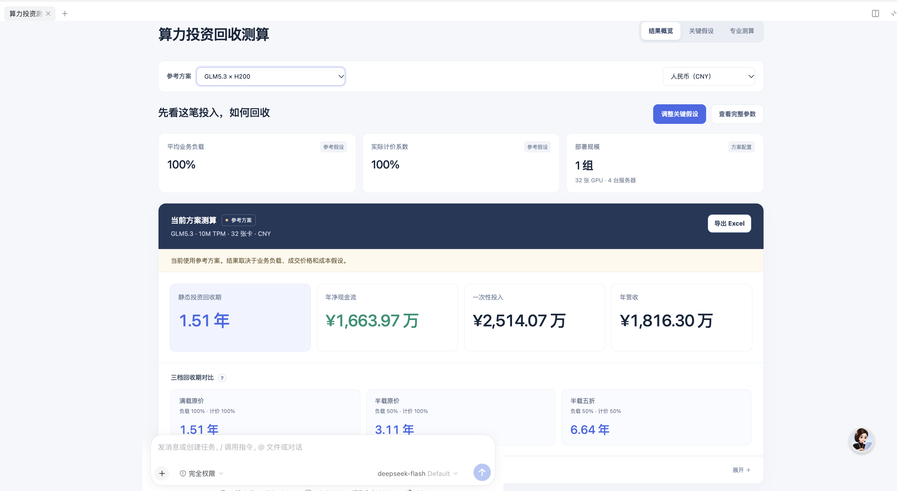
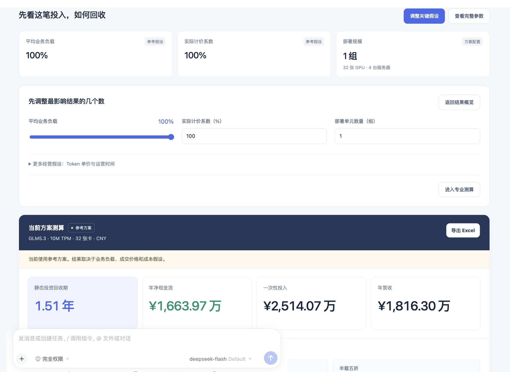
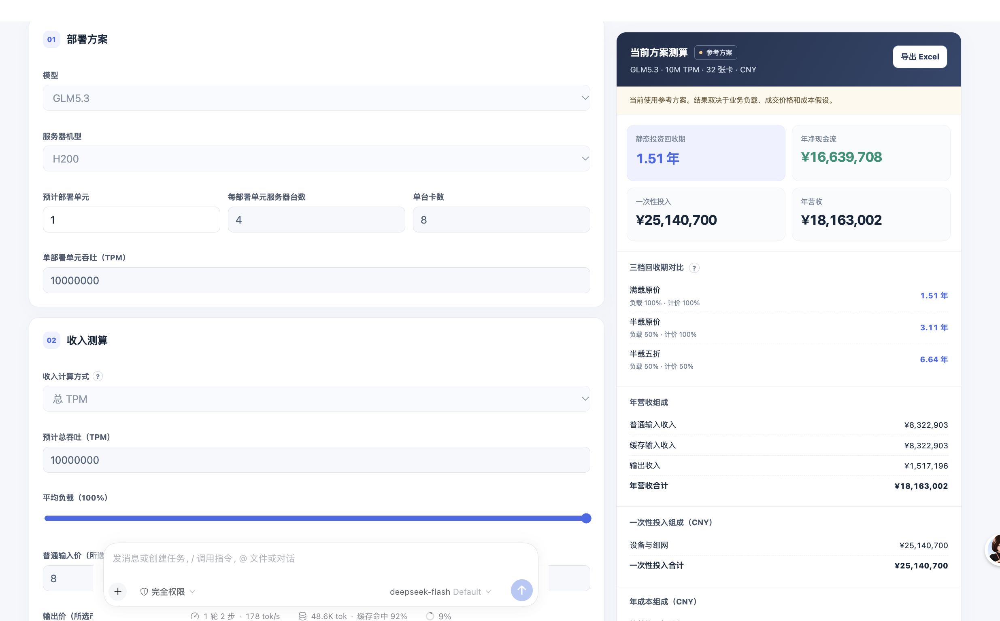

# 投资回收周期测算

投资回收周期测算是 [Copilot 智能工作台](./index.md) 面向算力投资规划提供的扩展能力。用户可以通过对话打开计算器，设置部署方案、业务负载、收入与成本条件，测算一次性投入、年营收、年净现金流和静态投资回收期。

计算器支持全程通过对话修改所有测算参数。Copilot 会将修改同步到表单并重新计算，用户也可以直接在界面中调整参数，比较不同经营条件下的回收周期。

## 通过对话开始测算

在 Copilot 中描述测算需求，例如：

> 帮我打开投资回收周期计算器。

也可以在提出需求时说明初始条件：

> 帮我测算算力项目的投资回收周期，先使用内置参考方案，按 50% 的平均业务负载计算。

Copilot 打开计算器后，可以选择参考方案，或根据实际项目自定义模型、服务器和测算参数。

计算器内置 GLM5.3 × H200、GLM5.2 × PPU（真武 M890）、Kimi-K3 × B200 三组参考方案，以实际验证的数据为基础，帮助用户快速开始测算。项目的经营条件和成本可以按需调整。

## 通过对话调整参数

测算过程中，可以继续向 Copilot 描述需要调整的条件，无需逐个查找表单字段。模型与服务器配置、部署规模、吞吐、业务负载、Token 单价、运营时间和费用项目等参数均可通过对话修改。

| 调整内容 | 对话示例 |
| --- | --- |
| 业务负载 | 将平均业务负载改为 50%。 |
| 计价条件 | 将实际计价系数调整为 80%。 |
| 部署规模 | 将部署单元数量调整为 2 组。 |
| 成本条件 | 将柜电费调整为每月 4 万元。 |
| 多项条件 | 将平均业务负载设为 50%，实际计价系数设为 80%，重新测算。 |

Copilot 会根据对话修改对应表单参数，重新计算并更新结果。调整后，可以查看当前参数与测算明细，继续修改条件或追问结果变化的原因。

例如：

> 现在的业务负载只有一半，回收周期发生了什么变化？

> 如果成交价格进一步下降，哪些成本对回收周期的影响更大？

## 查看测算结果

计算器提供 **结果概览** 、**关键假设** 和 **专业测算 ** 三个视图，分别用于查看结论、调整主要条件和核对完整参数。

### 结果概览

结果概览集中展示当前方案的主要条件和测算结果，便于快速了解投入与回收情况。

| 内容 | 说明 |
| --- | --- |
| 当前条件 | 平均业务负载、实际计价系数和部署规模 |
| 静态投资回收期 | 按当前收入与成本条件，预计收回一次性投入所需的年数 |
| 年净现金流 | 年营收扣除年度持续成本后的金额 |
| 一次性投入 | 按当前方案计入的设备、组网等一次性支出 |
| 年营收 | 按吞吐、业务负载、运营时间和计价条件折算的年度收入 |

页面同时提供三档经营情景，便于比较业务量和价格变化的影响：

| 情景 | 平均业务负载 | 实际计价系数 |
| --- | --- | --- |
| 满载原价 | 100% | 100% |
| 半载原价 | 50% | 100% |
| 半载五折 | 50% | 50% |

通过“调整关键假设”可以进入主要参数调整区域，通过“查看完整参数”可以进入专业测算视图。

### 关键假设

关键假设视图优先展示影响结果的主要参数，适合快速调整并观察回收周期变化。

- **平均业务负载**：用于将参考产能折算为预计业务量。
- **实际计价系数**：用于调整相对于基准 Token 单价的计价水平。
- **部署单元数量**：用于设置项目的部署规模。
- **更多经营假设**：展开后可调整 Token 单价与运营时间。

可以直接修改界面中的参数，也可以继续通过对话调整。完成后可返回结果概览，或进入专业测算查看详细配置。

### 专业测算

专业测算视图用于设置和核对部署、收入与成本条件，同时查看当前方案的结果及组成明细。

| 参数类别 | 主要内容 |
| --- | --- |
| 部署方案 | 模型、服务器机型、部署单元数量、服务器台数、单台卡数和吞吐 |
| 收入测算 | 收入计算方式、预计吞吐、业务负载、普通输入价、缓存输入价、输出价及运营时间 |
| 成本测算 | 成本模式、设备与组网、软件许可与服务、人工与设备运维、机房与水电、税费及其他费用 |

成本模式支持 **月租设备** 、 **自购设备，租机柜** 和 **买地建设** 。用户可以按项目实际情况调整费用，选择某项费用是否计入，或添加、删除费用字段。

结果区域展示年营收、一次性投入和年成本的组成，便于核对收入与支出的计算依据。所有测算参数均可通过对话修改，并同步反映在表单和结果中。

## 导出测算结果

确认当前方案和参数后，单击结果区域的 **导出 Excel ** ，导出测算结果，用于方案讨论、内部评审或后续整理。

## 测算口径

计算器以静态投资回收期衡量回收周期，采用以下关系：

> 年净现金流 = 年营收 − 年度持续成本
>
> 静态投资回收期（年）= 一次性投入 ÷ 年净现金流

年净现金流不为正时，按当前条件显示“不可回收”，不提供回收年数。

参考方案提供测算起点，最终结果取决于业务负载、实际计价、运营时间和成本设置。截图中的数值仅表示对应参数下的测算示例；使用时应结合项目实际条件调整，并核对费用是否完整计入。
