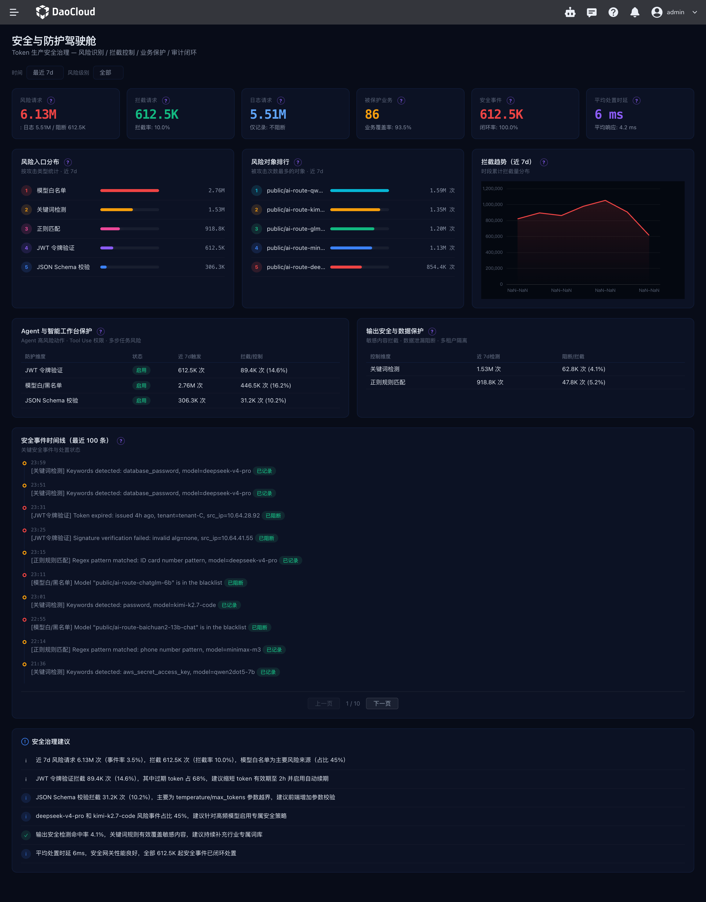

# 风险防护

风险防护页面主要面向安全运营人员，汇总 Token 服务的安全风险识别、请求拦截、防护策略状态和安全事件，帮助发现风险变化并跟进处置。

## 如何打开

1. 登录 Token 工厂控制台。
2. 在产品导航中打开 **驾驶舱**，选择 **风险防护** 菜单。

菜单是否显示取决于用户是否具有风险防护页面的查看权限。若菜单不可见，请联系管理员检查驾驶舱权限。

## 筛选数据

页面默认查看最近 **7 天**的数据。可选择最近 24 小时、7 天或 30 天，并可按风险级别筛选高风险、中风险或低风险；选择“全部”可查看所有级别。更改筛选后，页面各面板会重新查询对应时间范围和风险级别的数据。

安全事件时间线支持分页，每页显示 10 条，按时间倒序展示。切换筛选条件后，时间线会回到第一页。

## 页面指标

| 区域 | 说明 |
| --- | --- |
| 安全指标 | 展示风险请求数、拦截请求数、仅记录审计日志的请求数、已启用防护策略的集群覆盖情况、安全事件数和平均处置时延。 |
| 风险入口分布 | 按攻击或风险类型统计所选范围内的风险请求数量。 |
| 风险对象排行 | 排出遭受风险请求次数较多的模型或业务对象。 |
| 拦截趋势 | 查看安全策略在所选时间范围内拦截风险请求的变化。选择近 24 小时时按小时展示，选择更长周期时查看时段累计分布。 |
| Agent 与智能工作台保护 | 查看 Agent 高风险动作、工具调用权限和多步任务等防护维度的状态、触发次数及拦截或控制情况。 |
| 输出安全与数据保护 | 查看模型输出安全、敏感数据保护和租户隔离等控制维度的检测与拦截情况。 |
| 安全事件时间线 | 查看事件发生时间、风险级别、事件说明和处置状态，并通过分页浏览记录。 |
| 安全治理建议 | 查看根据安全数据生成的治理建议。 |

页面上方的时间范围与风险级别筛选适用于各统计面板和事件列表。被保护业务指标展示至少启用一项安全防护策略的集群覆盖情况；点击指标旁的说明可查看其统计定义。

## 数据状态说明

各面板独立加载和报错，单个面板异常时其他已成功加载的数据仍可查看。没有符合筛选条件的事件或风险记录时，排行、趋势或时间线可能为空。若多个面板持续没有数据，请检查上游安全防护策略和 Hydra 安全事件数据是否已接入。

## 相关文档

- [什么是驾驶舱](../intro/index.md)
- [经营概览面板](./singlepage.md)
