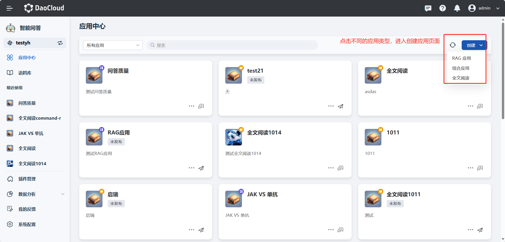
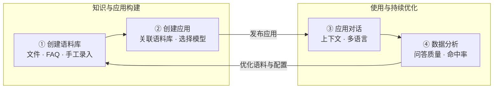

---
hide:
  - toc
---

# 什么是 AI 应用

d.run 智能问答（AI 应用）是基于 **RAG（Retrieval-Augmented Generation，检索增强生成）** 技术的智能对话产品。
它会先将您的专属语料库进行 **向量化处理**，并通过 **相似度搜索** 精准检索与问题相关的内容，再由
**大语言模型（LLM）** 生成自然流畅的答案。这种方式不仅显著减少了模型的“幻觉”现象，还能在保障
**隐私数据安全** 的同时，为您提供更精准、更个性化的回复。

无论是在线客服、知识管理，还是内部知识检索，d.run 智能问答都能帮助您快速构建 **高效、可信、可控** 的 AI 知识服务体系。

## 核心能力

- :material-application-brackets-outline:{ .lg .middle } __应用与插件__

    ---

    创建并管理智能问答应用的全生命周期，支持关联语料库、应用密钥、链接分享，并可开发分片插件扩展语料处理能力。

    [:arrow_forward: 创建应用](user-guide/app-center/create-app.md)

- :material-library-outline:{ .lg .middle } __语料库管理__

    ---

    支持文件导入、格式化导入、手工录入、图文导入等多种方式构建专属语料库，按分隔符或大小智能分片，并可设置访问级别保障数据安全与隔离。

    [:arrow_forward: 创建语料库](user-guide/corpus/create-corpus.md)

- :material-chat-processing-outline:{ .lg .middle } __智能对话__

    ---

    上下文感知的智能问答，支持评价、复制、重新生成、翻译与多语言回答，并支持组合应用进行意图识别。

    [:arrow_forward: 应用对话说明](user-guide/app-center/conversation.md)

- :material-cog-outline:{ .lg .middle } __系统配置__

    ---

    集中管理模型服务、检索策略等平台级配置，优化 AI 回答质量。

    [:arrow_forward: 系统配置](user-guide/system-config.md)

- :material-chart-box-outline:{ .lg .middle } __数据分析__

    ---

    通过问答次数、问答质量、分片命中率、分片质量等指标洞察应用运行状况，持续改进语料与问答质量。

    [:arrow_forward: 查看问答质量](data-analysis/qa-quality.md)

- :material-message-draw:{ .lg .middle } __我的反馈__

    ---

    在使用过程中随时提交评价与改进意见，帮助产品持续打磨体验。

    [:arrow_forward: 提交反馈](my-feedback/my-feedback.md)

## 使用流程

d.run 智能问答的使用分为 **知识与应用构建** 与 **使用与持续优化** 两个阶段：先导入专属语料并创建应用，应用发布后即可对外提供智能问答服务，再通过数据分析与用户反馈不断优化语料与应用配置。

| 步骤 | 角色 | 说明 |
| --- | --- | --- |
| [① 创建语料库](user-guide/corpus/create-corpus.md) | 知识管理员 | 通过文件导入、格式化导入、手工录入、图文导入等方式构建专属语料库 |
| [② 创建应用](user-guide/app-center/create-app.md) | 应用管理员 | 创建应用并关联语料库、选择模型服务，支持应用密钥与链接分享 |
| [③ 应用对话](user-guide/app-center/conversation.md) | 业务用户 | 在对话窗口提问，支持上下文、重新生成、翻译与多语言回答 |
| [④ 数据分析](data-analysis/qa-quality.md) | 应用管理员 | 通过问答质量、分片命中率等指标持续优化语料与应用配置 |

## 快速上手

  <a class="dak-path-step" style="--path-c:#2196f3" href="user-guide/corpus/create-corpus/">
    1
    创建语料库
    导入文档 · FAQ · 手工录入
    Go →
  </a>
  <a class="dak-path-step" style="--path-c:#00acc1" href="user-guide/app-center/create-app/">
    2
    创建应用
    关联语料库 · 选择模型
    Go →
  </a>
  <a class="dak-path-step" style="--path-c:#43a047" href="user-guide/app-center/conversation/">
    3
    应用对话
    上下文问答 · 多语言
    Go →
  </a>
  <a class="dak-path-step" style="--path-c:#fb8c00" href="my-feedback/my-feedback/">
    4
    我的反馈
    提交评价与改进意见
    Go →
  </a>
  <a class="dak-path-step" style="--path-c:#8e24aa" href="data-analysis/qa-quality/">
    5
    数据分析
    问答质量 · 命中率
    Go →
  </a>

## 更多资源

- :material-format-list-bulleted:{ .lg .middle } __功能特性__

    ---

    一览智能问答在对话功能、应用中心与语料库管理上的完整功能清单。

    [:arrow_forward: 查看功能特性](features.md)

- :material-puzzle-outline:{ .lg .middle } __分片插件__

    ---

    了解分片插件的实现原理与集成方式，自定义语料分片逻辑。

    [:arrow_forward: 查看分片插件指南](user-guide/plugins/create-plugin.md)

- :material-comment-quote-outline:{ .lg .middle } __改进意见__

    ---

    查看用户反馈与改进建议的汇总分析，了解产品优化方向。

    [:arrow_forward: 查看改进意见](data-analysis/suggestions.md)

[下载中心](https://docs.daocloud.io/download/){ .md-button .md-button--primary }
[了解 Token 工厂效能平台](https://docs.daocloud.io/tf/){ .md-button .md-button--primary }
[了解 d.run AI 操作系统](https://docs.daocloud.io/drun/){ .md-button .md-button--primary }
[查看 AI 应用手册 PDF](https://harbor-test2.cn-sh2.ufileos.com/docs/download/docs/dak.pdf){ .md-button .md-button--primary }
