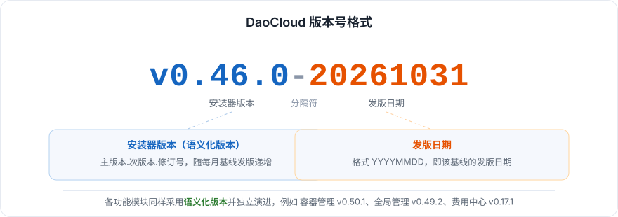

---
hide:
  - toc
---

# 版本发布说明

DaoCloud 采用统一的模块化版本基线，此处的 Release Notes 同时适用于所有产品线：

| 产品线 | 定位 |
| :--- | :--- |
| d.run Token 工厂效能平台 | Token 生产和运营平台 |
| d.run AI 操作系统 | AI 操作系统 |
| DaoCloud Enterprise (DCE) | 企业级云原生操作系统 |

自 2023 年 5 月起，产品线通常每个月汇总发布一次版本。每个版本发布页说明该版本包含的功能模块、新增特性、优化与缺陷修复，并附各模块自己的 Release Notes 链接。

产品线各模块采用[语义化版本](https://semver.org/lang/zh-CN/)，版本发布页的版本号格式为 `v<安装器版本>-<发版日期>`：

产品线的汇总 Release Notes 仅简单说明各模块的版本变更、重大变化等；具体每个模块的功能细节、配置方法与完整变更清单，请查看对应模块的 Release Notes。

## 模块乐高式自由搭配

三条产品线均由各类功能模块组合而成，每个模块独立解耦、独立发版：

- 各产品线可按乐高积木的方式自由搭配：按需选装模块、独立升级，模块版本无需与安装器基线同步。
- 每个版本默认包含的模块组合由安装器决定；如需独立升级或替换某个模块，参阅 [DaoCloud 下载站](../../download/index.md#_3)和各个模块的安装/升级说明。

[下载中心](https://docs.daocloud.io/download/){ .md-button }
[了解 Token 工厂效能平台](https://docs.daocloud.io/tf/){ .md-button }
[了解 d.run AI 操作系统](https://docs.daocloud.io/drun/){ .md-button }
