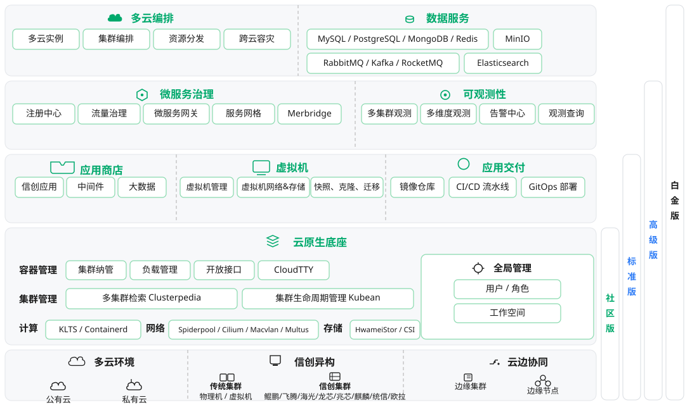

---
hide:
  - toc
---

# DaoCloud Enterprise 文档导航

DaoCloud Enterprise (DCE) 以 K8s 作为开发底座，提供了高度可扩展、强大灵活的各项生产级功能，使得企业能够轻松构建和管理分布式应用。
借助 DCE 的云原生天赋，企业可以充分利用云上云下优势，实现资源的最优利用，提高 IT 系统的可靠性和弹性，极大地加速应用的交付速度。

  

    
云原生底座

    

      <a class="tf-arch-card tf-arch-card--compute" href="../middleware/">
        中间件
        数据库与消息队列
      </a>
      <a class="tf-arch-card tf-arch-card--compute" href="../kairship/intro/">
        多云编排
        多云与混合云编排
      </a>
      <a class="tf-arch-card tf-arch-card--compute" href="../kangaroo/intro/">
        镜像仓库
        镜像托管与集成
      </a>
      <a class="tf-arch-card tf-arch-card--compute" href="../mspider/intro/">
        服务网格
        非侵入式服务治理
      </a>
      <a class="tf-arch-card tf-arch-card--compute" href="../skoala/intro/">
        微服务引擎
        微服务治理与网关
      </a>
      <a class="tf-arch-card tf-arch-card--compute" href="../amamba/intro/">
        应用工作台
        CI/CD 与应用交付
      </a>
      <a class="tf-arch-card tf-arch-card--compute" href="../kpanda/intro/">
        容器管理
        集群与工作负载管理
      </a>
      <a class="tf-arch-card tf-arch-card--compute" href="../virtnest/intro/">
        虚拟机
        KubeVirt 虚拟机管理
      </a>
      <a class="tf-arch-card tf-arch-card--compute" href="../topohub/intro/">
        设备管理
        硬件设备统一纳管
      </a>
      <a class="tf-arch-card tf-arch-card--compute" href="../kant/intro/">
        云边协同
        边缘节点纳管与协同
      </a>
      <a class="tf-arch-card tf-arch-card--compute" href="../network/intro/">
        云原生网络
        多 CNI 融合网络
      </a>
      <a class="tf-arch-card tf-arch-card--compute" href="../storage/">
        云原生存储
        容器化存储与 CSI
      </a>
    

  

  
▲

  

    
运维管理

    

      <a class="tf-arch-card tf-arch-card--ops" href="../insight/intro/">
        可观测性
        指标日志链路观测
      </a>
      <a class="tf-arch-card tf-arch-card--ops" href="../ghippo/intro/">
        全局管理
        用户权限与平台设置
      </a>
    

  

## 产品架构

## 安装和教程

- :fontawesome-solid-jet-fighter-up:{ .lg .middle } __安装__

    ---

    DCE 支持[离线](../install/community/k8s/offline.md)和[在线](../install/community/k8s/online.md)两种安装方式，
    可以安装到[不同的 Linux 发行版上](../install/os-install/uos-v20-install-dce5.0.md)。

    - [安装依赖项](../install/install-tools.md)
    - [安装社区版](../install/community/resources.md)
    - [安装商业版](../install/commercial/deploy-requirements.md)
    - [安装到各种 Linux 发行版](../install/os-install/uos-v20-install-dce5.0.md)
    - [安装到不同 K8s 版本](../install/k8s-install/ocp-install-dce5.0.md)

- :material-microsoft-azure-devops:{ .lg .middle } __视频教程__

    ---

    我们为 DCE 的各个模块和场景制作了精良的[视频教程](../videos/index.md)。

    - [场景化视频](../videos/use-cases.md)
    - [应用工作台视频](../videos/amamba.md)
    - [容器管理视频](../videos/kpanda.md)
    - [微服务视频](../videos/skoala.md)
    - [中间件视频](../videos/mcamel.md)
    - [全局管理视频](../videos/ghippo.md)

## 学习路径

  <a class="dce-path-step" style="--path-c:#2196f3" href="../install/">
    1
    部署平台
    离线或在线安装 DCE 5.0
    前往 →
  </a>
  <a class="dce-path-step" style="--path-c:#00acc1" href="../kpanda/intro/">
    2
    管理集群
    接入集群，统一容器编排调度
    前往 →
  </a>
  <a class="dce-path-step" style="--path-c:#43a047" href="../amamba/intro/">
    3
    交付应用
    流水线与 GitOps 持续交付
    前往 →
  </a>
  <a class="dce-path-step" style="--path-c:#fb8c00" href="../insight/intro/">
    4
    观测系统
    指标、日志、链路统一观测
    前往 →
  </a>
  <a class="dce-path-step" style="--path-c:#8e24aa" href="../ghippo/intro/">
    5
    管控平台
    用户权限与全局安全治理
    前往 →
  </a>

[申请社区免费体验](./license0.md){ .md-button }
[最佳实践](./bphome.md){ .md-button }
[常见问题](./faq.md){ .md-button }
[查阅 DaoCloud Enterprise 彩页](https://harbor-test2.cn-sh2.ufileos.com/docs/download/dce.pdf){ .md-button }
