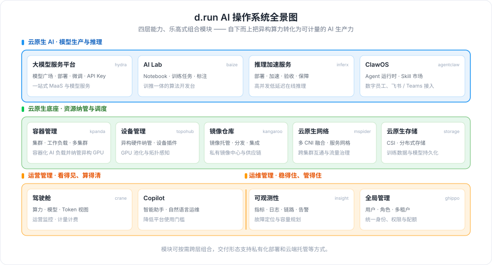

---
hide:
  - toc
---

# d.run AI 操作系统

d.run 依托全球前三的 Kubernetes 调度技术与 vLLM 等主流开源推理引擎核心贡献积淀，统一纳管多元异构算力，
实现颗粒化调度、全栈推理优化与全链路 Token 治理，算力利用率超 80%，将算力高效转化为可管可控的 Token 化 AI 生产力；
平台汇聚全球主流大模型生态，配备可视化运营驾驶舱与 d.run Copilot 智能助手，面向企业全部门输出稳定高效的 AI 服务，
全方位支撑业务智能化长期升级。
[查看/下载 d.run AI 操作系统彩页](https://harbor-test2.cn-sh2.ufileos.com/docs/download/drun.pdf){ .md-button }

  

    
云原生 AI

    

      <a class="tf-arch-card tf-arch-card--model" href="hydra/">
        大模型服务平台
        模型部署与运维管理
      </a>
      <a class="tf-arch-card tf-arch-card--model" href="baize/intro/">
        AI Lab
        云原生训推一体化
      </a>
      <a class="tf-arch-card tf-arch-card--model" href="inferx/">
        推理加速
        推理加速与引擎管理
      </a>
      <a class="tf-arch-card tf-arch-card--model" href="clawos/intro/">
        ClawOS
        多智能体运行与治理
      </a>
    

  

  
▲

  

    
云原生底座

    

      <a class="tf-arch-card tf-arch-card--compute" href="kpanda/intro/">
        容器管理
        集群与工作负载管理
      </a>
      <a class="tf-arch-card tf-arch-card--compute" href="kangaroo/intro/">
        镜像仓库
        镜像托管与集成
      </a>
      <a class="tf-arch-card tf-arch-card--compute" href="topohub/intro/">
        设备管理
        硬件设备统一纳管
      </a>
      <a class="tf-arch-card tf-arch-card--compute" href="network/intro/">
        云原生网络
        多 CNI 融合网络
      </a>
      <a class="tf-arch-card tf-arch-card--compute" href="storage/">
        云原生存储
        容器化存储与 CSI
      </a>
    

  

  
▲

  

    
运营管理

    

      <a class="tf-arch-card tf-arch-card--ops" href="copilot/">
        Copilot
        智能运维助手
      </a>
      <a class="tf-arch-card tf-arch-card--ops" href="crane/intro/">
        驾驶舱
        运营数据可视化
      </a>
    

  

  
▲

  

    
运维管理

    

      <a class="tf-arch-card tf-arch-card--ops" href="insight/intro/">
        可观测性
        指标日志链路观测
      </a>
      <a class="tf-arch-card tf-arch-card--ops" href="ghippo/intro/">
        全局管理
        用户权限与平台设置
      </a>
    

  

作为面向企业输出的 AI 操作系统，d.run 将算力调度、大模型推理与运营治理融为一体。
平台统一纳管英伟达及国产异构算力，依靠颗粒化调度与全栈推理优化，把分散 GPU 算力转化为低成本、高稳定的 Token 服务；
配备可视化运营驾驶舱，实时呈现算力消耗、模型调用与 Token 产出全链路数据；
内置 d.run Copilot 智能助手，降低企业全部门使用 AI 的门槛，推动业务智能化长期升级。

## 学习路径

  <a class="drun-path-step" style="--path-c:#2196f3" href="install/">
    1
    部署平台
    离线安装 d.run AI 操作系统
    前往 →
  </a>
  <a class="drun-path-step" style="--path-c:#00acc1" href="kpanda/intro/">
    2
    纳管算力
    接入集群，纳管异构 GPU 算力
    前往 →
  </a>
  <a class="drun-path-step" style="--path-c:#43a047" href="hydra/">
    3
    部署模型
    模型广场选型，一键部署推理服务
    前往 →
  </a>
  <a class="drun-path-step" style="--path-c:#fb8c00" href="clawos/intro/">
    4
    部署智能体
    编排多智能体，落地业务场景
    前往 →
  </a>
  <a class="drun-path-step" style="--path-c:#8e24aa" href="crane/intro/">
    5
    运营洞察
    驾驶舱看全链路 Token 运营
    前往 →
  </a>

[下载 d.run AI 操作系统离线包](https://docs.daocloud.io/download/drun/){ .md-button }
[查阅 d.run AI 操作系统彩页](https://harbor-test2.cn-sh2.ufileos.com/docs/download/drun.pdf){ .md-button }
[安装 d.run AI 操作系统](install/index.md){ .md-button }
