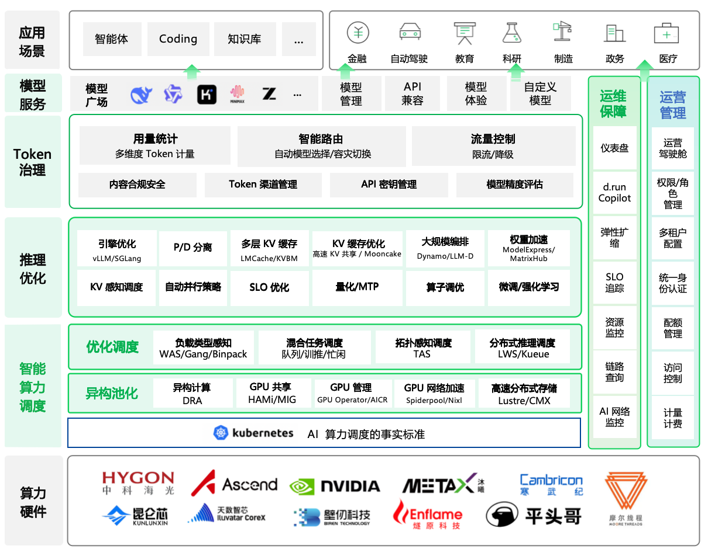

# 功能和优势

d.run AI 操作系统是面向企业的 AI 基础设施与服务平台，连接算力、模型和应用。平台基于云原生底座，提供异构算力管理、AI 开发与训练、模型部署与推理、智能体运行以及运营运维等能力，帮助企业将基础资源转化为可使用、可管理的 AI 服务。

## 功能特性

### 异构算力管理与资源调度

- **集群与设备管理**：接入和管理集群与工作负载，并通过设备管理统一查看和管理服务器、交换机等基础设施，帮助运维人员掌握资源分布。
- **资源池与调度**：通过 AI Lab 创建资源池，组织集群中的 CPU、内存和异构 GPU 资源；通过队列关联工作空间，为开发、训练和推理任务统筹分配资源。
- **网络与存储**：通过云原生网络连接容器化工作负载，并通过容器存储对接不同存储资源，为数据集、模型文件和应用提供数据访问能力。

了解[容器管理](kpanda/intro/index.md)、[AI Lab](baize/intro/index.md)和[设备管理](topohub/intro/index.md)。

### AI 开发与模型训练

- **数据准备**：管理训练代码、训练数据和输出数据集，支持多数据源接入与数据预热，为开发和训练任务准备数据。
- **模型开发**：使用 JupyterLab 或 CodeServer 等 Notebook 环境编写和调试代码，按需挂载资源与数据集，并支持自定义环境镜像。
- **训练任务**：提交单机或分布式训练任务，支持 PyTorch、TensorFlow、PaddlePaddle 和 MPI 等框架；通过资源池与队列分配资源，并使用 TensorBoard 分析任务。
- **模型服务**：将模型通过 Triton 或 vLLM 部署为推理服务，衔接模型开发、训练与服务部署。

了解 [AI Lab](baize/intro/index.md) 和[开发控制台快速入门](baize/developer/quick-start.md)。

### 模型部署与推理优化

- **模型选择与部署**：通过模型广场浏览和体验模型，选择模型及部署配置创建推理服务；管理员可统一管理模型上架与部署配置。
- **分布式推理**：支持多机多卡部署，并兼容多种异构 GPU，为资源需求较大的模型提供推理环境。
- **推理优化与监测**：支持 vLLM、SGLang 等推理后端；推理加速服务提供 PD 分离、KV Cache 卸载等优化，以及上线前性能评估和上线后运行监测能力。

了解[大模型服务平台](hydra/intro/index.md)和[推理加速服务](inferx/index.md)。

### 模型服务与 Token 治理

- **模型接入与调用**：提供模型接入和统一调用入口，应用可以通过兼容 OpenAI 的 API 使用模型服务，便于将模型能力集成到业务系统中。
- **访问控制**：通过 API Key 验证模型服务调用身份，并为 API Key 配置 IP 地址或网段白名单及可访问的模型范围，限制调用来源和模型访问权限。
- **限额与限流**：支持为 API Key 和工作空间设置 Token 配额，管理调用用量；支持按 API Key 或工作空间配置时间窗口内的请求次数限制，也支持基于 Token 的限流，辅助控制流量并保障服务稳定性。
- **智能路由**：应用使用 `model=auto` 发起请求后，平台可根据时间、请求长度或其他规则选择目标模型；未命中规则时使用兜底模型，帮助不同请求匹配合适的模型服务。
- **内容安全与审计**：通过网关安全策略检测模型请求和响应中的敏感词或风险模式，按配置执行阻断、记录日志或脱敏等操作；还可配置模型白名单或黑名单，并通过安全审计日志追溯策略触发记录。
- **用量统计**：按 API Key、模型和时间等维度查看调用量及输入、输出 Token 用量，为服务使用分析和资源规划提供依据。

了解[大模型服务平台](hydra/intro/index.md)、[API Key 管理](hydra/apikey.md)、[MaaS 模型管理](hydra/oam/maas.md)、[智能路由](hydra/oam/auto-route.md)和[用量统计](hydra/usage.md)。

### 智能体运行与治理

- **实例管理**：在工作空间中创建和管理受支持的 OpenClaw 实例，查看运行记录、调用量、Token 用量及错误率等信息。
- **Skill 与网络管理**：通过 Skill 市场和管理能力组织智能体技能，并配置网络策略，管理实例的网络访问范围。
- **协作工具集成**：支持与飞书和 Microsoft Teams 集成，使业务人员能够通过协作工具使用智能体，开展知识问答、文档处理和开发辅助等工作。

了解 [ClawOS](clawos/intro/index.md)。

### 运营、运维与安全管理

- **运营洞察**：通过驾驶舱汇聚算力产能、Token 产出和生产健康等数据；在企业模式下查看组织用量与部门配额，辅助资源规划。
- **可观测性**：通过指标、日志、链路和告警等能力观察平台与工作负载，辅助发现异常、分析运行状态和定位问题。
- **权限与审计**：管理用户、工作空间和访问权限，并通过审计记录查看关键操作，支持团队协作和操作追溯。
- **智能交互**：通过 Copilot 自然语言交互入口查询资源与服务状态、分析运行情况，并在权限范围内辅助执行任务。

了解[驾驶舱](crane/intro/index.md)、[可观测性](insight/intro/index.md)、[全局管理](ghippo/intro/index.md)和 [Copilot](copilot/index.md)。

## 产品优势

- **统一异构算力，支撑多团队共享**：集中管理不同集群和异构 GPU 资源，通过资源池与队列为开发、训练和推理任务分配资源，减少分散建设和闲置资源带来的管理负担。
- **优化推理链路，提升服务承载能力**：结合推理引擎、分布式推理和缓存等优化能力，针对不同模型与业务负载进行评估和调优，在吞吐、延迟和资源使用之间寻求平衡。
- **统一模型服务，降低业务接入门槛**：通过模型广场、部署配置和兼容 API，帮助企业将开源模型及自有模型转化为可调用的服务，为多个业务团队提供统一入口。
- **治理调用与用量，增强安全可控性**：通过访问权限、限额限流、内容安全、用量统计与审计等能力，帮助企业管理模型服务的调用和使用情况。
- **贯通运营与运维，支撑持续优化**：结合驾驶舱、可观测性和 Copilot，帮助管理人员了解算力与模型服务运行情况，辅助资源规划、异常排查和日常运营。

[了解典型应用场景](intro/scenarios.md)
