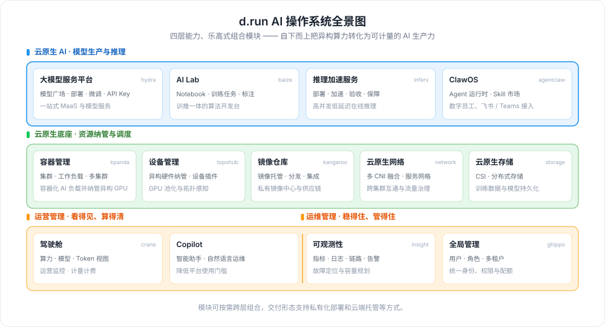

---
hide:
  - toc
---

# d.run AI 操作系统

d.run 依托全球前三的 Kubernetes 调度技术与 vLLM 等主流开源推理引擎核心贡献积淀，统一纳管多元异构算力，
实现颗粒化调度、全栈推理优化与全链路 Token 治理，算力利用率超 80%，将算力高效转化为可管可控的 Token 化 AI 生产力；
平台汇聚全球主流大模型生态，配备可视化运营驾驶舱与 d.run Copilot 智能助手，面向企业全部门输出稳定高效的 AI 服务，
全方位支撑业务智能化长期升级。

  

    
云原生 AI

    

      <a class="tf-arch-card tf-arch-card--model" href="hydra/intro/">
        大模型服务平台
        模型部署与运维管理
      </a>
      <a class="tf-arch-card tf-arch-card--model" href="baize/intro/">
        AI Lab
        云原生训推一体化
      </a>
      <a class="tf-arch-card tf-arch-card--model" href="inferx/">
        推理加速
        推理加速与引擎管理
      </a>
      <a class="tf-arch-card tf-arch-card--model" href="clawos/intro/">
        ClawOS
        多智能体运行与治理
      </a>
    

  

  
▲

  

    
云原生底座

    

      <a class="tf-arch-card tf-arch-card--compute" href="kpanda/intro/">
        容器管理
        集群与工作负载管理
      </a>
      <a class="tf-arch-card tf-arch-card--compute" href="kangaroo/intro/">
        镜像仓库
        镜像托管与集成
      </a>
      <a class="tf-arch-card tf-arch-card--compute" href="topohub/intro/">
        设备管理
        硬件设备统一纳管
      </a>
      <a class="tf-arch-card tf-arch-card--compute" href="network/intro/">
        云原生网络
        多 CNI 融合网络
      </a>
      <a class="tf-arch-card tf-arch-card--compute" href="storage/">
        云原生存储
        容器化存储与 CSI
      </a>
    

  

  
▲

  

    
运营管理

    

      <a class="tf-arch-card tf-arch-card--ops" href="copilot/">
        Copilot
        智能运维助手
      </a>
      <a class="tf-arch-card tf-arch-card--ops" href="crane/intro/">
        驾驶舱
        运营数据可视化
      </a>
    

  

  
▲

  

    
运维管理

    

      <a class="tf-arch-card tf-arch-card--ops" href="insight/intro/">
        可观测性
        指标日志链路观测
      </a>
      <a class="tf-arch-card tf-arch-card--ops" href="ghippo/intro/">
        全局管理
        用户权限与平台设置
      </a>
    

  

作为面向企业输出的 AI 操作系统，d.run 将算力调度、大模型推理与运营治理融为一体。
平台统一纳管英伟达及国产异构算力，依靠颗粒化调度与全栈推理优化，把分散 GPU 算力转化为低成本、高稳定的 Token 服务；
配备可视化运营驾驶舱，实时呈现算力消耗、模型调用与 Token 产出全链路数据；
内置 d.run Copilot 智能助手，降低企业全部门使用 AI 的门槛，推动业务智能化长期升级。

## 客户成功故事

  

    

      

        
全链路方案金融

        

金融资产管理集团

中国 500 强金融资产管理集团，从 GPU 选型规划到大模型适配的全链路方案

<b>稳定</b>算力供应<b>多场景</b>AI 智能

      

      

        
AI 一体机制造

        

液晶屏制造巨头

半导体液晶屏行业领军企业，以 AI 一体机构建高性能 GPU 集群，落地制造业场景化模型应用

<b>30%</b>软件研发效率提升<b>10,000+</b>AI 智能体

      

      

        
AI 知识库日本

        

欧姆龙

全球知名的自动化控制及电子设备制造领军企业，打造工业制造与企业行政双场景 AI 知识库

<b>65%</b>知识整理工时节约<b>60%</b>客服处理效率提升

      

      

        
港产大模型香港

        

HKGAI

联合港科大打造支撑首个港产大模型落地的高效能算力集群，全面赋能 HKGAI Studio

<b>90%</b>GPU 利用率<b>60%</b>模型微调效率提升

      

      

        
算力服务平台上海

        

模速空间

全国首个大模型创新生态社区的算力资源服务平台，通过资源池化、弹性调度与成本优化降低创新门槛

<b>一站式</b>算力-模型-应用<b>全国首个</b>大模型创新生态社区

      

      

        
智算超节点国产算力

        

Shanghai Cube

联合国产算力厂商研发国内首款开放架构智算超节点，软硬深度协同推进国产算力规模化应用

<b>80%</b>性能达进口高端设备<b>全栈</b>“芯片-系统-平台”国产化

      

    

    

      

        
全链路方案金融

        

金融资产管理集团

中国 500 强金融资产管理集团，从 GPU 选型规划到大模型适配的全链路方案

<b>稳定</b>算力供应<b>多场景</b>AI 智能

      

      

        
AI 一体机制造

        

液晶屏制造巨头

半导体液晶屏行业领军企业，以 AI 一体机构建高性能 GPU 集群，落地制造业场景化模型应用

<b>30%</b>软件研发效率提升<b>10,000+</b>AI 智能体

      

      

        
AI 知识库日本

        

欧姆龙

全球知名的自动化控制及电子设备制造领军企业，打造工业制造与企业行政双场景 AI 知识库

<b>65%</b>知识整理工时节约<b>60%</b>客服处理效率提升

      

      

        
港产大模型香港

        

HKGAI

联合港科大打造支撑首个港产大模型落地的高效能算力集群，全面赋能 HKGAI Studio

<b>90%</b>GPU 利用率<b>60%</b>模型微调效率提升

      

      

        
算力服务平台上海

        

模速空间

全国首个大模型创新生态社区的算力资源服务平台，通过资源池化、弹性调度与成本优化降低创新门槛

<b>一站式</b>算力-模型-应用<b>全国首个</b>大模型创新生态社区

      

      

        
智算超节点国产算力

        

Shanghai Cube

联合国产算力厂商研发国内首款开放架构智算超节点，软硬深度协同推进国产算力规模化应用

<b>80%</b>性能达进口高端设备<b>全栈</b>“芯片-系统-平台”国产化

      

    

  

## 学习路径

  <a class="drun-path-step" style="--path-c:#2196f3" href="install/">
    1
    部署平台
    离线安装 d.run AI 操作系统
    Go →
  </a>
  <a class="drun-path-step" style="--path-c:#00acc1" href="kpanda/intro/">
    2
    纳管算力
    接入集群，纳管异构 GPU 算力
    Go →
  </a>
  <a class="drun-path-step" style="--path-c:#43a047" href="hydra/intro/">
    3
    部署模型
    模型广场选型，一键部署推理服务
    Go →
  </a>
  <a class="drun-path-step" style="--path-c:#fb8c00" href="clawos/intro/">
    4
    部署智能体
    编排多智能体，落地业务场景
    Go →
  </a>
  <a class="drun-path-step" style="--path-c:#8e24aa" href="crane/intro/">
    5
    运营洞察
    驾驶舱看全链路 Token 运营
    Go →
  </a>

[下载 d.run AI 操作系统离线包](https://docs.daocloud.io/download/drun/){ .md-button }
[安装 d.run AI 操作系统](install/index.md){ .md-button }
[查阅 d.run AI 操作系统彩页](https://harbor-test2.cn-sh2.ufileos.com/docs/download/drun.pdf){ .md-button }
{: .tf-footer-cta }
