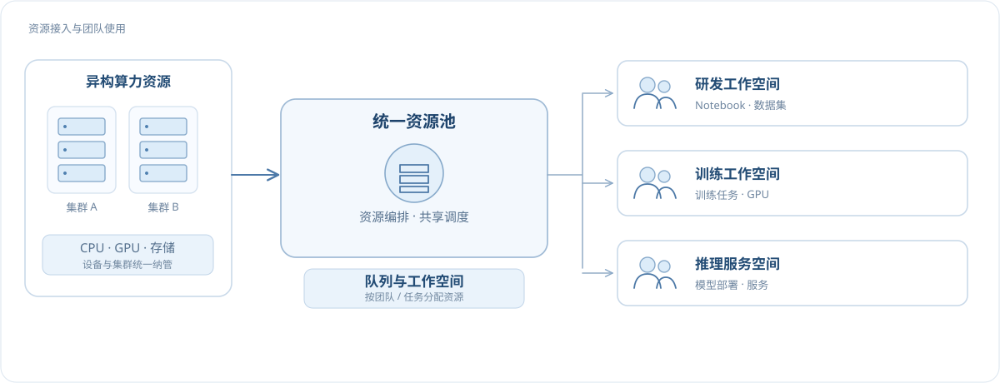
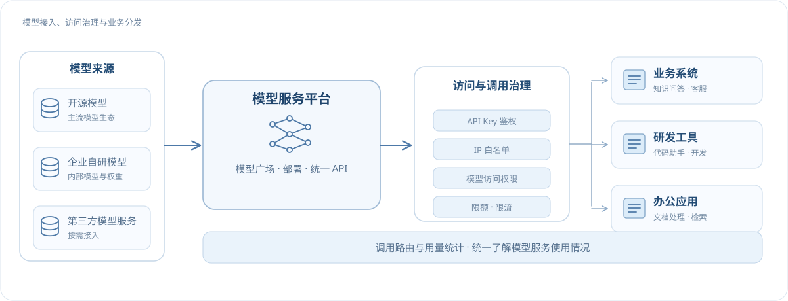
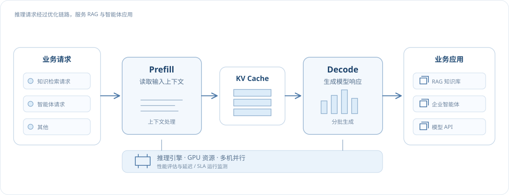
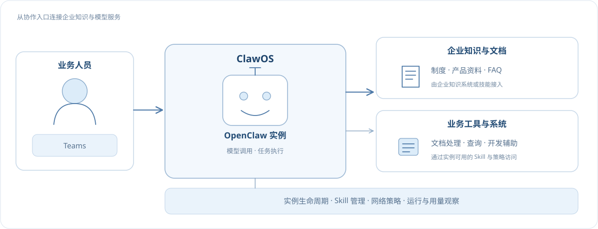
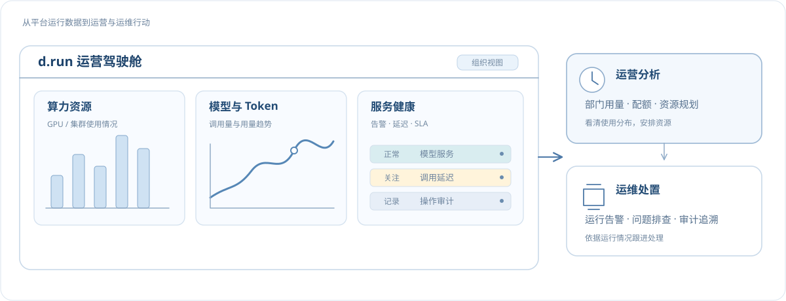

# 典型应用场景

d.run AI 操作系统面向企业建设和使用 AI 的不同阶段，提供从算力资源管理、模型开发与服务，到智能体应用和运营管理的能力。企业可以根据业务需求组合这些能力，为不同团队提供统一的 AI 基础设施和服务。以下场景介绍了平台在企业 AI 建设与应用中的典型用法。

## 企业统一 AI 算力与开发平台

企业多个团队开展模型开发、训练和推理时，可能面临算力分散、环境重复建设和资源分配困难。管理员可以接入集群并创建资源池和队列，为团队分配资源；开发者通过 Notebook、数据集和训练任务开展工作，再部署模型服务。

这一场景适合希望集中管理 AI 基础设施、同时为多个团队提供开发环境的企业。参阅[容器管理](../kpanda/intro/index.md)和 [AI Lab 快速入门](../baize/developer/quick-start.md)。

## 企业级大模型服务

企业可以通过模型广场选择、体验和部署模型，为不同业务系统提供统一的模型调用入口。结合 API Key、模型访问权限、限额限流和用量统计，平台团队能够管理服务访问并了解各业务的使用情况。

例如，金融机构可以在统一 AI 基础设施上部署和接入模型，支撑制度查询、员工问答、知识检索、案例推荐与研究分析等应用。参阅[大模型服务平台](../hydra/intro/index.md)和[部署新模型](../hydra/deploy/deploy.md)。

## 高性能推理与业务应用支撑

面向高并发、长上下文或较大模型的推理需求，企业可以结合多机多卡部署与推理加速能力，评估并调整模型服务，为知识库、智能体等应用提供推理支撑。制造企业也可以围绕研发和生产中的模型应用，组合算力资源、推理服务与业务系统。

实际效果取决于模型、硬件、负载和配置，需要通过性能评估验证。参阅[推理加速服务](../inferx/index.md)和[模型服务概览](../hydra/deploy/index.md)。

## 企业智能体与知识服务

企业可以结合模型服务与 ClawOS，运行受支持的 OpenClaw 实例，并管理实例、Skill 和网络访问策略。结合企业知识内容，业务团队可以探索制度查询、客服问答、文档处理和开发辅助等应用，通过支持的协作工具使用智能体。

例如，制造和行政团队可以围绕产品知识、内部制度或常见问题建设知识服务，为员工和客户提供查询入口。具体知识库及业务应用需结合企业数据和集成方案建设。参阅 [ClawOS](../clawos/intro/index.md)和[快速入门](../clawos/intro/quickstart.md)。

## AI 使用与运营管理

当企业需要了解不同部门或业务的 AI 使用情况时，可以结合模型用量统计、驾驶舱和可观测性，查看资源使用、模型调用和 Token 消耗等信息，辅助进行资源规划、用量管理和问题排查。

这一场景适合平台运营和运维团队持续观察 AI 服务的使用与运行情况。参阅[驾驶舱](../crane/intro/index.md)、[用量统计](../hydra/usage.md)和[可观测性](../insight/intro/index.md)。

## 下一步

- [安装 d.run AI 操作系统](../install/index.md)
- [了解容器管理与集群纳管](../kpanda/intro/index.md)
- [了解大模型服务平台](../hydra/intro/index.md)
- [了解 ClawOS](../clawos/intro/index.md)
- [了解驾驶舱](../crane/intro/index.md)
