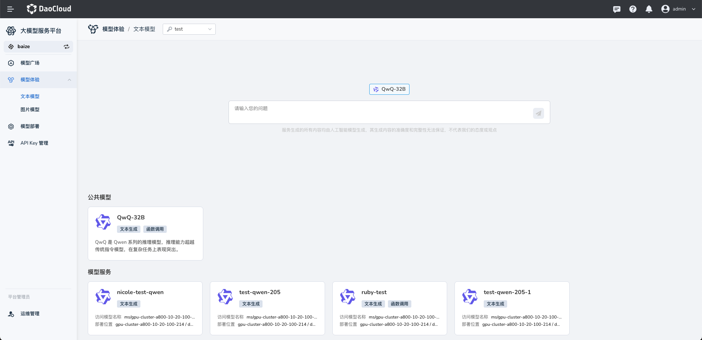
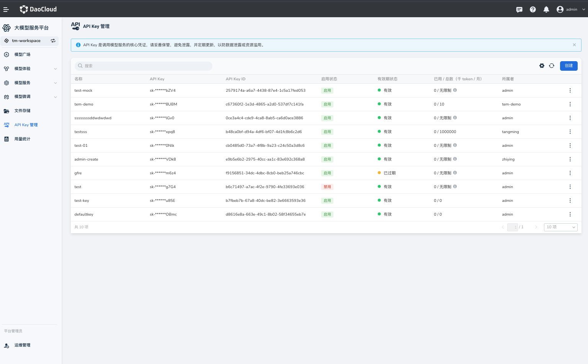

---
hide:
  - toc
---

# 体验与调用模型 - 用户

模型服务跑起来之后，本教程带您通过[模型体验](../hydra/exp.md)在线对话验证效果，再创建
[API Key](../hydra/apikey.md)，用 OpenAI 兼容接口把模型接入您的应用。

## 前提条件

- 已完成[部署模型服务](deploy-model.md)，或使用平台预置的公共模型。

## 在线体验

1. 在左侧导航栏点击 **大模型服务平台** -> **模型体验**；
   也可以在[模型广场](../hydra/index.md)中点击目标模型的 **体验** 按钮直接进入。

    

2. 首次进入时选择一个 API Key（没有的话，可授权平台自动创建），然后从 **公共模型** 或 **模型服务** 列表中选择要体验的模型。

3. 在对话框中输入问题即可开始对话。对话底部会显示此轮回答消耗的 Token 数；
   点击右上角 **添加模型** 还可以同时选择最多 3 个文本模型进行对比。

    !!! tip

        在 **模型配置** 中可以调整 `temperature`、`top_p`、`max_tokens` 等参数：
        `temperature` 越低输出越稳定，越高越发散；工程实践中二者通常二选一即可。

## 创建 API Key

1. 在左侧导航栏点击 **API Key 管理**，点击右上角的 **创建** 按钮。

    

2. 填写 API Key 名称（如 `test-key`），点击 **确定** 生成新 Key。

    !!! note

        完整密钥只在首次显示，请立即保存；泄露后请及时删除并重新生成。

## 通过 API 调用

d.run AI 操作系统提供 OpenAI 兼容接口。调用自己部署的模型服务时，Endpoint 为模型服务所在区域地址（如 `sh-02.d.run`）；
调用 MaaS by Token 共享模型时，Endpoint 为 `chat.d.run`。

使用 curl 验证：

```bash
curl 'https://sh-02.d.run/v1/chat/completions' \
  -H "Content-Type: application/json" \
  -H "Authorization: Bearer $API_KEY" \
  -d '{
    "model": "u-8105f7322477/test",
    "messages": [{"role": "user", "content": "Hello, model!"}],
    "temperature": 0.7
  }'
```

使用 Python（OpenAI SDK）：

```python
import openai

openai.api_key = "your-api-key"          # 替换为您的 API Key
openai.api_base = "https://sh-02.d.run"  # 替换为模型服务所在区域

response = openai.Completion.create(
  model="u-1100a15812cc/qwen2",          # 替换为您的模型服务访问名称
  prompt="What is your name?"
)

print(response.choices[0].text)
```

## 验证结果

在线对话能收到模型回答、curl 调用返回正常响应，即表示模型链路贯通。

## 下一步

把模型接入智能体场景，参阅[创建智能体](deploy-agent.md)；更多调用方式与参数，参阅[模型调用](../hydra/api-call.md)。
