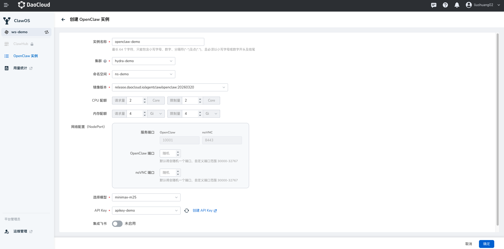
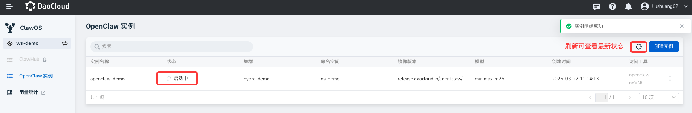
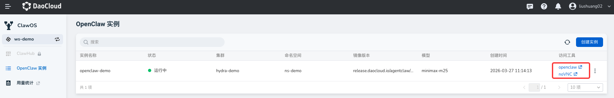
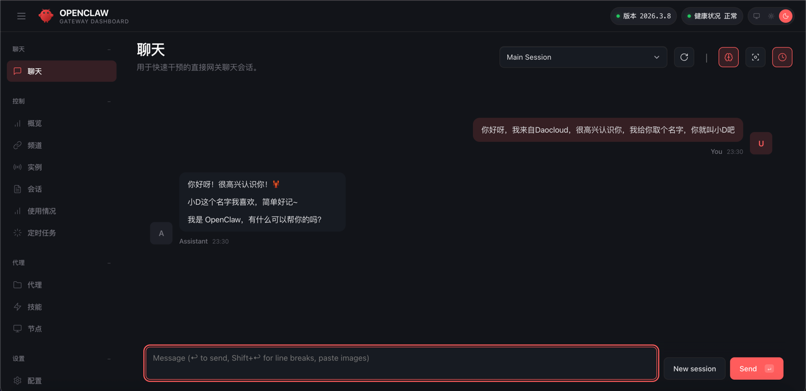

---
hide:
  - toc
---

# 创建智能体 - 用户

本教程在 [ClawOS](../clawos/intro/index.md) 中创建一个 OpenClaw 智能体实例，接入大模型服务平台的模型与 API Key，
让智能体在浏览器中为您工作，还可以集成到飞书等办公套件。

## 前提条件

- 拥有 Workspace Editor、Workspace Admin 或 Admin 权限。
- 工作空间的资源组中已经绑定命名空间。
- 已在大模型服务平台的同一个工作空间中[创建 API Key](call-model.md)。

## 操作步骤

1. 从左侧导航栏选择 **ClawOS**，点击右侧的 **创建实例** 按钮。

2. 配置 OpenClaw 实例后点击右下角 **确定**：

    - 设置实例名称，选择对应的集群、命名空间、镜像版本，配置 CPU/内存资源、网络、模型（推荐使用 minimax 模型）和 API Key。
    - （可选）启用 **集成飞书** 并填入飞书的 App ID 和 App Secret，
      详细步骤参阅[飞书集成](../clawos/workspace/feishu.md)。

    

3. 耐心等待实例创建完成，状态显示为 **运行中**。

    

    !!! note

        某些情况下，由于网络波动，创建实例后可能需要等待 1–2 分钟才能访问。

## 访问与使用

实例状态为 **运行中** 后：

1. 点击右侧的 **访问工具** -> **openclaw** 或 **noVNC**（浏览器里的远程桌面）。

    

2. 在 OpenClaw 聊天界面中即可与小龙虾智能体对话、下发任务。

    

3. 需要在后台调试时，通过 noVNC 远程桌面进入实例执行命令（如 `df -h` 查看磁盘、`free -h` 查看内存）。

## 验证结果

在聊天窗口中向智能体发送一条消息并收到回复，即表示智能体创建成功、模型链路可用。

## 下一步

为智能体安装和编排技能，参阅 [Skill 市场](../clawos/workspace/skill.md)；遇到问题参阅 [ClawOS FAQ](../clawos/faq.md)。

智能体跑起来后，查看平台的运营数据，参阅[运营洞察](operations.md)。

了解 ClawOS 的完整用法，参阅 [ClawOS 快速入门](../clawos/intro/quickstart.md)与[工作空间视角](../clawos/workspace/index.md)。
