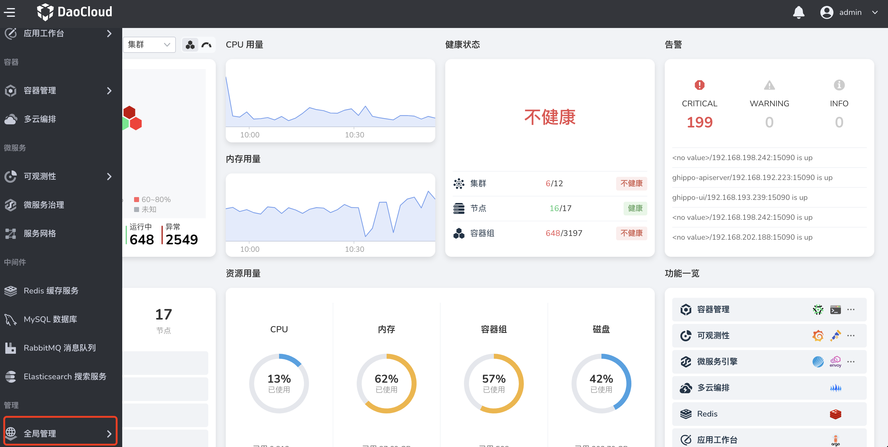

---
hide:
  - toc
---

# 创建用户与工作空间 - 管理员

d.run AI 操作系统采用多租户体系：管理员创建用户和工作空间，再把资源分配给不同的项目组。
本教程以最小配置创建一个用户和一个工作空间，并把用户绑定到该工作空间。

## 前提条件

- 已用 `admin` 账号登录 d.run AI 操作系统控制台。

## 操作步骤

1. 在左侧导航栏点击 **全局管理** -> **用户与访问控制** -> **用户**，点击右上方的 **创建用户**。

2. 填写用户名和登录密码（例如 `drun-user`），点击 **确定**。
   如需批量创建，可一次性创建最多 5 个用户。

    

    !!! note

        此处设置的用户名和密码将用于登录平台，请妥善保存。

3. 在用户列表中找到新用户，点击 **┇** -> **授权**，为其勾选角色权限（如容器管理模块管理员），点击 **确定**。
   新建用户默认没有任何权限，必须授权后才能使用对应模块。

    

4. 在左侧导航栏点击 **全局管理** -> **工作空间与层级**，点击右上方的 **创建工作空间**。

    

5. 填写工作空间名称（如 `drun-demo`）和所属文件夹，点击 **确定**。

    

6. 进入工作空间详情，在 **用户组** 或 **成员** 中将该用户添加到工作空间，使其可以访问工作空间内的资源。

## 验证结果

使用新建用户 `drun-user` 登录控制台，能够看到被授权的模块入口和工作空间，即表示配置成功。

## 下一步

继续[创建工作集群](join-cluster.md)纳管 GPU 算力。

了解用户、权限与工作空间的完整用法，参阅[访问控制](../ghippo/user-guide/access-control/index.md)与[工作空间与层级](../ghippo/user-guide/workspace/index.md)。
