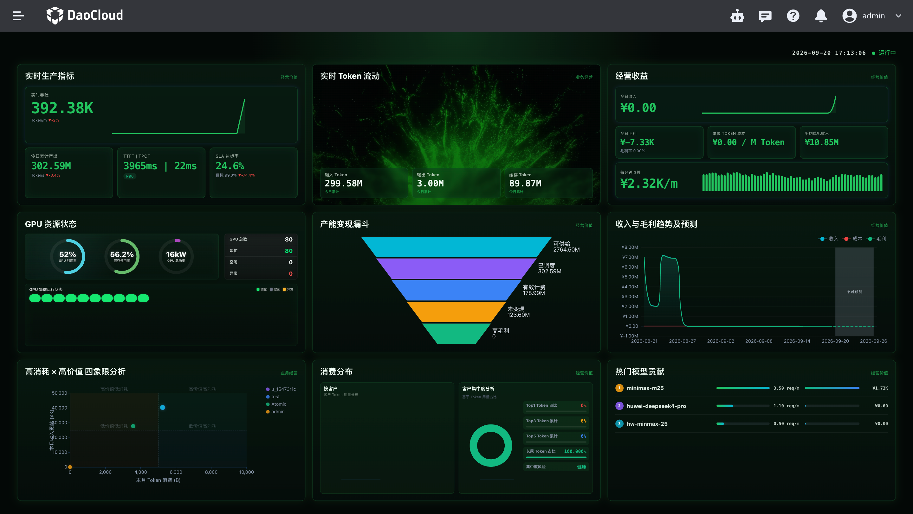

---
hide:
  - toc
---

# 运营洞察 - 用户

模型和智能体跑起来之后，运营者最关心平台的经营状况。本教程带您用[驾驶舱](../crane/intro/index.md)
查看算力产能、Token 产出与收入成本等全链路运营数据。

## 前提条件

- 已完成[部署模型服务](deploy-model.md)、[模型调用](call-model.md)或[创建智能体](deploy-agent.md)，平台已产生真实的 Token 消耗。
- 使用具有驾驶舱权限的用户登录控制台。

!!! note

    d.run AI 操作系统安装后驾驶舱（`crane`）默认关闭，需要在 [manifest-cloud.yaml](../install/commercial/manifest.md) 中开启后重新应用才会出现该模块。

## 查看驾驶舱

1. 在产品导航中打开 **驾驶舱**，默认进入[经营概览面板](../crane/user-guide/singlepage.md)。

2. 在经营概览中查看收入、成本、毛利、产能变现与客户消费结构等核心指标，
   掌握算力产能、Token 产出与生产健康状态。

    

3. 需要查看部门配额消耗与组织用量分布时，切换到企业模式视图；
   需要复盘经营状况时，切换到运营模式视图。

## 验证结果

驾驶舱中能看到与实际调用对应的 Token 产出与消费数据，即表示运营洞察链路贯通。

## 下一步

确认平台的指标与日志采集是否正常，参阅[可观测性](../insight/intro/index.md)；
了解运营指标的更多内容，参阅[运营驾驶舱](../crane/intro/index.md)。
