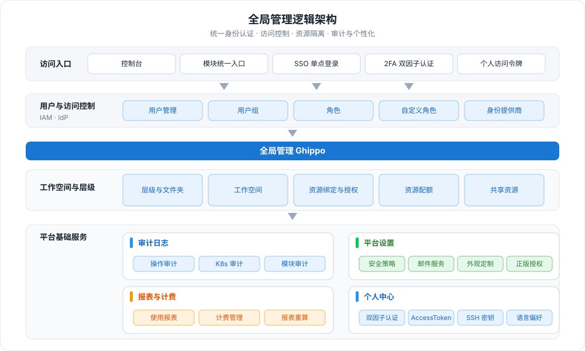
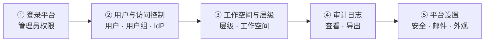

---
hide:
  - toc
---

# 什么是全局管理

全局管理 (Ghippo) 是以用户为中心的综合性服务板块，将用户与访问控制、工作空间与层级、审计日志、平台设置等基础服务模块汇聚一处。通过扁平化的用户/用户组管理与层级式租户（工作空间）协作，实现基于平台的访问控制和基于资源的权限划分；同时支持登录页与导航栏的个性化定制，并预置密码规则、会话超时等安全策略，帮助管理员在一个菜单下完成基础平台设置与用户管理，上手即用。

## 核心能力

- :material-shield-account-outline:{ .lg .middle } __用户与访问控制__

    ---

    创建并管理用户、用户组与角色，灵活配置权限，支持接入 OIDC、LDAP、OAuth2 等身份提供商。

    [:arrow_forward: 用户与访问控制](../user-guide/access-control/global.md)

- :material-view-grid-outline:{ .lg .middle } __工作空间与层级__

    ---

    具有层级结构和访问权限控制的资源隔离单元，按企业环境、部门结构划分层级，并控制资源的访问权限。

    [:arrow_forward: 工作空间与层级](../user-guide/workspace/ws-folder.md)

- :material-text-search:{ .lg .middle } __审计日志__

    ---

    记录平台与各模块的资源操作，支持安全分析、资源变更追踪与问题定位，并可导出审计日志。

    [:arrow_forward: 审计日志](../user-guide/audit/audit-log.md)

- :material-cog-outline:{ .lg .middle } __平台设置__

    ---

    配置平台安全策略、邮件服务器、外观定制与正版授权，保障用户信息安全与平台个性化。

    [:arrow_forward: 平台设置](../user-guide/platform-setting/mail-server.md)

- :material-chart-box-outline:{ .lg .middle } __报表与计费__

    ---

    汇总集群与各模块的使用报表，支持计费管理、报表重算与 GPU 用量统计。

    [:arrow_forward: 使用报表](../user-guide/report-billing/report.md)

- :material-lock-outline:{ .lg .middle } __个人中心__

    ---

    管理双因子认证、访问令牌、SSH 密钥与语言偏好等个人账户安全设置。

    [:arrow_forward: 个人中心](../user-guide/personal-center/security-setting.md)

## 使用流程

使用全局管理通常按以下五步完成平台的用户、租户与基础策略初始化：

| 步骤 | 说明 |
| --- | --- |
| ① [登录平台](../install/login.md) | 使用平台管理员（Admin）或具有管理员权限的用户登录平台 |
| ② [用户与访问控制](../user-guide/access-control/user.md) | [创建用户并授权](../user-guide/access-control/user.md)，[创建用户组并授权](../user-guide/access-control/group.md)，[创建身份提供商](../user-guide/access-control/idprovider.md) |
| ③ [工作空间与层级](../user-guide/workspace/ws-folder.md) | [创建层级](../user-guide/workspace/ws-folder.md)（企业层级关系），[创建工作空间](../user-guide/workspace/workspace.md)（租户） |
| ④ [审计日志](../user-guide/audit/audit-log.md) | 查看并[导出审计日志](../user-guide/audit/audit-log.md) |
| ⑤ [平台设置](../user-guide/platform-setting/security.md) | 设置安全策略、邮件服务器、外观定制、正版授权 |

## 快速上手

  <a class="ghippo-path-step" style="--path-c:#2196f3" href="../user-guide/access-control/user/">
    1
    创建用户并授权
    用户 · 用户组 · 角色
    Go →
  </a>
  <a class="ghippo-path-step" style="--path-c:#00acc1" href="../user-guide/workspace/ws-folder/">
    2
    创建层级与工作空间
    企业层级 · 租户隔离
    Go →
  </a>
  <a class="ghippo-path-step" style="--path-c:#43a047" href="../user-guide/workspace/wsbind-permission/">
    3
    绑定资源与授权
    工作空间绑定 · 权限划分
    Go →
  </a>
  <a class="ghippo-path-step" style="--path-c:#fb8c00" href="../user-guide/audit/audit-log/">
    4
    查看审计日志
    操作记录 · 安全分析
    Go →
  </a>

## 更多资源

- :material-format-list-bulleted:{ .lg .middle } __功能列表__

    ---

    一览全局管理在用户访问控制、工作空间与层级、审计日志与平台设置上的完整功能清单。

    [:arrow_forward: 查看功能列表](features.md)

- :material-book-open-page-variant:{ .lg .middle } __术语表__

    ---

    了解全局管理涉及的常见术语与概念，如 IAM、层级、工作空间、资源绑定等。

    [:arrow_forward: 查看术语表](glossary.md)

- :material-chat-question-outline:{ .lg .middle } __常见问题__

    ---

    汇总全局管理安装、登录与使用过程中的常见问题与排障方法。

    [:arrow_forward: 查看常见问题](faq.md)

- :material-map-outline:{ .lg .middle } __最佳实践__

    ---

    了解工作空间规划、权限分配、层级设计与 OEM 定制等场景下的实践建议。

    [:arrow_forward: 查看最佳实践](../best-practice/ws-best-practice.md)

[下载中心](https://docs.daocloud.io/download/){ .md-button .md-button--primary }
[了解 Token 工厂效能平台](https://docs.daocloud.io/tf/){ .md-button .md-button--primary }
[了解 d.run AI 操作系统](https://docs.daocloud.io/drun/){ .md-button .md-button--primary }
[查阅《全局管理用户手册》PDF](https://harbor-test2.cn-sh2.ufileos.com/docs/download/docs/ghippo.pdf){ .md-button .md-button--primary }
