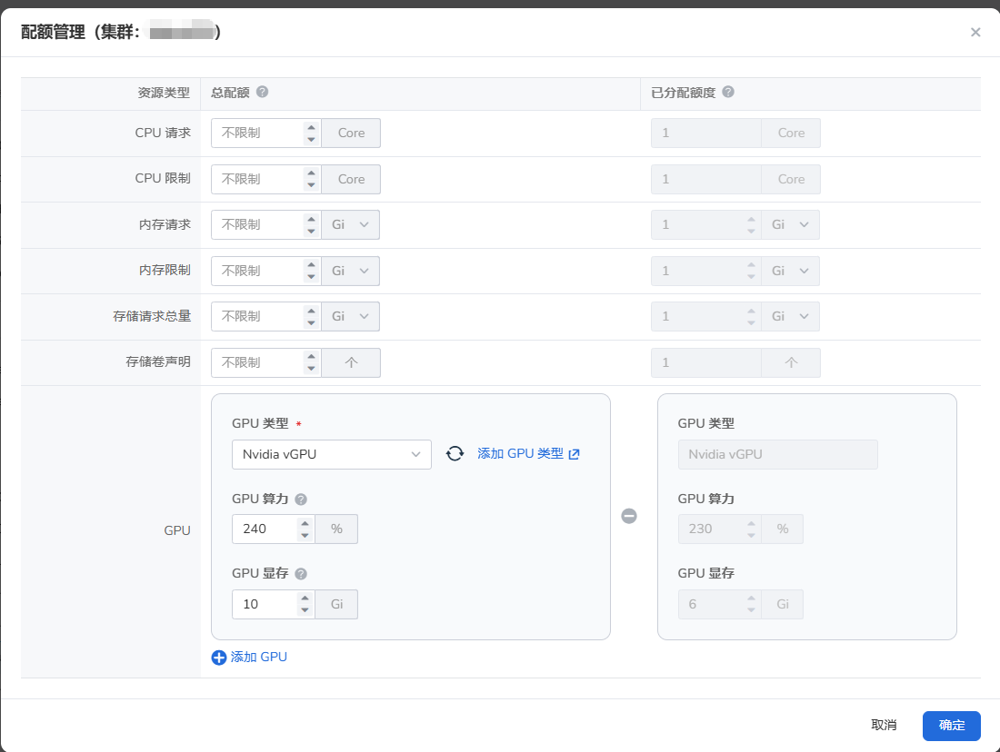

# 资源配额（Quota）

共享资源并非意味着被共享者可以无限制地使用被共享的资源。
Admin、Kpanda Owner 和 Workspace Admin 可以通过共享资源中的 __资源配额__ 功能限制某个用户的最大使用额度。
若不限制，则表示可以无限制使用。

- CPU 请求（Core）
- CPU 限制（Core）
- 内存请求（MB）
- 内存限制（MB）
- 存储请求总量（GB）
- 存储卷声明（个）
- GPU 类型、算力、显存（包括但不限于 Nvidia、Ascend、lluvatar等GPU卡类型）

一个资源（集群）可以被多个工作空间共享，一个工作空间也可以同时使用多个共享集群中的资源。

## 资源组和共享资源

共享资源和资源组中的集群资源均来自[容器管理](../../../kpanda/intro/index.md)，但是集群绑定和共享给同一个工作空间将会产生两种截然不同的效果。

1. 绑定资源

    使工作空间中的用户/用户组具有该集群的全部管理和使用权限，Workspace Admin 将被映射为 Cluster Admin。
    Workspace Admin 能够进入[容器管理模块](../../../kpanda/user-guide/permissions/permission-brief.md)管理该集群。

    

    !!! note

        当前容器管理模块暂无 Cluster Editor 和 Cluster Viewer 角色，因此 Workspace Editor、Workspace Viewer 还无法映射。

2. 新增共享资源

    使工作空间中的用户/用户组具有该集群资源的使用权限，这些资源可以在[创建命名空间（Namespace）](../../../amamba/user-guide/namespace/namespace.md#_3)时使用。

    

    与资源组不同，将集群共享到工作空间时，用户在工作空间的角色不会映射到资源上，因此 Workspace Admin 不会被映射为 Cluster admin。

## 设置共享资源配额

1. 在 **全局管理** -> **工作空间与层级** 中选择目标工作空间，进入 **共享资源** 页签。
2. 找到目标共享集群，在操作菜单中选择 **配额管理**。
3. 在 **总配额** 一列按需设置 CPU、内存、存储和 GPU 配额，然后点击 **确定**。
   选择 GPU 类型后，设置 GPU 算力和 GPU 显存配额：

    - **GPU 算力**：该工作空间可分配给所有命名空间的 GPU 总算力，是多张 GPU 算力之和，因此可以超过 100%。
    - **GPU 显存**：该工作空间可分配给所有命名空间的 GPU 总显存，是多张 GPU 显存之和。

    

配额页面中的数据含义如下：

- **总配额**：共享集群分配给当前工作空间的资源上限。可以按需填写具体值，也可以保持不限制。vGPU 配额不再单独设置物理卡数量。
- **已分配额度**：当前工作空间已经分配给所绑定命名空间的配额总和，并非 GPU 的实时使用量。
- **剩余可用量**：总配额减去已分配额度。例如总算力为 240%、已分配算力为 230% 时，剩余可分配算力为 10%。

!!! note

    工作空间下所有命名空间的配额总和不能超过共享资源总配额，否则无法将该命名空间绑定到工作空间。

本节展示 3 个与资源配额有关的场景。

## 创建命名空间

创建命名空间时会涉及到资源配额。

1. 在工作空间 ws01 新增一个共享集群。

    

1. 在应用工作台选择工作空间 ws01 和共享集群，创建命名空间 ns01。

    

    - 若在共享集群中未设置资源配额，则创建命名空间时可不设置资源配额。
    - 若在共享集群中已设置资源配额（例如 CPU 请求 = 100 core），则创建命名空间时 __CPU 请求 ≤ 100 core__ 。

## 命名空间绑定到工作空间

前提：工作空间 ws01 已新增共享集群，操作者为 Workspace Admin + Kpanda Owner 或 Admin 角色。

以下两种绑定方式的效果相同。

- 在容器管理中将创建的命名空间 ns01 绑定到 ws01

    

    - 若在共享集群未设置资源配额，则命名空间 ns01 无论是否已设置资源配额，均可成功绑定。
    - 若在共享集群已设置资源配额 __CPU 请求 = 100 core__ ，则命名空间 ns01 必须满足 __CPU 请求 ≤ 100 core__ 才能绑定成功。

- 在全局管理中，将命名空间 ns01 绑定到 ws01

    

    - 若在共享集群未设置资源配额，则命名空间 ns01 无论是否已设置资源配额，均可成功绑定。
    - 若在共享集群已设置资源配额 __CPU 请求 = 100 core__ ，则命名空间 ns01 必须满足 __CPU 请求 ≤ 100 core__ 才能绑定成功。

## 从工作空间解绑命名空间

以下两种解绑方式的效果相同。

- 在容器管理中将命名空间 ns01 从工作空间 ws01 解绑

    

    - 若在共享集群中未设置资源配额，则命名空间 ns01 无论是否已设置资源配额，解绑后均不会对资源配额产生影响。
    - 若在共享集群已设置资源配额 __CPU 请求 = 100 core__ ，命名空间 ns01 也设置了资源配额，则解绑后将释放相应的资源额度。

- 在全局管理中将命名空间 ns01 从工作空间 ws01 解绑

    

    - 若在共享集群未设置资源配额，则命名空间 ns01 无论是否已设置资源配额，解绑后均不会对资源配额产生影响。
    - 若在共享集群已设置资源配额 __CPU 请求 = 100 core__ ，命名空间 ns01 也设置了资源配额，则解绑后将释放相应的资源额度。
