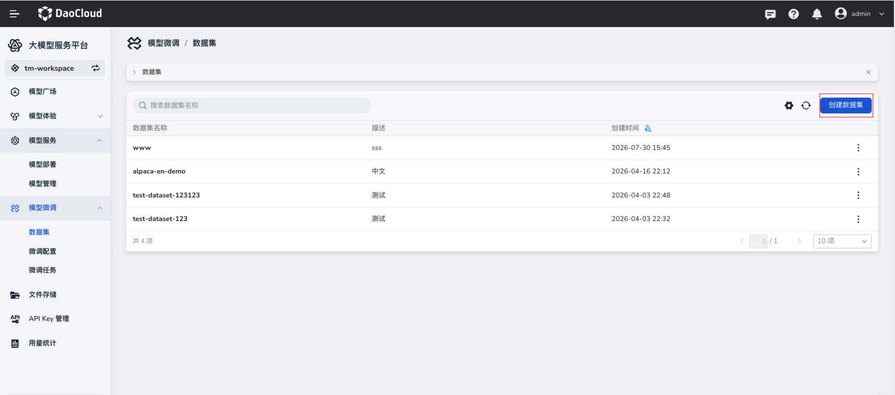
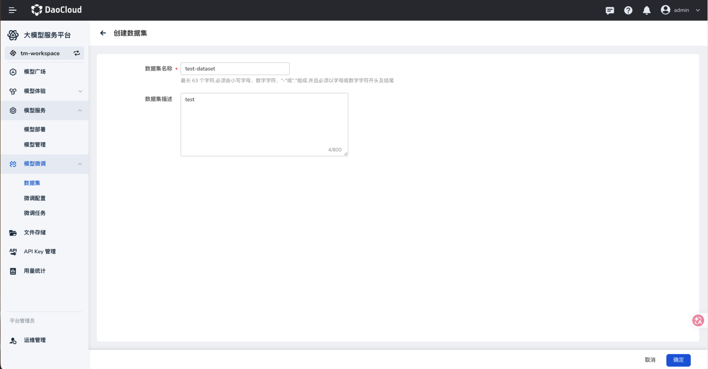
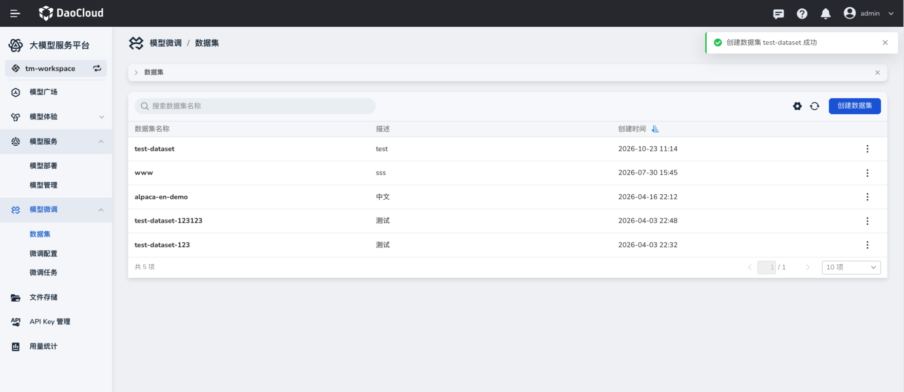
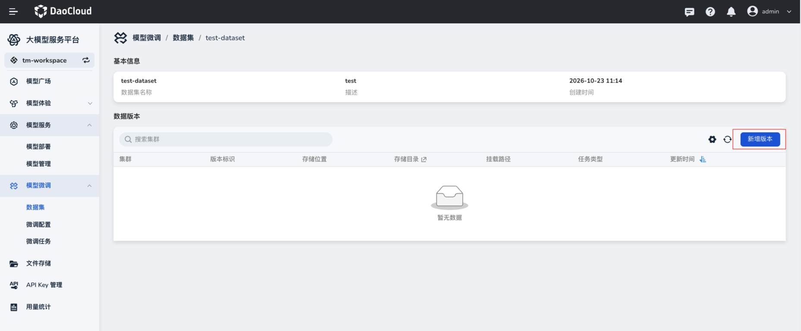
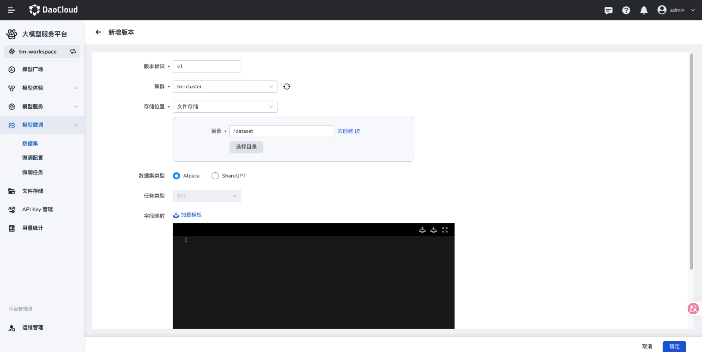
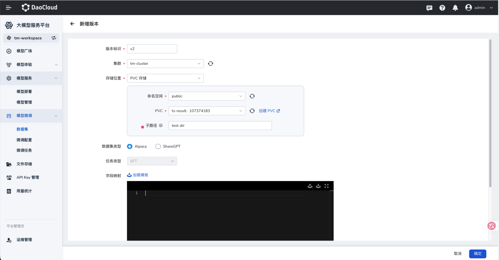
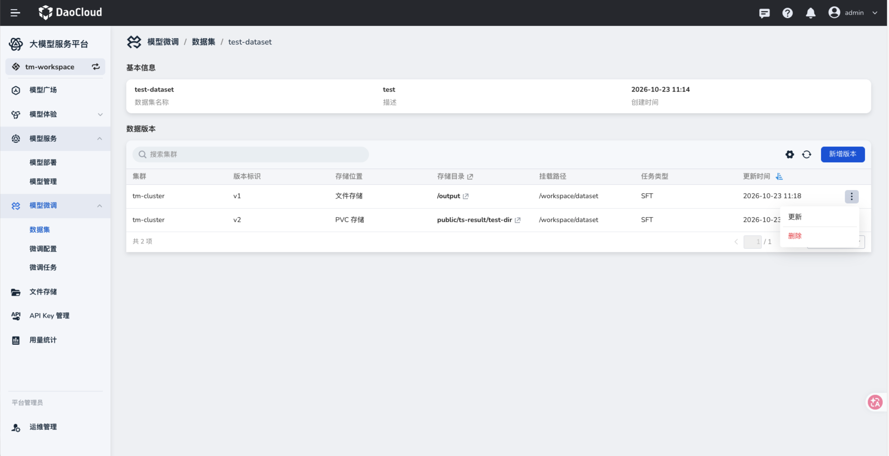
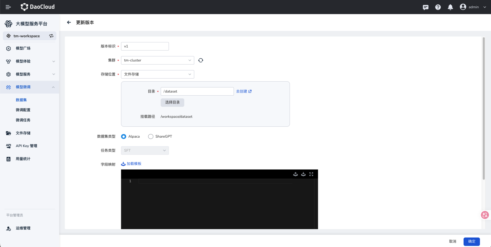

# 数据集管理

数据集用于保存微调训练所需的数据。同一个数据集可以创建多个版本，每个版本分别关联集群中的文件存储或 PVC 存储，并记录数据格式与字段映射。

## 前提条件

- 已进入目标工作空间，并准备好要用于训练的数据文件。
- 已在目标集群准备文件存储目录或 PVC；选择对应存储方式时，确保数据文件位于所选目录或 PVC 中。

## 创建数据集

1. 在左侧导航栏展开 **模型微调**，选择 **数据集**，点击 **创建数据集**。

    

2. 填写数据集名称和描述，点击 **确定**。名称为必填项；页面提示名称最长 63 个字符，支持小写字母、数字、`-` 和 `.`，并须以字母或数字开头和结尾。描述为可选项，最多 800 个字符。

    

3. 返回列表，确认新数据集已创建，点击其名称进入详情页。

    

## 为数据集新增版本

1. 在数据集详情页的 **数据版本** 区域，点击 **新增版本**。

    

2. 填写版本标识和集群，选择 **存储位置**。根据数据所在位置，完成以下一种配置：

    - **文件存储**：填写或选择文件目录；尚未准备目录时，可点击 **去创建**。
    - **PVC 存储**：选择命名空间和 PVC；如数据在 PVC 的某个目录下，填写子路径。

    

    

3. 选择 **数据集类型**，并按实际数据字段填写 **字段映射**。页面提供 **Alpaca**、**ShareGPT** 两种类型，以及 **加载模板** 入口；截图中的任务类型显示为 **SFT**。字段映射应与存储目录内的实际数据结构一致。

4. 点击 **确定**，在版本列表核对版本标识、集群、存储位置、存储目录、挂载路径和任务类型。

    

    | 参数项 | 说明 |
    | --- | --- |
    | 版本标识 | 区分同一数据集的不同版本，必填。 |
    | 集群 | 数据所在的目标集群，必填。 |
    | 存储位置 | 选择文件存储或 PVC 存储，必填；后续字段随选择而变化。 |
    | 目录 / 命名空间、PVC、子路径 | 指向实际数据文件所在位置。文件存储需要目录；PVC 存储需要命名空间和 PVC，子路径按需填写。 |
    | 数据集类型 | 按数据内容选择 Alpaca 或 ShareGPT。 |
    | 任务类型 | 截图中的微调任务类型为 SFT。 |
    | 字段映射 | 根据数据字段与训练格式建立对应关系，可从模板开始配置。 |
    | 挂载路径 | 版本列表展示任务访问该数据集时使用的路径。 |

### 更新已有版本

在版本列表中点击目标版本右侧的 **┇**，选择 **更新**，按需修改版本配置后点击 **确定**。更新后应在版本列表重新核对存储目录和挂载路径。

## 下一步操作

数据集及版本准备好后，[创建微调配置](./create-finetune-config.md)。
