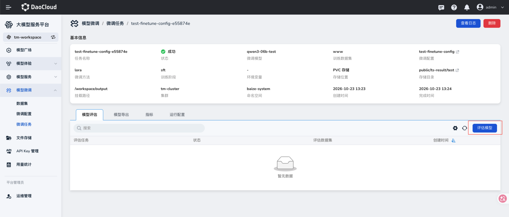
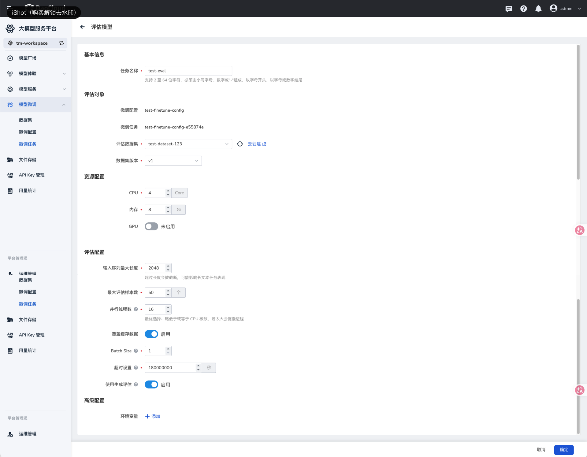
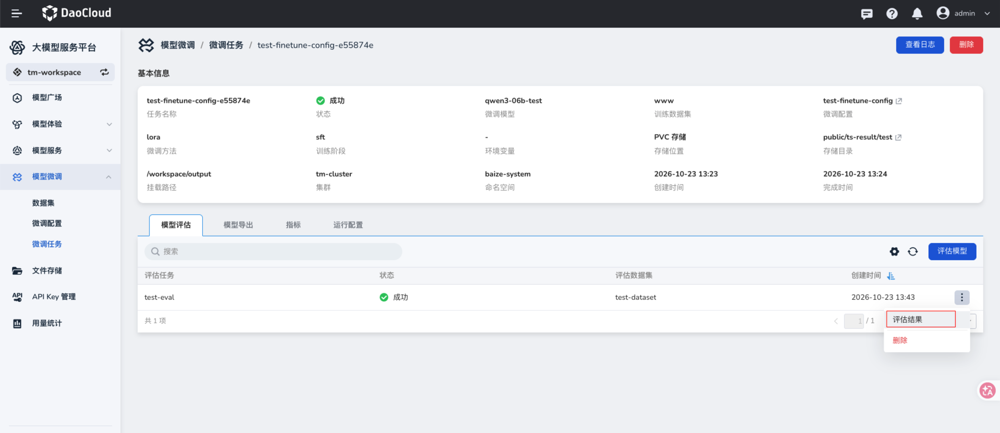
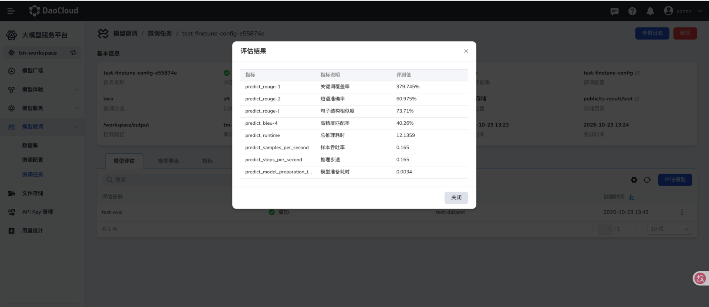

# 评估任务

微调任务完成后，可选择评估数据集，创建评估任务并查看模型评估结果。

## 前提条件

- 已[创建微调任务](./create-finetune-task.md)，且目标任务状态为 **成功**。
- 已准备评估用的数据集及版本；其内容和字段映射应适用于本次评估，详见[创建数据集](./create-dataset.md)。

## 操作步骤

1. 在左侧导航栏展开 **模型微调**，选择 **微调任务**，点击已成功的目标任务。在详情页选择 **模型评估** 页签，点击 **评估模型**。

    

2. 填写任务名称，选择评估数据集和数据集版本。页面会带入当前微调配置与微调任务，确认对象正确。

3. 设置 CPU、内存及 GPU 资源，再按需调整评估配置和环境变量，点击 **确定**。

    

    | 参数项 | 说明 |
    | --- | --- |
    | 任务名称 | 必填。页面提示长度为 2～64 个字符，仅支持小写字母、数字和 `-`，须以字母开头、以字母或数字结尾。 |
    | 微调配置、微调任务 | 从当前任务带入；提交前核对评估对象。 |
    | 评估数据集、数据集版本 | 选择用于评估的数据及版本，必填。 |
    | CPU、内存、GPU | 分配评估任务使用的资源；按模型规模决定是否启用 GPU。 |
    | 输入序列最大长度 | 超过该长度的输入会被截断。 |
    | 最大评估样本数 | 限制本次评估读取的样本数量。 |
    | 并行线程数 | 控制同时运行的评估线程数量。 |
    | 覆盖缓存数据 | 按需重新生成缓存数据。 |
    | Batch Size | 设置评估时每批处理的样本数。 |
    | 超时设置 | 设置任务超时时间，页面单位为秒。 |
    | 使用生成评估 | 按评估方式决定是否启用生成式评估。 |
    | 环境变量 | 高级配置，可按运行环境添加。 |

4. 在 **模型评估** 页签查看评估任务状态。任务成功后，点击任务右侧的 **┇**，选择 **评估结果**。

    

5. 查看评估指标及数值。结果弹窗展示的指标可包括 ROUGE、BLEU、推理耗时、样本吞吐率和推理步速；具体指标与结果以本次评估为准。

    

    | 指标 | 说明 |
    | --- | --- |
    | ROUGE-1、ROUGE-2 | 衡量生成文本与参考文本中单词或连续双词的重叠程度。 |
    | ROUGE-L | 根据生成文本与参考文本的最长公共子序列衡量文本重叠程度。 |
    | BLEU-4 | 综合一至四词的连续片段匹配精确率，并考虑生成文本过短的惩罚。 |
    | 推理耗时 | 本次评估推理所用的总时间。 |
    | 样本吞吐率 | 平均每秒处理的评估样本数。 |
    | 推理步速 | 平均每秒执行的评估步数。 |
    | 模型准备耗时 | 评估前准备模型所用的时间。 |

    ROUGE 和 BLEU 反映文本重叠情况，不能单独代表回答的事实准确性或整体质量；比较结果时应使用相同的数据集和评估配置，并结合实际输出判断。

## 下一步操作

需要保存训练后的模型文件时，[创建导出任务](./create-export-task.md)。
