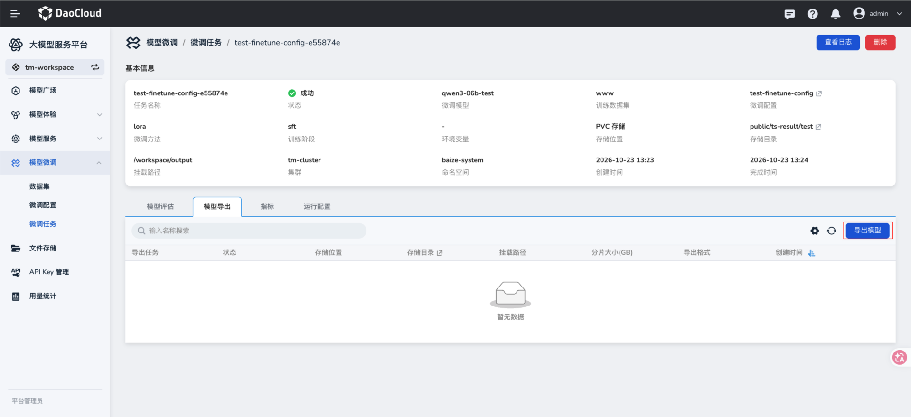
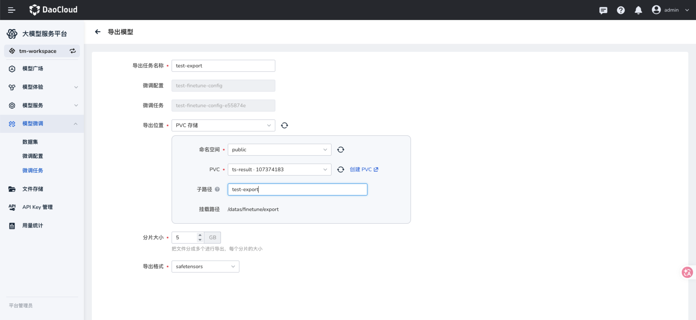
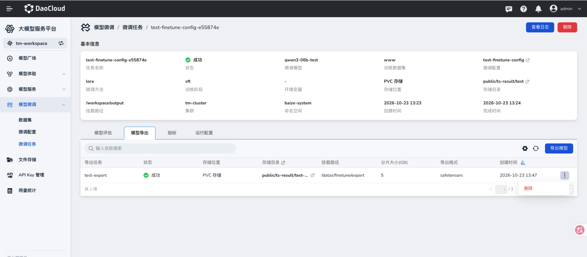

# 导出任务

导出任务将成功微调后的模型写入指定存储位置，供后续使用。

## 前提条件

- 已[创建微调任务](./create-finetune-task.md)，且目标任务状态为 **成功**。
- 已准备可写入的文件存储目录或 PVC，并确认容量满足导出结果需要。

## 操作步骤

1. 在左侧导航栏展开 **模型微调**，选择 **微调任务**，点击已成功的目标任务。在详情页选择 **模型导出** 页签，点击 **导出模型**。

    

2. 填写导出任务名称并确认页面带入的微调配置和微调任务。选择 **导出位置**，填写目标存储信息，再设置分片大小和导出格式，点击 **确定**。截图以 PVC 存储和 `safetensors` 格式为例。

    

    | 参数项 | 说明 |
    | --- | --- |
    | 导出任务名称 | 必填，用于在导出任务列表中识别本次操作。 |
    | 微调配置、微调任务 | 从当前任务带入；提交前核对导出来源。 |
    | 导出位置 | 选择导出文件的存储类型，必填。截图展示 PVC 存储。 |
    | 命名空间、PVC、子路径 | 使用 PVC 存储时选择目标命名空间和 PVC，并按需指定子路径。 |
    | 挂载路径 | 页面展示导出位置在任务中的挂载路径。 |
    | 分片大小 | 设置每个导出文件分片的大小，页面单位为 GB，必填。 |
    | 导出格式 | 选择导出模型文件的格式，必填；截图示例为 `safetensors`。 |

3. 返回 **模型导出** 页签，查看任务状态。状态为 **成功** 后，核对存储位置、存储目录、挂载路径、分片大小和导出格式，并在目标存储位置检查导出文件。

    

## 下一步操作

- 需要管理权重版本时，可在[模型管理](../model-management/index.md#创建模型权重文件)中为模型添加权重文件，指向导出目录，再从模型管理发起[部署](../model-management/model-manage.md#部署模型)。模型管理目前仅支持文件存储；如果导出到 PVC，需先将文件放到可访问的文件存储目录。
- 也可以通过[部署新模型](../deploy/deploy.md)创建模型服务，如果部署环境支持自定义存储挂载，可将导出文件所在目录挂载到推理容器，并确保运行时能够访问权重文件。
