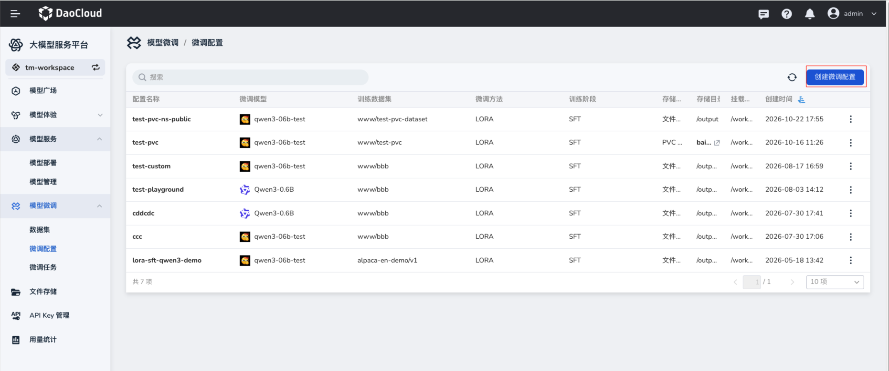
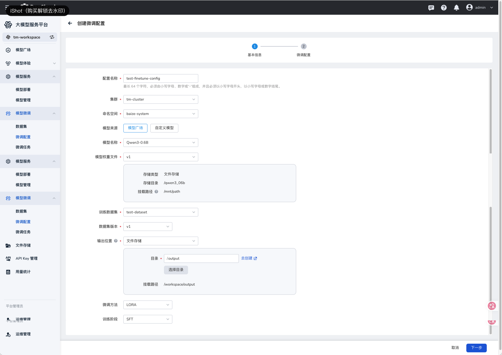
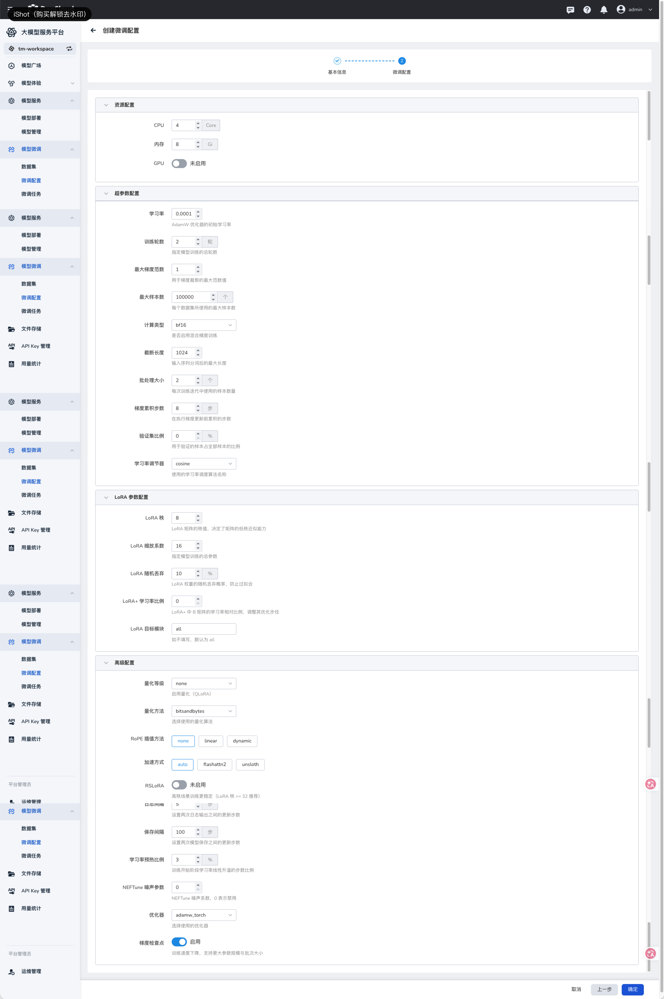
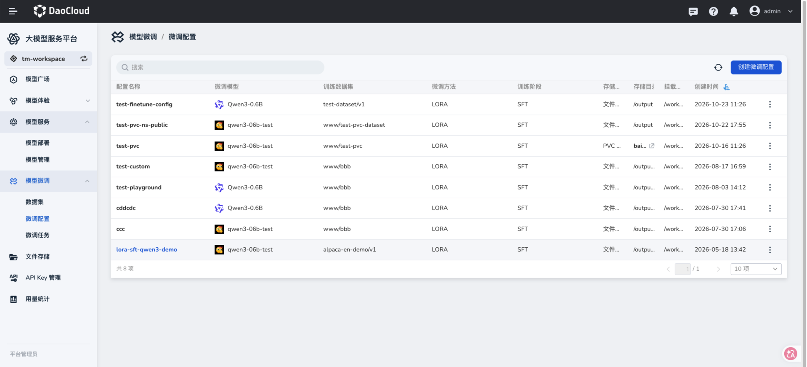
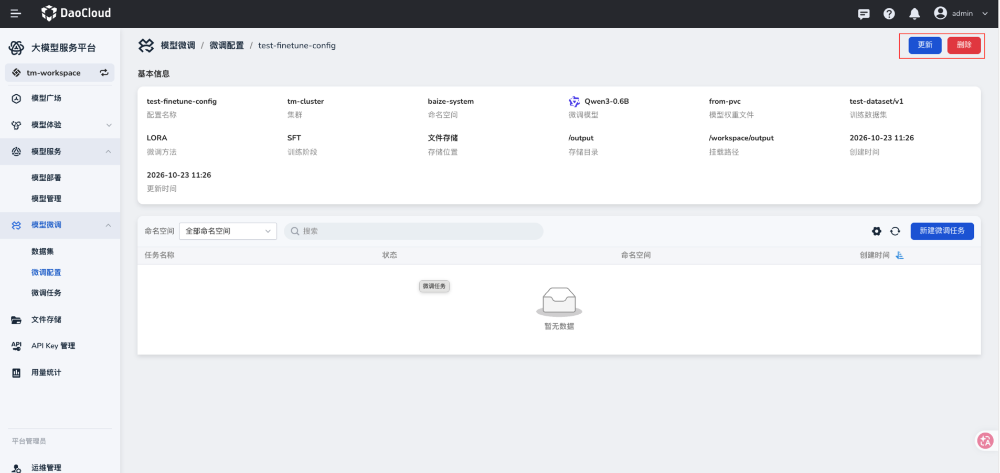

# 微调配置

微调配置将模型权重、训练数据集、输出位置、资源和训练参数保存为可复用的配置。后续可以基于此配置创建微调任务。

## 前提条件

- 已准备模型及可访问的模型权重文件，详见[创建模型](./create-model.md)。
- 已[创建数据集](./create-dataset.md)并准备好训练数据集版本。
- 已准备保存训练输出的文件存储目录或 PVC。

## 操作步骤

1. 在左侧导航栏展开 **模型微调**，选择 **微调配置**，点击 **创建微调配置**。

    

2. 在 **基本信息** 页面填写配置名称、集群和命名空间，选择模型来源、模型和模型权重文件，再选择训练数据集及版本。

3. 设置 **输出位置**，选择 **微调方法** 和 **训练阶段**，点击 **下一步**。截图以文件存储、LoRA 和 SFT 为例；实际选择应与模型、数据和输出存储相匹配。

    

| 参数项 | 说明 |
| --- | --- |
| 配置名称 | 必填。页面提示最长 64 个字符，仅支持小写字母、数字和 `-`，须以小写字母开头、以小写字母或数字结尾。 |
| 集群、命名空间 | 选择运行微调任务的目标位置，必填。 |
| 模型来源 | 可选 **模型广场** 或 **自定义模型**；按来源选择后续模型。 |
| 模型名称、模型权重文件 | 选择要微调的模型和权重版本，必填。权重信息区域会显示存储类型、目录和挂载路径。 |
| 训练数据集、数据集版本 | 选择已创建的数据集及版本，必填。 |
| 输出位置 | 选择保存微调结果的文件存储或 PVC，并指定相应目录。 |
| 微调方法、训练阶段 | 截图中使用 **LoRA** 和 **SFT**。 |

4. 在 **微调配置** 页面设置资源、训练超参数、LoRA 参数及高级参数，确认后点击 **确定**。

    

### 训练参数说明

以下字段按创建页面分组。截图中的数值仅是示例，应根据模型大小、数据量和集群资源调整。

| 分组 | 参数项 | 作用 |
| --- | --- | --- |
| 资源配置 | CPU、内存、GPU | 指定任务使用的计算资源；启用 GPU 后按页面要求选择 GPU 资源。 |
| 超参数配置 | 学习率、训练轮数 | 控制参数更新幅度和数据集训练次数。 |
| 超参数配置 | 最大梯度范数 | 用于梯度裁剪。 |
| 超参数配置 | 最大样本数、截断长度 | 限制参与训练的样本数量和输入序列长度。 |
| 超参数配置 | 计算类型 | 选择训练计算精度。 |
| 超参数配置 | 批处理大小、梯度累积步数 | 控制单次训练批量及参数更新前的累积次数。 |
| 超参数配置 | 验证集比例、学习率调节器 | 设置验证数据比例及学习率变化方式。 |
| LoRA 参数配置 | LoRA 秩、LoRA 缩放系数、LoRA 随机丢弃 | 控制 LoRA 适配器规模、缩放和 dropout。 |
| LoRA 参数配置 | LoRA+ 学习率比例、LoRA 目标模块 | 按模型结构指定 LoRA+ 比例及应用模块。 |
| 高级配置 | 量化等级、量化方法、RoPE 插值方法、加速方式、RSLoRA | 按模型及运行环境选择附加训练选项。 |
| 高级配置 | 日志间隔、保存间隔、学习率预热比例 | 设置记录、保存和预热频率。 |
| 高级配置 | NEFTune 噪声参数、优化器、梯度检查点 | 调整训练策略及内存使用。 |

5. 返回配置列表，确认新配置已出现。点击配置名称可查看详情、更新配置，并从详情页创建微调任务。

    

    

## 下一步操作

配置确认无误后，[创建微调任务](./create-finetune-task.md)。
