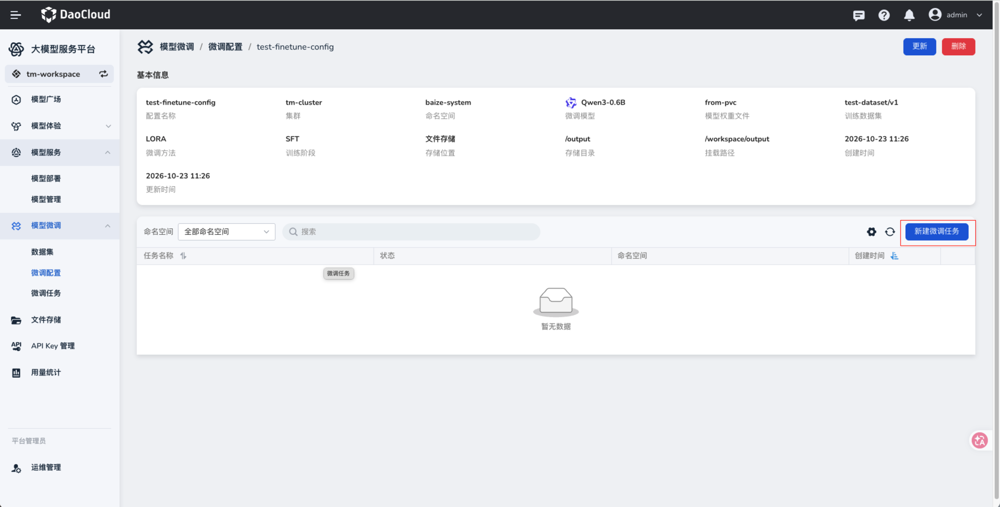
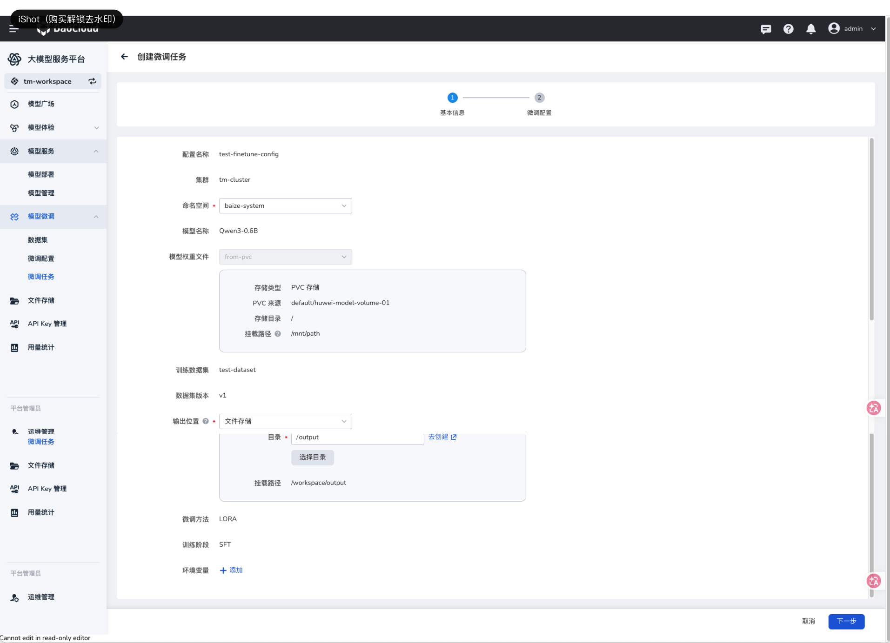
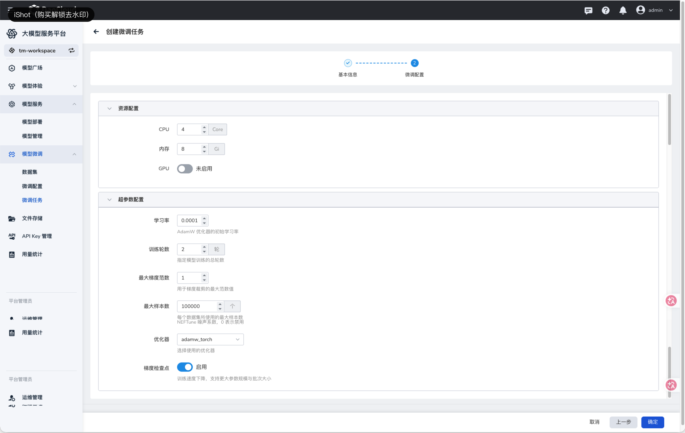
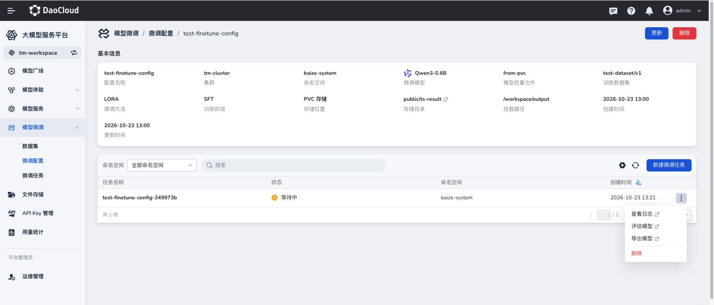
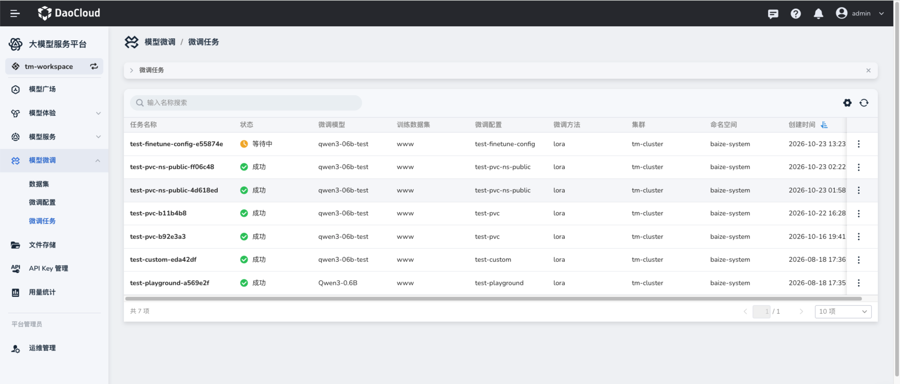
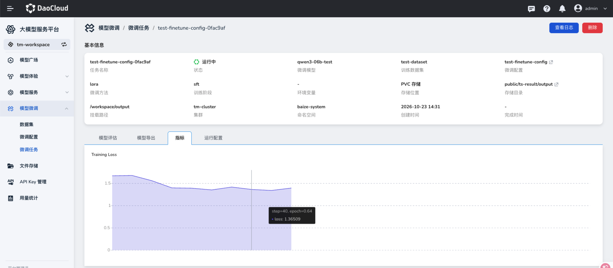
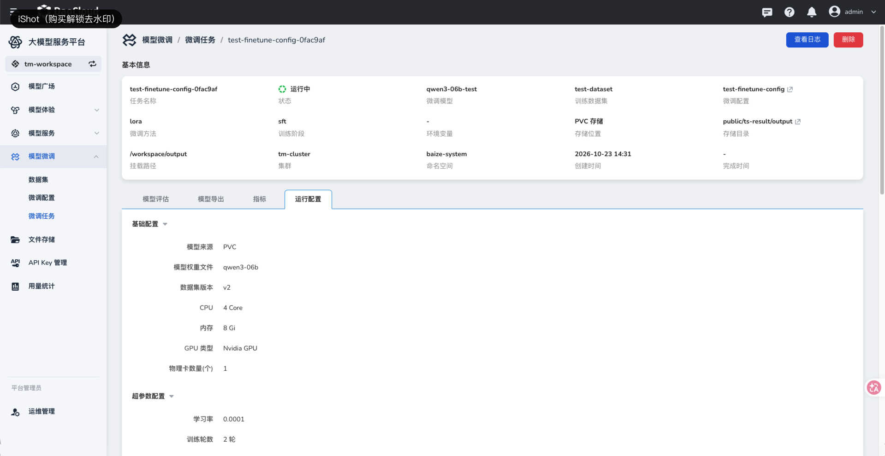

# 微调任务

微调任务基于已保存的微调配置运行训练。创建时可检查模型、数据集和输出位置，并按本次运行的资源需求调整配置。

## 创建微调任务

### 前提条件

已[创建微调配置](./create-finetune-config.md)，并确认模型权重、训练数据集版本及输出存储可用。

### 操作步骤

1. 在左侧导航栏展开 **模型微调**，选择 **微调配置**，点击目标配置名称。在配置详情页点击 **新建微调任务**。

    

2. 在 **基本信息** 页面检查配置名称、集群、模型、权重、训练数据集及版本。选择任务运行的命名空间，确认输出位置；如有需要，点击 **添加** 配置环境变量，然后点击 **下一步**。

    

    | 参数项 | 说明 |
    | --- | --- |
    | 配置名称、集群 | 从所选微调配置带入，用于确认任务来源和目标集群。 |
    | 命名空间 | 选择本次任务运行的命名空间，必填。 |
    | 模型名称、模型权重文件 | 显示本次训练使用的模型与权重；核对存储类型、目录和挂载路径。 |
    | 训练数据集、数据集版本 | 显示本次训练使用的数据。 |
    | 输出位置 | 指定训练结果写入的文件存储目录或 PVC。 |
    | 微调方法、训练阶段 | 显示配置中选定的训练方式。 |
    | 环境变量 | 按运行环境需要添加键值对。 |

3. 在 **微调配置** 页面检查 CPU、内存、GPU 和训练参数。页面中的超参数、LoRA 参数及高级参数与[创建微调配置](./create-finetune-config.md#训练参数说明)时的字段对应。确认资源足够且参数适用于本次训练后，点击 **确定**。

    

4. 在配置详情页或 **微调任务** 列表查看新任务及其状态。任务尚未运行时可能显示 **等待中**；运行成功后再进行评估或导出。

    

    

## 查看运行情况

点击任务名称进入详情页，可通过 **查看日志**、**指标** 和 **运行配置** 检查训练过程。**指标** 页面可查看训练损失曲线；**运行配置** 页面可核对本次任务实际使用的模型、数据集版本和资源参数。

## 下一步操作

任务成功后，可以[创建评估任务](./create-evaluation-task.md)，也可以根据需要[创建导出任务](./create-export-task.md)。
