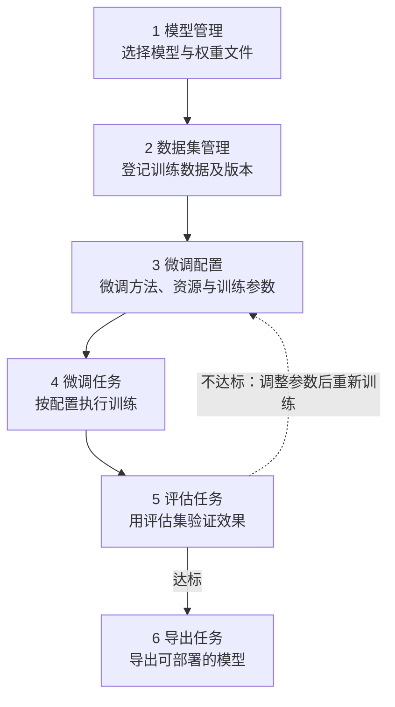

---
hide:
  - toc
---

# 模型微调

模型微调（Fine-tuning）是在预训练模型的基础上，用少量领域数据继续训练，让模型掌握特定业务知识、输出风格或任务格式。相比提示词工程，微调把领域知识固化到模型权重中，推理时无需反复堆叠上下文，输出更稳定、Token 成本更低；相比继续预训练，微调所需的数据量和算力小得多，通常数张 GPU 即可完成一轮训练。

大模型服务平台把微调拆解为模型、数据集、配置、任务、评估、导出六个可复用的对象：模型权重和数据集版本可以被多组微调配置引用，配置保存训练参数后可以反复发起任务，每次训练都会产生独立的记录和输出，评估确认效果后再导出为可部署的模型。这样每次实验的输入、参数和结果都可追溯，也能在不影响线上模型的前提下反复迭代。

## 微调流程

按以下顺序完成六个阶段。点击图中任一阶段可跳转到对应的操作文档；评估结果未达标时，回到微调配置调整参数重新训练即可，无需重复准备模型和数据集。

!!! note "提示"

    - 六个阶段需在同一个工作空间内完成，开始前请先切换到目标工作空间。
    - 评估任务和导出任务依赖状态为 **成功** 的微调任务，必须先完成训练。
    - 微调配置可复用于多轮任务：评估结果不理想时，调整配置参数后重新创建任务，模型和数据集无需重新准备。

[下载中心](https://docs.daocloud.io/download/){ .md-button .md-button--primary }
[了解 Token 工厂效能平台](https://docs.daocloud.io/tf/){ .md-button .md-button--primary }
[了解 d.run AI 操作系统](https://docs.daocloud.io/drun/){ .md-button .md-button--primary }
