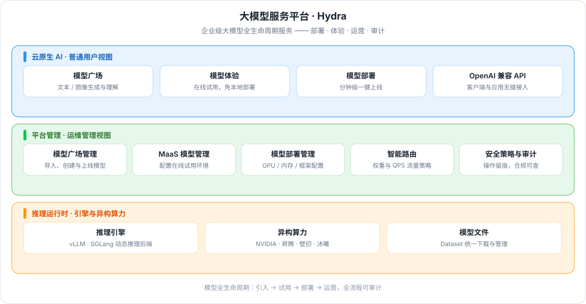
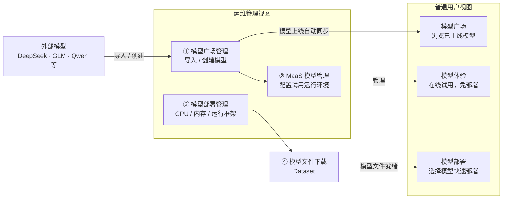
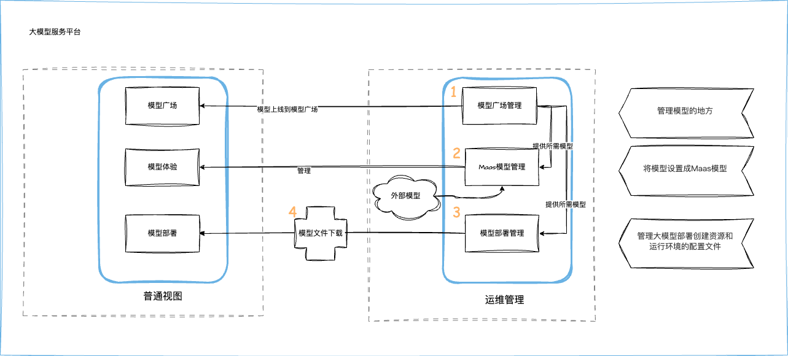

---
hide:
  - toc
---

# 什么是大模型服务平台

大模型服务平台（Hydra）是专为企业级用户打造的综合性 AI 模型服务管理平台，旨在解决企业在大模型应用过程中面临的模型部署复杂、选型困难、运行稳定性不足与安全风险等核心挑战。
平台提供从模型部署到运维管理的全生命周期服务，帮助企业和开发者高效接入各类大模型能力，加速数字化转型与智能化升级。

## 核心能力

- :material-rocket-launch-outline:{ .lg .middle } __一键部署与简化运维__

    ---

    Web 界面与 API 双支持，主流大模型分钟级快速上线；vLLM、SGLang 等动态推理后端，支持实时扩缩容与多地域就近部署。

    [:arrow_forward: 部署新模型](../deploy/deploy.md)

- :material-transit-connection-horizontal:{ .lg .middle } __流量治理与稳定性保障__

    ---

    基于权重、QPS 限制等多维度的智能流量策略，全局、API Key、租户三级限流层层设防，保障服务稳定。

    [:arrow_forward: 智能路由与限流](../oam/auto-route.md)

- :material-server-network:{ .lg .middle } __分布式推理__

    ---

    多机多卡部署支撑 DeepSeek、GLM 等超大参数模型；兼容 NVIDIA、昇腾、壁仞、沐曦等异构 GPU，支持轮询、随机、权重等负载均衡策略。

    [:arrow_forward: 模型服务概览](../deploy/index.md)

- :material-chart-box-outline:{ .lg .middle } __精准计费与统计__

    ---

    Token 精确计量，覆盖主流大模型计费逻辑；按 API Key、模型类型、时间维度多角度统计调用量与输入/输出 Token。

    [:arrow_forward: API Key 管理](../apikey.md)

- :material-view-grid-outline:{ .lg .middle } __多模态统一管理__

    ---

    模型广场汇聚文本生成、图像生成、图片理解等各类模型；一次输入多模型同步响应对比，并附丰富的 Demo 与接入文档。

    [:arrow_forward: 模型广场](../index.md)

- :material-lan-connect:{ .lg .middle } __开放生态接入__

    ---

    提供 OpenAI 兼容 API 与丰富调用示例，Cherry Studio、Cline、LobeChat、Bob 等主流客户端开箱即用。

    [:arrow_forward: 客户端实践](../user-guides/index.md)

## 使用流程

平台通过“运维管理视图 + 普通用户视图”协同配合，实现模型的统一管理、试用体验和快速部署。
模型的使用流程主要分为 **三个步骤 + 模型文件下载**：

??? note "查看原始手绘流程图"

    

| 步骤 | 运维管理视图 | 普通用户视图 | 相关文档 |
| --- | --- | --- | --- |
| ① 模型广场管理 | 在 **模型广场管理** 中导入或创建模型，模型上线后自动同步到用户视图 | 在 **模型广场** 中浏览已上线的模型，作为体验或部署的入口 | [模型广场管理](../oam/index.md) |
| ② MaaS 模型管理 | 将模型设置为 **MaaS 模型**，配置其试用运行环境 | 在 **模型体验** 中选择配置好的模型在线试用，无需本地部署 | [MaaS 模型管理](../oam/maas.md) |
| ③ 模型部署管理 | 为模型创建资源和环境的部署配置文件，如 GPU/内存/运行框架等 | 在 **模型部署** 页面选择模型快速完成部署，无需手动填写复杂参数 | [模型部署管理](../oam/mdm.md) |
| ④ 模型文件下载 | 由运维人员[将模型文件下载到指定位置](../dataset.md)，作为部署的底层基础 | — | [Dataset 管理](../dataset.md) |

## 快速上手

=== ":material-shield-account: 管理员：部署与运营平台"

    

      <a class="hydra-path-step" style="--path-c:#2196f3" href="deploy-ws/">
        1
        部署平台
        WS 模式安装大模型服务平台
        前往 →
      </a>
      <a class="hydra-path-step" style="--path-c:#00acc1" href="../oam/">
        2
        上架模型
        导入或创建模型并上线
        前往 →
      </a>
      <a class="hydra-path-step" style="--path-c:#43a047" href="../oam/maas/">
        3
        配置试用
        设置 MaaS 模型试用环境
        前往 →
      </a>
      <a class="hydra-path-step" style="--path-c:#fb8c00" href="../oam/mdm/">
        4
        配置部署
        规划 GPU、内存与运行框架
        前往 →
      </a>
      <a class="hydra-path-step" style="--path-c:#8e24aa" href="../dataset/">
        5
        准备模型文件
        Dataset 下载模型到指定位置
        前往 →
      </a>
    

=== ":material-account: 普通用户：体验与调用模型"

    

      <a class="hydra-path-step" style="--path-c:#2196f3" href="../">
        1
        选模型
        模型广场筛选、对比主流模型
        前往 →
      </a>
      <a class="hydra-path-step" style="--path-c:#00acc1" href="../exp/">
        2
        在线体验
        模型体验页直接对话与生图
        前往 →
      </a>
      <a class="hydra-path-step" style="--path-c:#43a047" href="../deploy/deploy/">
        3
        部署服务
        选择模型一键完成部署
        前往 →
      </a>
      <a class="hydra-path-step" style="--path-c:#fb8c00" href="../apikey/">
        4
        创建 API Key
        管理调用凭证与访问频次
        前往 →
      </a>
      <a class="hydra-path-step" style="--path-c:#8e24aa" href="../user-guides/">
        5
        接入客户端
        Cherry Studio / Cline / LobeChat
        前往 →
      </a>
    

## 安全与审计 {: #security-audit }

审计功能是大模型服务模块的核心组成部分，通过记录关键操作事件，确保用户行为和系统变更可追溯，以满足合规性、可追溯性和安全审计的需求。主要审计项如下：

| 审计类别 | 覆盖操作 | 事件标识 |
| :--- | :--- | :--- |
| 模型管理 | 创建、更新、删除模型；启用/禁用 MaaS 模型体验功能；发布、下线模型 | `Model`、`EnabledMAASModel`、`PublishModel`、`UnPublishModel` |
| 部署模板管理 | 添加、更新模型部署模板 | `AddDeployTemplates`、`UpdateDeployTemplates` |
| 模型提供商管理 | 创建、更新、删除模型提供商 | `ModelProvider` |
| 工作空间 API 密钥管理 | 创建、删除工作空间 API 密钥 | `CreateWSAPIKey`、`DeleteWSAPIKey` |
| 模型服务管理 | 创建、删除工作空间模型服务；更新副本数；执行服务操作 | `CreateWSModelServing`、`DeleteWSModelServing`、`UpdateWSModelServingReplicas`、`DoModelWSServingAction` |

这些审计项涵盖了模型生命周期的各个方面，确保每个操作都有迹可循。
有关操作指引参见[安全审计日志](../oam/security-audit-logs.md)，审计项完整列表参见[大模型服务平台审计项](../../ghippo/user-guide/audit/gproduct-audit/hydra.md)。

[下载中心](https://docs.daocloud.io/download/){ .md-button }
[了解 Token 工厂效能平台](https://docs.daocloud.io/tf/){ .md-button }
[了解 d.run AI 操作系统](https://docs.daocloud.io/drun/){ .md-button }
[查阅《大模型服务平台》用户手册](https://harbor-test2.cn-sh2.ufileos.com/docs/download/docs/hydra.pdf){ .md-button }
