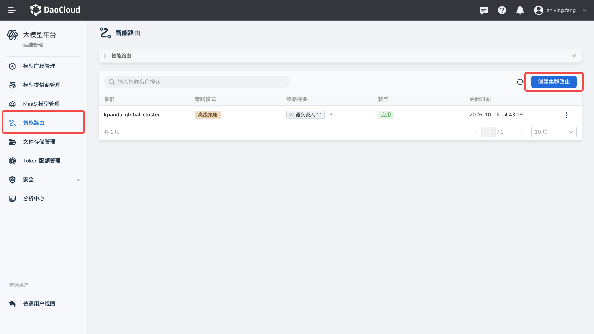
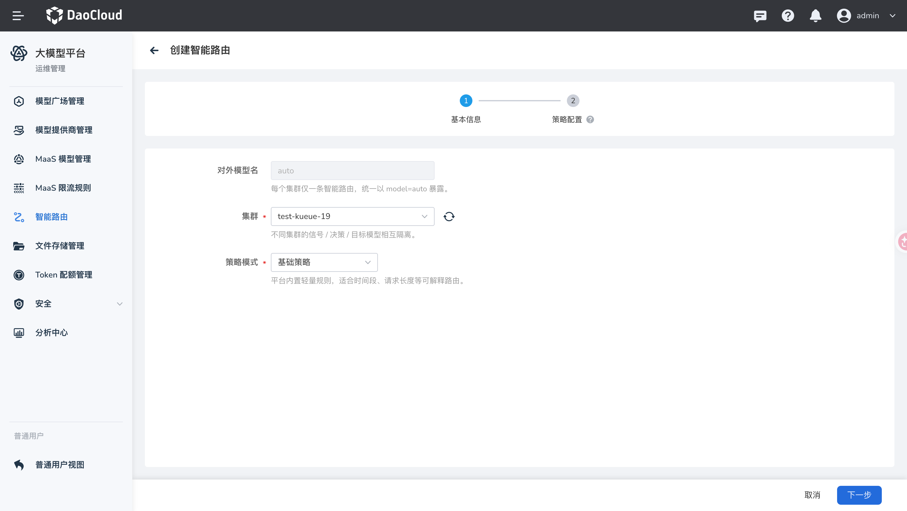
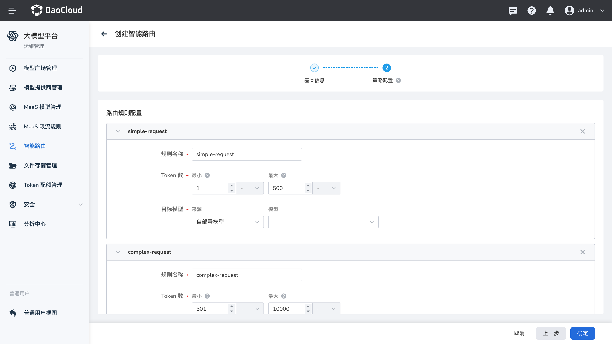
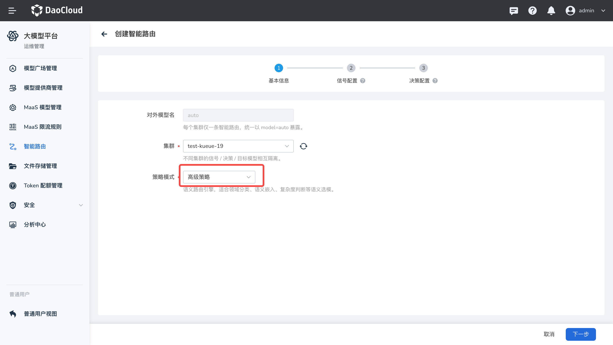
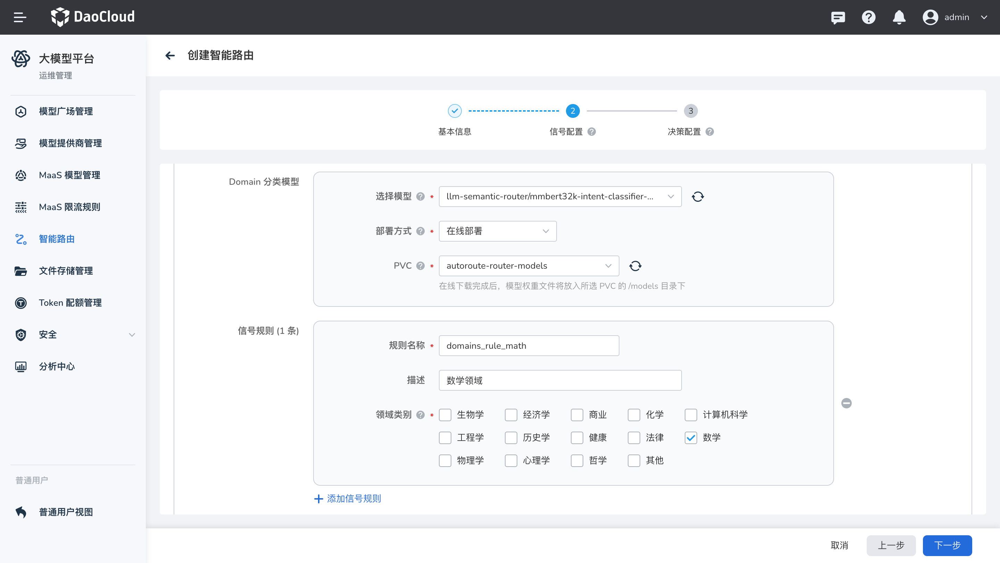
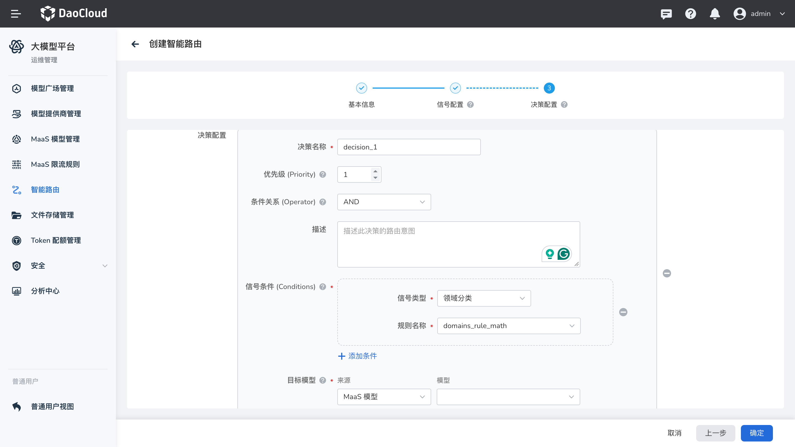
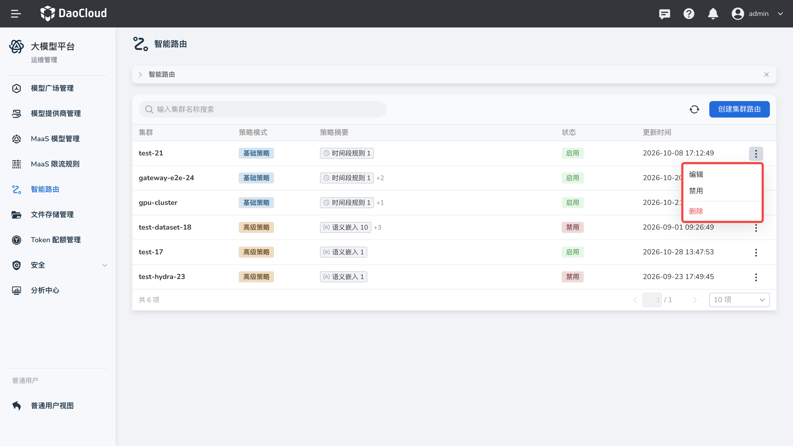

# 智能路由

智能路由面向平台运维管理员，用于按集群配置模型选择策略。应用通过统一的 `model=auto` 发起请求，平台根据请求特征选择目标模型。每个集群独立维护一条智能路由，未命中规则时使用配置的兜底模型。

## 使用场景与价值

- **降低调用成本**：简单任务也使用大模型时，可能产生不必要的成本。可以将轻量任务分配给经济模型，将复杂任务交给能力更强的模型。
- **缩短响应等待**：轻量请求经过复杂推理链路时，响应时间可能较长。可以按请求特征选择适合的轻量模型，改善简单任务的响应体验。
- **提升任务效果**：单一模型难以适合所有场景。可以按请求意图、领域或复杂度选择模型，使不同任务匹配更合适的模型。

实际成本、响应时间和回答质量取决于模型、资源与规则配置，建议结合业务请求进行测试和调整。

## 前提条件

- 当前用户具备平台管理员权限，可进入 **运维管理**。
- 目标集群已接入平台，且 Gateway API 与网关相关组件就绪。
- 已准备该集群可用的 MaaS 模型，作为路由目标和兜底模型。工作空间模式还可选择自部署模型。MaaS 模型接入方式参见 [MaaS 模型管理](./maas.md)。
- 使用高级策略时，语义嵌入、请求复杂度及领域分类等信号可能需要路由模型和可访问的 PVC。在线部署需要集群能够下载模型；离线部署需要提前准备模型文件。

## 创建基础策略

基础策略适用于按时间段、请求长度或自定义条件选择模型的场景。

1. 进入 **运维管理** 视图，在左侧导航栏选择 **智能路由** ，点击 **创建集群路由**。
    
2. 在 **基本信息** 中选择集群和 **基础策略**，确认对外模型名为 `auto`，进入下一步。
    
3. 在 **策略配置** 中按需添加规则，并为每条规则选择目标模型。可配置以下规则：

    | 规则类型 | 配置说明 |
    | --- | --- |
    | 时间段规则 | 设置开始时间、结束时间及生效日期，并选择目标模型。 |
    | 请求长度规则 | 设置预估 Token 数的最小值和最大值，并选择目标模型。支持 `K`（千）和 `M`（百万）单位。 |
    | 自定义策略规则 | 填写规则名称、表达式和目标模型，可通过页面上的 **语法说明** 查看字段与示例。 

    !!! note
        - 多个规则之间是或的关系，只要有一个规则命中，就使用对应目标模型。
        - 没有规则命中时使用兜底模型。

    

4. 未配置规则时，系统会自动使用兜底模型。配置至少一条规则并选择 **兜底模型**，确认配置后创建路由。

5. 返回列表，等待路由就绪，再进行调用验证。

## 创建高级策略

高级策略通过信号识别请求特征，再根据决策选择目标模型，适合按意图、领域或任务复杂度选模。

1. 进入 **运维管理** 视图，在左侧导航栏选择 **智能路由** ，点击 **创建集群路由**。

2. 在 **基本信息** 中选择集群和 **高级策略**，进入 **信号配置**。
      

3. 按需启用信号类型并添加规则：

    | 信号类型 | 配置说明 |
    | --- | --- |
    | 语义嵌入 | 填写候选语句、相似度阈值和聚合方式，根据请求与候选语句的相似度判断是否命中。 |
    | 领域分类 | 从页面提供的领域类别中选择需要匹配的类别。 |
    | 请求复杂度 | 配置简单样本、困难样本和阈值，用于区分不同复杂度的请求。 |
    | 上下文长度 | 配置最小和最大 Token 数，按请求长度匹配。 |

    

    !!! note
        - 语义嵌入与请求复杂度使用的 Embedding 模型、PVC 和部署方式需要保持一致。
        - 领域分类使用分类模型；上下文长度信号不需要部署分类模型。

4. 进入 **决策配置**，添加决策，填写名称、优先级、条件关系和目标模型，并选择需要组合的信号条件。
    

    !!! note
        - 未配置决策时，系统会自动使用兜底模型。配置至少一条决策并选择 **兜底模型**，确认配置后创建路由。

## 调用与验证

路由就绪后，可以使用 API Key 调用入口集群的模型服务。在请求体中将 `model` 设置为 `auto`：

```shell
curl 'https://<入口集群地址>/v1/chat/completions' \
  -H 'Content-Type: application/json' \
  -H 'Authorization: Bearer <API_KEY>' \
  -d '{
    "model": "auto",
    "messages": [{"role": "user", "content": "你好"}]
  }'
```

请将入口地址和 API Key 替换为实际环境中的值。获取 API Key 的方式参见 [API Key 管理](../apikey.md)。

## 管理智能路由

在智能路由列表或详情中，您可以执行以下操作：

- **编辑**：调整当前集群的路由配置，并保存更新。
- **启用或禁用**：控制该集群智能路由是否启用。
- **删除**：确认后删除该集群的智能路由配置；如需再次使用，需重新创建。

