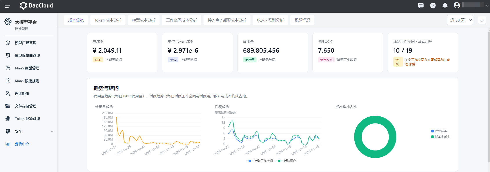
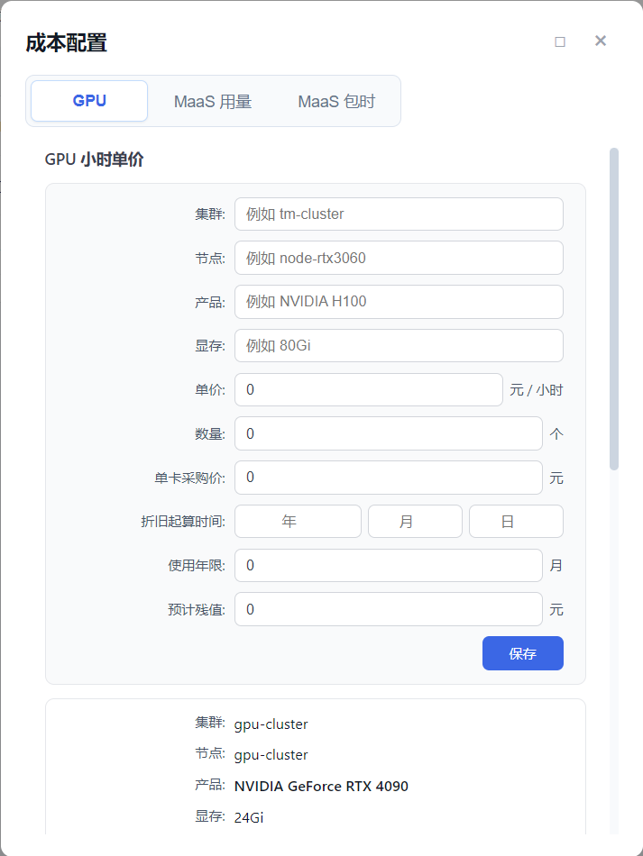
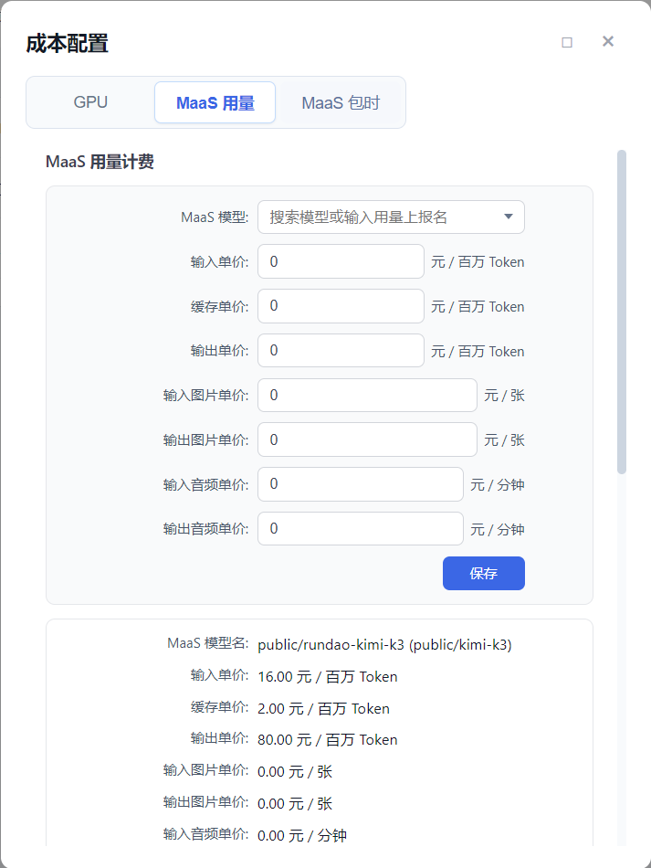
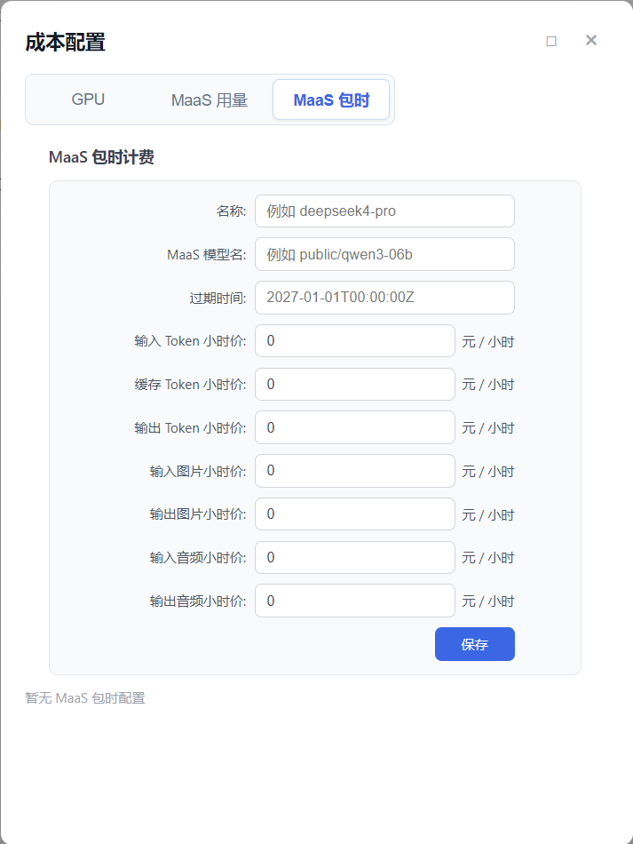
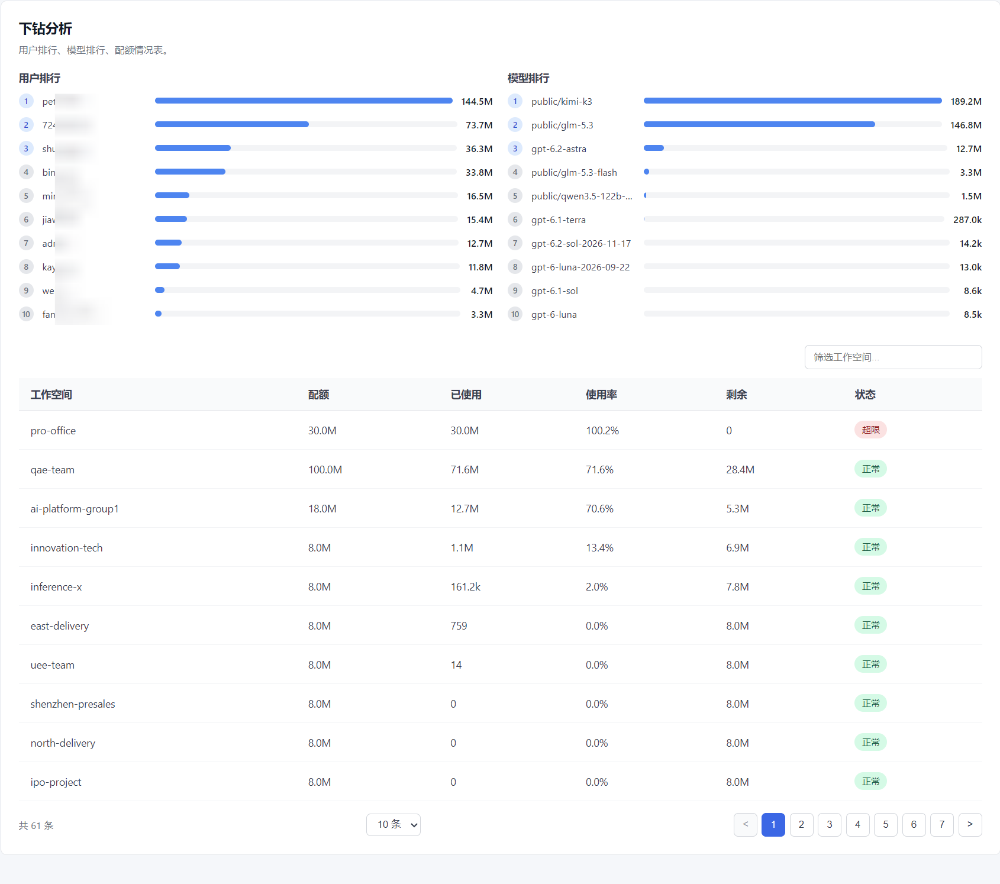
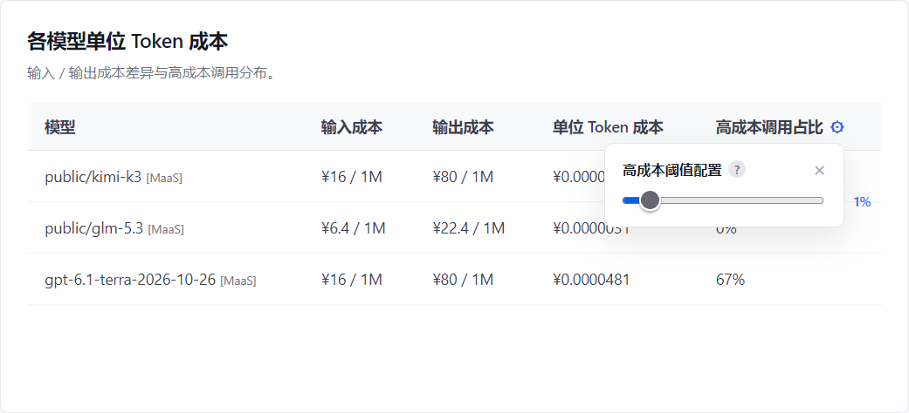
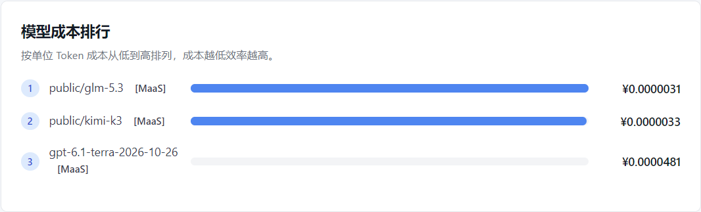
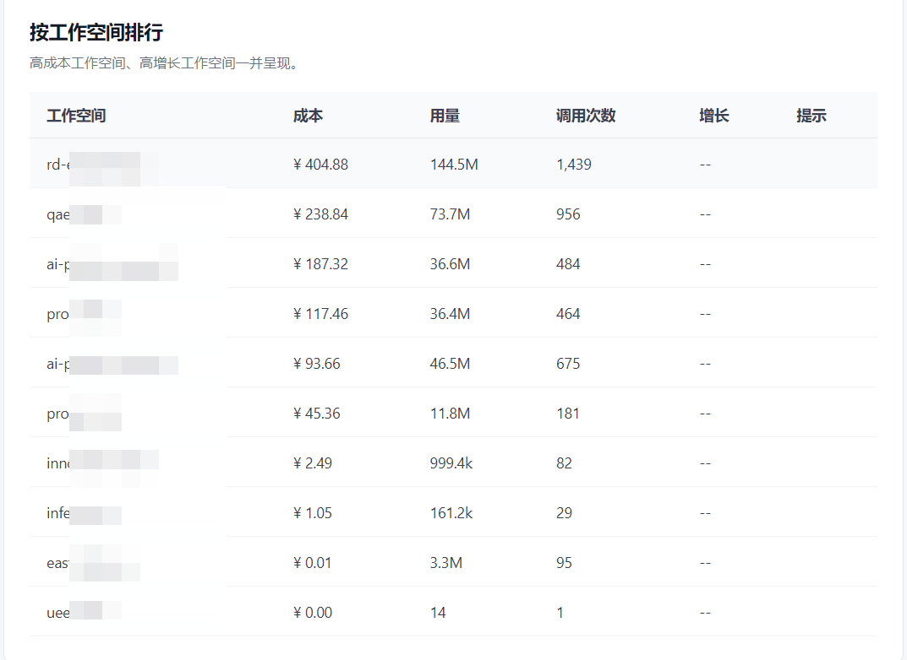
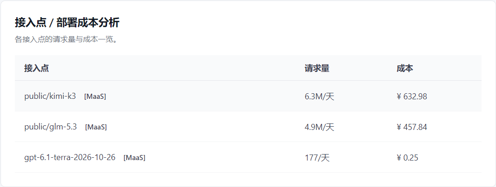
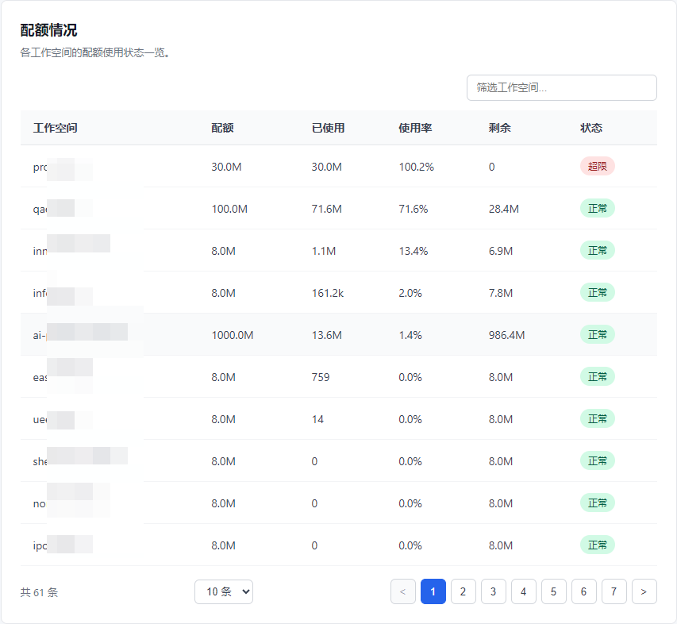

# 成本分析中心

平台管理员可以通过成本分析中心统一维护 GPU 硬件与 MaaS 模型的上游成本单价，查看大模型服务的调用用量和成本变化，比较自建模型与 MaaS 模型的单位 Token 成本，并按模型、工作空间（或租户）、接入点及配额状态定位成本来源与异常风险。

## 功能概览与模式说明

分析中心顶部包含 **7 个分析页签**，页面展示的指标与部分页签名称会根据平台运行模式自适应切换：

| 页签 | 适用模式 | 核心用途 |
| ---- | ---- | ---- |
| 成本总览 | 通用 | 查看核心成本/用量指标卡片、配额或预算风险、每日趋势、成本构成占比及下钻排行。 |
| Token 成本分析 | 通用 | 对比各模型的输入/输出单价、单位 Token 成本、高成本调用占比与 Top 成本来源。 |
| 模型成本分析 | 通用 | 按单位 Token 成本从低到高排行，评估各模型的成本效率。 |
| 工作空间成本分析 / 租户 / 客户成本分析 | 工作空间模式 / CSP 模式 | 按使用方查看成本、用量、调用次数（或收入、毛利率）与增长情况。 |
| 接入点 / 部署成本分析 | 通用 | 查看各模型接入点或部署的日均请求量与成本排行。 |
| 收入 / 毛利分析 | 通用（主要用于 CSP 模式） | 查看收入趋势、毛利趋势与毛利率变化。 |
| 配额情况 / 预算 / 预测 | 工作空间模式 / CSP 模式 | 查看各工作空间的实时配额使用状态，或 CSP 模式下的月度预算与成本预测。 |

页面右上角提供两项全局控件：

- **时间范围选择器**：支持切换 **近 1 天**、**近 7 天** 或 **近 30 天**（默认 **近 30 天**），作用于前 6 个分析页签。**配额情况** 页签展示当前实时配额状态，不显示时间范围选择器。
- **成本配置（齿轮图标）**：在任意页签右上角均可点击打开，用于配置 GPU 成本与 MaaS 上游计费单价。

## 进入成本分析中心

1. 使用平台管理员账号登录，进入 **大模型服务平台**。启用 Token 工厂时，产品入口显示为 **Token 工厂管理**。
2. 在 **运维管理** 的左侧导航中点击 **分析中心**，默认进入 **成本总览**。

    

## 配置成本

在查看精准的成本统计前，需要先维护自建推理所用的 GPU 硬件成本以及上游 MaaS 模型单价。在分析页面右上角点击齿轮图标，打开 **成本配置** 弹窗（支持点击弹窗右上角按钮最大化显示），按需在以下三个页签中完成配置。

### 配置 GPU 成本

在 **GPU**（**GPU 小时单价**）页签填写自建模型的算力成本信息，用于核算自建模型成本：

| 参数 | 说明 | 单位 / 示例 |
| ---- | ---- | ---- |
| 集群 | GPU 所在集群名称 | 例如 `tm-cluster` |
| 节点 | GPU 所在节点名称（可选） | 例如 `node-rtx3060` |
| 产品 | GPU 型号名称 | 例如 `NVIDIA H100` |
| 显存 | 单卡显存规格（可选） | 例如 `80Gi` |
| 单价 | GPU 核算小时单价 | `元 / 小时` |
| 数量 | 对应 GPU 卡数（可选） | `个` |
| 单卡采购价 | 需要核算资产折旧时填写单卡采购价格 | `元` |
| 折旧起算时间 | 折旧开始计提的日期 | 按 `年`、`月`、`日` 填写 |
| 使用年限 | 资产预计折旧周期 | `月` |
| 预计残值 | 折旧期满后的预计残值 | `元` |

填写完成后点击 **保存**。系统会在下方已保存列表中自动计算并展示 **折旧状态**（如 `计提中`）和 **每小时折旧**（`元 / 小时`）。如需调整或移除记录，点击对应卡片右下角的 **编辑** 或 **删除**。

### 配置 MaaS 用量成本

上游 MaaS 模型按实际调用量计费时，切换到 **MaaS 用量**（**MaaS 用量计费**）页签：

1. 在 **MaaS 模型** 中搜索选择已有模型，或直接输入用量上报名。
2. 根据模型支持的能力填写对应的上游单价：

    - **输入单价**、**缓存单价**、**输出单价**：单位为 `元 / 百万 Token`。
    - **输入图片单价**、**输出图片单价**：单位为 `元 / 张`。
    - **输入音频单价**、**输出音频单价**：单位为 `元 / 分钟`。

3. 点击 **保存**。在下方列表中可随时对已有模型配置执行 **编辑** 或 **删除**。

### 配置 MaaS 包时成本

上游 MaaS 模型采用包时采购方式计费时，切换到 **MaaS 包时**（**MaaS 包时计费**）页签：

1. 填写基础信息：

    - **名称**：包时配置标识名称（例如 `deepseek4-pro`）。
    - **MaaS 模型名**：对应的 MaaS 模型名称（例如 `public/qwen3-06b`）。
    - **过期时间**：包时资源到期时间，使用 ISO 8601 格式（例如 `2027-01-01T00:00:00Z`）。

2. 按实际计费项填写各维度小时单价（单位均为 `元 / 小时`）：**输入 Token 小时价**、**缓存 Token 小时价**、**输出 Token 小时价**、**输入图片小时价**、**输出图片小时价**、**输入音频小时价**、**输出音频小时价**。
3. 点击 **保存**。

## 查看成本总览

1. 在 **成本总览** 右上角选择统计周期：**近 1 天**、**近 7 天** 或 **近 30 天**（默认展示 **近 30 天** 的数据）。
2. 查看顶部的 **5 张核心指标卡片**（各卡片下方同时显示与上一周期的对比状态）：

    - **总成本**：所选周期内的模型调用总成本。
    - **单位 Token 成本**：所选周期内的平均单 Token 成本。
    - **使用量** / **调用次数**（工作空间模式）：展示周期内总 Token 消耗量与总调用次数；在 CSP 模式下，此处对应展示 **收入** 与 **毛利率**。
    - **活跃工作空间 / 活跃用户**：展示周期内产生调用的活跃工作空间数量与活跃用户数量。

3. **查看风险明细**：当存在工作空间配额风险（或 CSP 模式下的账户预算风险）时，**活跃工作空间 / 活跃用户** 卡片下方会出现风险条数与 **查看详情** 入口。点击 **查看详情** 可在浮层中查看具体风险对象与原因，例如 **超限**（展示已使用百分比和超出配额量）或 **无限制**（提示未设置配额上限）。

    

4. 查看 **趋势与结构** 区域的 3 张图表：

    - **使用量趋势**：按日展示 Token 使用量变化趋势。
    - **活跃趋势**：按日对比展示 **活跃工作空间** 与 **活跃用户** 数量变化。
    - **成本构成占比**：通过环形图展示 **自建成本** 与 **MaaS 成本** 的占比构成。

5. 查看 **下钻分析** 区域，进一步定位高消耗对象：

    - **用户排行**：按 Token 使用量从高到低展示 Top 10 用户。
    - **模型排行**：按 Token 使用量从高到低展示 Top 10 模型。
    - **配额情况表**：支持在 **筛选工作空间** 搜索框按名称过滤，查看各工作空间的 **配额**、**已使用**、**使用率**、**剩余** 和 **状态**（`超限`、`正常`、`无限制`），并支持分页与每页 `10 / 20 / 50 条` 切换。

    

## 分析 Token 成本

1. 点击页面顶部的 **Token 成本分析**。
2. 在左侧 **各模型单位 Token 成本** 表格中，查看各模型（MaaS 模型标注 `[MaaS]` 标签）的 **输入成本**、**输出成本**、**单位 Token 成本** 和 **高成本调用占比**。
3. 在右侧 **Top 成本来源** 环形图中，按 **输入 Token** 与 **输出 Token** 维度查看成本构成及合计比例。
4. 如需调整高成本调用的判定门槛，点击 **高成本调用占比** 列标题旁的齿轮图标，打开 **高成本阈值配置** 浮层，拖动滑块在 `0.1%`–`10%` 范围内设置阈值（步长 `0.1%`，默认 `1%`）：

    - **阈值作用**：设定判定“高成本调用”的成本比例门槛。例如阈值为 `1%` 时，单次调用成本达到模型总成本的 `1%` 即视为高成本调用。
    - **计算逻辑**：`高成本调用占比 = 高成本调用次数 / 总调用次数`。

    

## 其他分析维度

### 模型成本分析

展示 **模型成本排行** 横向条形列表，标注模型来源（如 `[MaaS]`）及对应的单位 Token 成本。列表按单位 Token 成本 **从低到高** 排列（成本越低效率越高），便于对比不同模型的成本效率；未配置单价、缺少单位 Token 成本的模型排在末尾。

### 工作空间成本分析（CSP 模式为「租户 / 客户成本分析」）

- **工作空间模式**：在 **按工作空间排行** 表格中查看各活跃工作空间的 **工作空间**、**成本**、**用量**、**调用次数**、**增长** 与 **提示**，同时呈现高成本与高增长的工作空间。
- **CSP 模式**：页签显示为 **租户 / 客户成本分析**，用于查看各租户的收入、成本、毛利率与增长情况。

### 接入点 / 部署成本分析

在 **接入点 / 部署成本分析** 表格中查看各接入点（带 `[MaaS]` 标识）的 **请求量**（日均请求量，如 `11.6M/天`）和 **成本**。列表默认按成本从高到低排列，便于评估不同接入点或模型部署的流量与成本贡献。

### 收入 / 毛利分析

在 **收入 / 毛利趋势** 双折线图中按日查看 **收入趋势**、**毛利趋势** 与毛利率变化，主要用于 CSP 模式下跟踪计费收入与盈利表现。

!!! note

    在未开启计费收入统计的工作空间模式下，若暂无收入数据，收入趋势曲线会显示为 0。

### 配额情况（CSP 模式为「预算 / 预测」）

- **工作空间模式**：提供独立的 **配额情况** 实时视图（不随右上角时间范围切换）。支持通过 **筛选工作空间** 搜索框按名称过滤，查看各工作空间的 **配额**、**已使用**、**使用率**、**剩余** 和 **状态**（`超限`、`正常`、`无限制`），并支持分页浏览及每页 `10 / 20 / 50 条` 切换。
- **CSP 模式**：页签显示为 **预算 / 预测**，用于查看月度预算、当前消耗、未来 7 天和 30 天的预测及预算告警。

