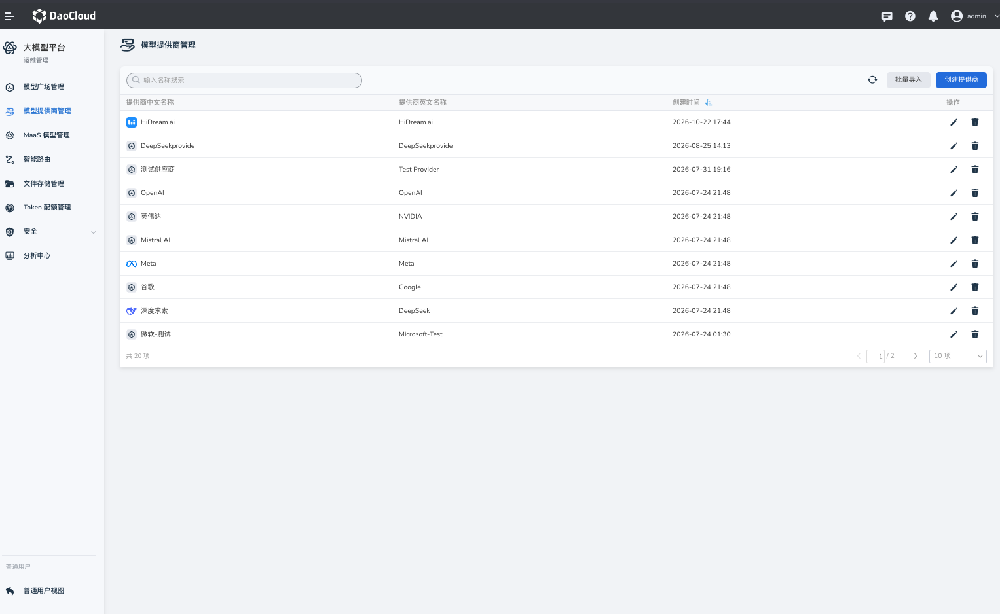

# 模型提供商管理

平台管理员可以通过 **模型提供商管理** 功能维护可用的模型服务提供商信息，包括批量导入、创建提供商、更新或删除提供商，为后续模型接入和管理提供基础信息。

## 访问模型提供商管理

1. 使用具备平台管理员权限的账号登录 Hydra。
2. 在大模型平台 **运维管理** 里使用模型提供商管理功能模块。

## 查看提供商

进入模型提供商管理页面后，可以查看当前已配置的模型提供商列表。使用页面提供的搜索或筛选功能定位目标提供商，并进入详情查看其配置。

## 创建提供商

1. 在模型提供商管理页面点击 **创建提供商** 。
2. 按页面表单填写提供商信息, 中文名字、英文名字、图标等；标识应保持唯一，并与后续模型配置中引用的提供商一致。
3. 核对填写内容后，点击 **确定** 完成创建。
4. 返回列表确认新提供商已显示。

## 更新提供商

1. 在提供商列表中选择目标提供商，点击对应的 **编辑** 操作。
2. 修改需要更新的信息，并保存。
3. 返回列表或详情，确认变更已生效。

## 删除提供商

1. 在提供商列表中选择目标提供商，点击 **删除**。
2. 在确认提示中核对对象，再确认删除。

删除前请检查是否仍有模型或其他配置引用该提供商；存在关联时，先调整相关配置，避免影响模型管理或调用。

## 使用建议

- 提供商名称和标识应清晰、稳定，便于管理员识别及后续配置引用。
- 修改或删除提供商前，先检查关联模型和业务配置。
- 登录凭据属于敏感信息，应通过受控渠道分发，并及时替换部署中的默认凭据。
- 模型提供商会作为筛选条件加载在模型广场筛选项里。
