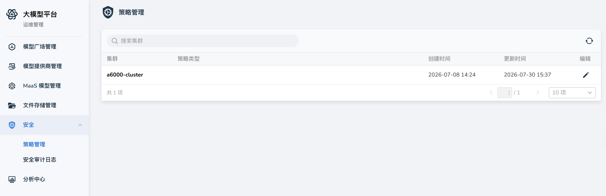
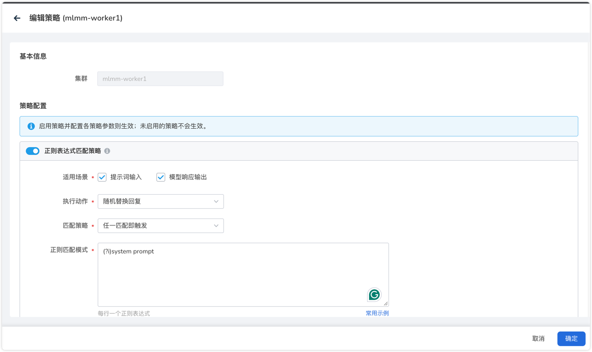
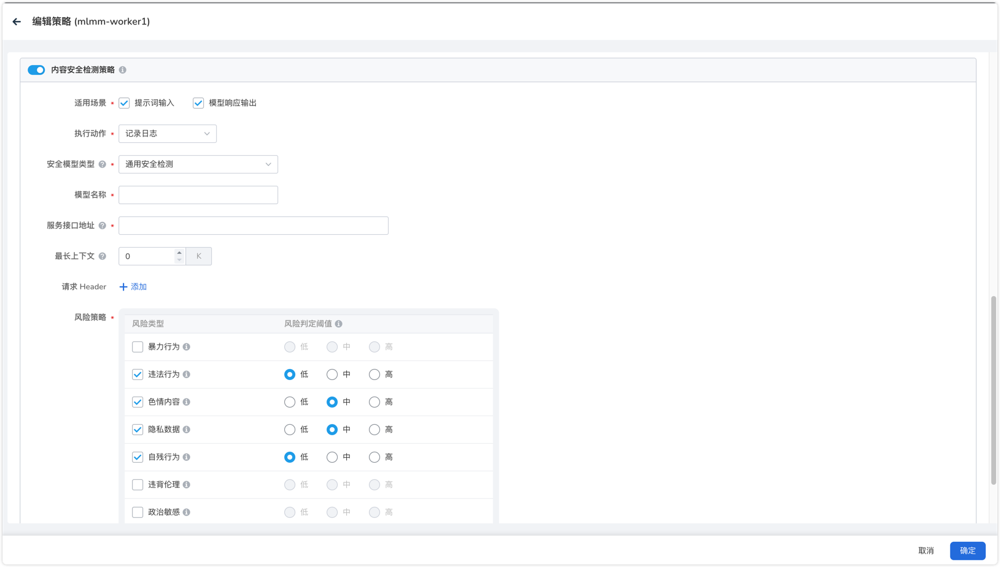
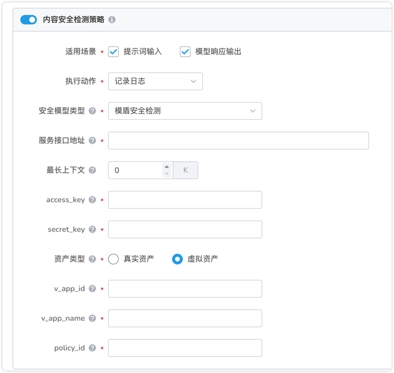

# 安全策略管理

安全策略管理面向平台运维管理员，用于按集群配置大模型网关的 AI 安全策略。
策略下发到工作集群的网关插件后，可对模型调用请求与响应进行检测，并按配置执行阻断、记录日志、随机替换回复或脱敏替换等动作。

!!! note

    网关安全策略依赖 Knoway 网关集成的 Higress，需大模型服务平台 **v0.15.0** 及以上版本，并在工作集群中开启 Higress。
    内容安全检测策略需 **v0.18.3** 及以上版本。
    开启方式参见[升级注意事项](../intro/upgrade-notes.md)。

## 前提条件

- 当前用户具备平台管理员权限，可进入 **运维管理**。
- 目标工作集群已安装 hydra-agent，并按升级说明开启 `knoway.higress.enabled`。
- 策略列表仅展示已存在网关安全插件配置的集群。若列表为空，请先完成 Higress 相关组件与 CRD 的安装与升级。
- 使用 **内容安全检测策略** 时，根据安全模型类型准备检测服务：
    - **通用安全检测**：已部署 OpenAI 兼容的安全分类模型，并可从网关访问。
    - **模盾安全检测**：已开通模盾服务，并取得服务地址、AccessKey、SecretKey 和资产信息。

## 入口

1. 登录平台后，进入 **运维管理**。
2. 在左侧导航中选择 **安全** → **策略管理**。

## 查看策略列表

策略列表按集群展示网关安全配置，主要字段如下：

| 字段名称 | 说明 |
| -------- | ---- |
| 集群 | 工作集群名称 |
| 策略类型 | 当前已启用的策略类型，可同时启用多种 |
| 创建时间 | 该集群策略配置的创建时间 |
| 更新时间 | 最近一次更新时间 |

您可以在页面右上角的搜索框中按 **集群** 名称进行搜索。点击某一行的 **编辑**，进入该集群的策略编辑页。

!!! note

    界面不提供独立的「创建策略」入口。安全策略按集群编辑已有网关插件配置；未完成 Higress 安装的集群不会出现在列表中。

## 编辑策略

1. 在策略列表中，找到目标集群，点击 **编辑**。
2. 在 **编辑策略** 页面中，**集群** 为只读信息，不可修改。
3. 在 **策略配置** 区域，按需启用各类策略并填写参数，点击 **确定**。

!!! note

    启用策略并配置各策略参数则生效；未启用的策略不会生效。

### 策略类型与字段说明

| 策略类型 | 说明 | 可配置项 | 执行动作 |
| -------- | ---- | -------- | -------- |
| 正则表达式匹配策略 | 对提示词输入和模型响应输出内容，按行匹配正则，用于识别越狱话术、系统指令注入等风险模式 | **检测范围**：提示词输入 / 模型响应输出；**匹配策略**：任一匹配即触发 / 全部匹配才触发；**正则匹配模式**（每行一个正则表达式）；选择 **随机替换回复** 时需填写 **随机替换回复文本**（每行一条） | 阻断请求、记录日志、随机替换回复、脱敏替换 |
| 敏感词包含检测策略 | 检测提示词输入和模型响应输出是否包含配置的敏感词，用于合规与内容安全 | **检测范围**：提示词输入 / 模型响应输出；**匹配策略**：任一词命中即触发 / 全部词命中才触发；**敏感词列表**（每行一个词）；选择 **随机替换回复** 时需填写 **随机替换回复文本** | 阻断请求、记录日志、随机替换回复、脱敏替换 |
| JSON Schema 验证策略 | 校验请求中携带的 JSON Schema 定义是否合法，包括 Structured Outputs 和 Function Calling 场景 | 启用开关与 **执行动作**。界面不提供 Schema 本体编辑 | 阻断请求、记录日志 |
| JWT 令牌验证策略 | 从指定请求头读取 JWT，校验结构和有效期（`exp`、`nbf`），不校验签名 | **请求头名称**：默认为 `Authorization`；**Token 必填**：必填 / 可选 | 阻断请求、记录日志 |
| 模型白 / 黑名单策略 | 按白名单仅允许指定模型，或按黑名单拒绝指定模型 | **模式**：白名单模式（仅允许列表中的模型）/ 黑名单模式（禁止列表中的模型）；**选择模型**（多选该集群已启用的 MaaS 模型）；**模型正则表达式**（每行一个正则，可用于批量匹配某一系列模型） | 阻断请求、记录日志 |
| 内容安全检测策略 | 调用外部安全检测服务，对提示词输入和模型响应输出做风险检测 | **安全模型类型**：通用安全检测 / 模盾安全检测；**检测范围**：提示词输入 / 模型响应输出；具体参数见下文 | 阻断请求、记录日志 |

### 内容安全检测策略

内容安全检测策略调用外部安全检测服务，对提示词输入和模型响应输出进行风险检测。
支持两种安全模型类型：

| 安全模型类型 | 说明 |
| --- | --- |
| 通用安全检测 | 使用已部署的 OpenAI 兼容大模型作为安全分类模型，推荐使用 `Qwen3Guard-Gen-0.6B`，按照实际部署环境选择不同尺寸的模型。 |
| 模盾安全检测 | 对接绿盟 AI 安全围栏（模盾）服务。 |

| 配置项 | 说明 |
| --- | --- |
| 安全模型类型 | **通用安全检测** 或 **模盾安全检测**。 |
| 检测范围 | **提示词输入** / **模型响应输出**，至少选择一项。 |
| 执行动作 | **阻断请求** / **记录日志**。 |

#### 通用安全检测

| 配置项 | 说明 |
| --- | --- |
| 模型名称 | 检测模型对外的模型名称，例如 `Qwen3Guard-Gen-0.6B`。可使用任意 OpenAI 兼容模型，检测质量取决于模型能力。 |
| 接口服务地址 | 完整的 OpenAI 兼容接口地址，例如 `http://test.com/v1/chat/completions`。 |
| 请求 Header | 按检测服务要求填写鉴权头等，例如 `Authorization: Bearer <token>`。 |
| 最长上下文 | 送检内容的最大长度，默认 32K。超过长度时截去较早的内容，保留最新的输入。 |
| 风险类型与阈值 | 至少选择一项风险类型并设置阈值。 |

#### 模盾安全检测

| 配置项 | 说明 |
| --- | --- |
| 服务接口地址 | 模盾服务地址，按模盾实际部署位置填写。 |
| 最长上下文 | 送检内容的最大长度，默认 10K。 |
| AccessKey / SecretKey | 模盾服务的访问密钥。 |
| 资产类型 | 真实资产或虚拟资产。 |
| 资产 ID | 真实资产填写 AppID；虚拟资产填写 VAppID、VAppName、PolicyID。 |

!!! note

    模盾相关字段需要先在模盾后台配置，再复制到本页面。

#### 风险类型与阈值

通用安全检测支持以下风险类型：

| 风险类型 | 说明 |
| --- | --- |
| 暴力行为 | 暴力、武器等相关内容。 |
| 违法行为 | 非暴力的违法内容。 |
| 色情内容 | 色情或性行为相关内容。 |
| 隐私数据 | 个人身份信息等隐私数据。 |
| 自残行为 | 自杀、自残相关内容。 |
| 违背伦理 | 不道德行为、仇恨言论等。 |
| 政治敏感 | 政治敏感话题。 |
| 版权侵犯 | 侵犯版权的内容。 |
| 越狱攻击 | 提示词注入、越狱攻击，仅检测提示词输入。 |

阈值分 **低**、**中**、**高** 三档，档位越高，拦截越严格：

- **低**：只拦截明确判定为不安全的内容。
- **中**：同时拦截有争议的内容。
- **高**：在中档基础上，把无法识别的检测结果也按风险处理。

### 执行动作说明

| 执行动作 | 说明 |
| -------- | ---- |
| 阻断请求 | 命中策略后拒绝本次调用 |
| 记录日志 | 请求继续转发，同时写入安全审计日志，便于事后排查 |
| 随机替换回复 | 仅对模型响应输出生效。命中后不返回模型真实输出，而是从配置的回复文本中随机返回一条；用于提示词输入时不产生替换效果 |
| 脱敏替换 | 对命中内容进行脱敏处理。用于模型响应输出时替换返回内容；用于提示词输入时改写请求内容后再转发给模型 |

### 配置校验

点击 **确定** 前请注意以下校验规则：

- 启用 **正则表达式匹配策略** 时，至少填写一条正则匹配模式，并在 **提示词输入** 和 **模型响应输出** 中至少选择一项。
- 启用 **敏感词包含检测策略** 时，至少填写一个敏感词，并在 **提示词输入** 和 **模型响应输出** 中至少选择一项。
- 执行动作为 **随机替换回复** 时，至少填写一条随机替换回复文本。
- 启用 **模型白 / 黑名单策略** 时，至少选择一个模型或填写一条模型正则表达式。
- 启用 **内容安全检测策略** 时，**提示词输入** 和 **模型响应输出** 至少选择一项，服务接口地址必须是包含协议和主机名的完整 URL。
    - **通用安全检测**：填写模型名称，并至少选择一个风险类型和阈值。
    - **模盾安全检测**：填写 AccessKey、SecretKey，并填写真实资产 ID 或虚拟资产的 VAppID、VAppName、PolicyID。
- **JSON Schema 验证策略** 和 **JWT 令牌验证策略** 的执行动作只能选择 **阻断请求** 或 **记录日志**。

编辑页提供 **常用示例**，可参考常见正则与敏感词写法后按需调整。

## 注意事项

- 策略按集群生效。同一平台下不同工作集群的策略相互独立，需分别编辑。
- 策略变更保存后，对新的网关请求生效。建议先在测试环境验证规则与动作，再在生产集群启用 **阻断请求**。
- 内容安全检测依赖外部服务。检测服务超时或不可用时，请求默认放行，不写入安全审计日志。启用 **阻断请求** 前请确认检测服务稳定。
- 通用安全检测的检测质量取决于所选模型。建议使用 Qwen3Guard-Gen 等专门的安全分类模型。
- 内容安全检测会增加请求延迟，流式响应下更明显。建议先在测试环境验证。
- 触发记录可在 [安全审计日志](./security-audit-logs.md) 中查询与导出。
