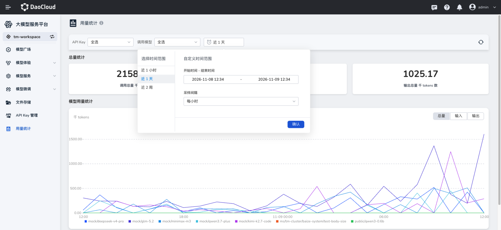
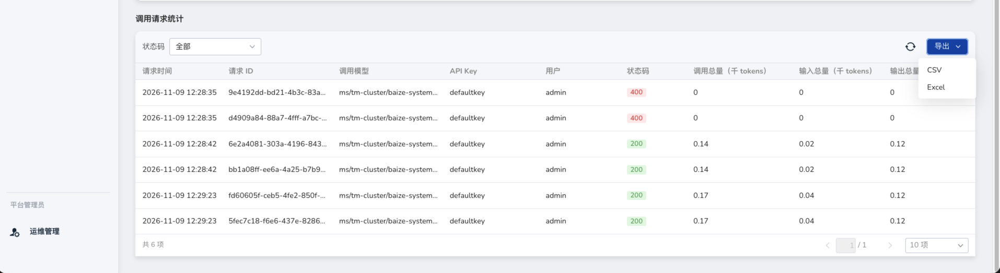

# 用量统计

用量统计用于查看当前工作空间内的模型调用用量和请求明细。您可以按 API Key、调用模型和时间范围筛选数据，查看用量趋势，并导出调用请求记录。

## 查看用量统计

1. 登录大模型服务平台，选择需要查看的工作空间。
2. 在左侧导航栏中点击 **用量统计**。
3. 在页面顶部选择筛选条件：

    - **API Key**：选择需要查看的 API Key，也可以选择全部。
    - **调用模型**：选择需要查看的模型，也可以选择全部。
    - **时间范围**：选择 **近 1 小时** 、**近 1 天** 或 **近 2 周** ，也可以设置开始时间和结束时间。
    - **采样间隔**：在时间范围选择窗口中选择统计图的采样间隔，然后点击 **确认**。

    

4. 查看页面中的总量统计和模型用量统计。点击筛选栏右侧的刷新按钮，可重新加载数据。

## 查看总量和模型用量趋势

**总量统计** 区域展示所选条件下的调用总量、输入总量和输出总量，单位为千 tokens。1 千 tokens 等于 1,000 tokens。

**模型用量统计** 区域以折线图展示各模型随时间变化的用量。您可以点击图表右上角的 **总量** 、**输入** 或 **输出** ，切换查看不同指标。图表底部的图例用于区分不同模型。

## 查看调用请求明细

在 **用量统计** 页面向下滚动至 **调用请求统计** ，可以查看每条调用请求的记录，包括请求时间、请求 ID、调用模型、API Key、用户、状态码以及调用总量、输入总量和输出总量。

您可以通过列表上方的 **状态码** 筛选请求，例如查看状态码为 200 或 400 的请求。点击列表右上角的刷新按钮，可重新加载列表；使用列表底部的分页控件，可以切换页码或调整每页显示的条数。

## 导出调用请求记录

1. 根据需要设置页面顶部的 API Key、调用模型和时间范围，并在 **调用请求统计** 区域设置状态码筛选条件。
2. 点击列表右上角的 **导出**。
3. 选择 **CSV** 或 **Excel** 格式，下载调用请求记录。

!!! note

    导出记录数和文件大小有限制。如果无法导出，请缩短时间范围或增加筛选条件后重试。
