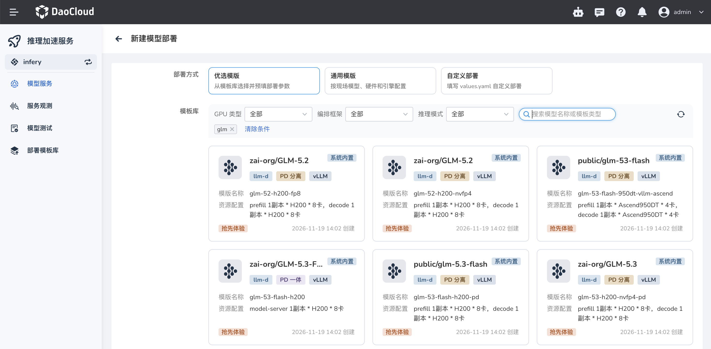
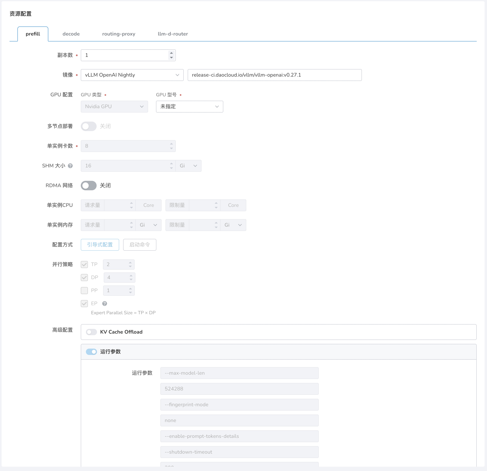

# 使用优选模板部署 PD 分离的 GLM 5.3 服务

本实践介绍如何使用 llm-d 和优选模板部署 PD 分离的 GLM 5.3 推理服务。部署完成后，可通过服务入口发起推理请求。

## 前提条件

- 已完成 [部署前准备](../model-services/prerequisites.md)。
- 模板库中已有适用于目标 GLM 模型和 GPU 的 llm-d PD 分离模板。如未找到匹配模板，请联系管理员。

## 操作步骤

1. 从左侧导航栏进入 **推理加速服务** > **模型服务**，点击 **新建部署**。

2. 在 **部署方式** 中选择 **优选模板**。

3. 在模板库中搜索目标 GLM 模型，按 **GPU 类型**、**编排框架**（llm-d）和 **推理模式**（PD 分离）筛选并选择模板。

    

4. 填写部署环境和模型信息。

    | 配置项 | 填写说明 | 建议值或示例 |
    | --- | --- | --- |
    | 目标集群 | 选择 GPU 资源满足模板要求的集群。 | 使用上述 H20 模板时，选择满足卡数要求的 H20 集群。 |
    | 命名空间 | 选择模型权重 PVC 所在的命名空间。 | 与所需 PVC 的命名空间一致。 |
    | 服务名称 | 填写用于在平台中识别部署实例的名称。 | `glm-53-pd` |
    | 别名 | 按需填写便于识别的服务名称。 | GLM 5.3 PD 分离服务 |
    | 模型访问名称 | 填写调用接口时传入的模型 ID。 | 部署上述模型时，可填写 `public/glm-5.3`。 |
    | PVC 名称 | 选择存放目标模型权重的 PVC。 | 选择与目标模型匹配的 PVC。新建 PVC 后可点击刷新按钮更新列表。 |
    | 模型子路径 | 填写 PVC 内的模型权重目录。 | 使用实际目录，例如 `/glm-5.3`。权重位于 PVC 根目录时留空。 |

5. 确认 **编排框架** 为 llm-d、**推理模式** 为 **PD 分离**。在 **资源配置** 中逐一核对各角色。GPU 类型、单实例卡数和并行策略等参数由优选模板预填，您只需按实际部署环境调整页面允许编辑的字段。

    | 角色 | 职责 | 配置建议 |
    | --- | --- | --- |
    | `prefill` | 处理输入并生成 KV Cache。 | 核对副本数和 vLLM 镜像地址，确认镜像版本满足模板要求。 |
    | `decode` | 逐步生成输出 Token。 | 核对副本数和 vLLM 镜像地址，确认镜像版本满足模板要求。 |
    | `routing-proxy` | 随 `decode` 实例部署，协调预填充与解码阶段的请求衔接。 | 核对配套镜像地址。 |
    | `llm-d-router` | 负责推理请求路由。 | 核对副本数和镜像版本，按请求并发量及预填充、解码实例的处理能力配置副本数。 |

    

6. 点击 **预览 YAML**，核对服务配置后点击 **提交并部署**。

7. 返回 **模型服务** 列表，确认服务状态为 **可用**，资源运行状态为 **运行中**。点击服务卡片进入详情，在 **拓扑与配置** 中核对各角色的配置，在 **资源列表** 中确认资源就绪。部署异常时，可在对应 Pod 行点击 **日志**。服务运行后，可在 **服务观测** 中查看指标。页面位置和状态示例参见 [通用模板部署的服务验证步骤](../model-services/generic-template.md#verify-service)。

8. 参考 [模型服务对外暴露（Hydra/Knoway）](export-by-hydra.md)，选择环境支持的接入方式并发起一次推理请求，确认模型返回结果。
