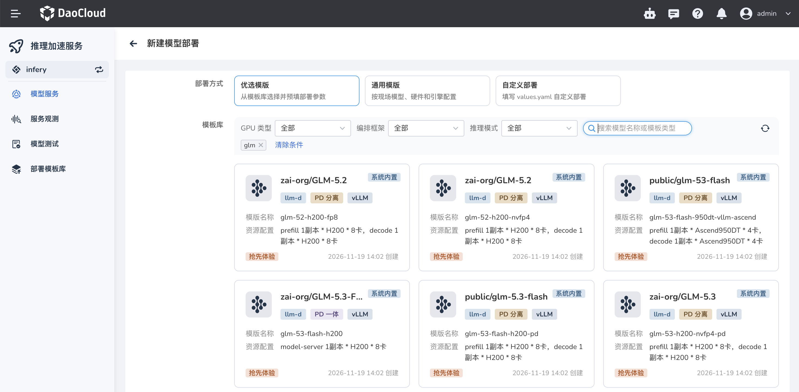
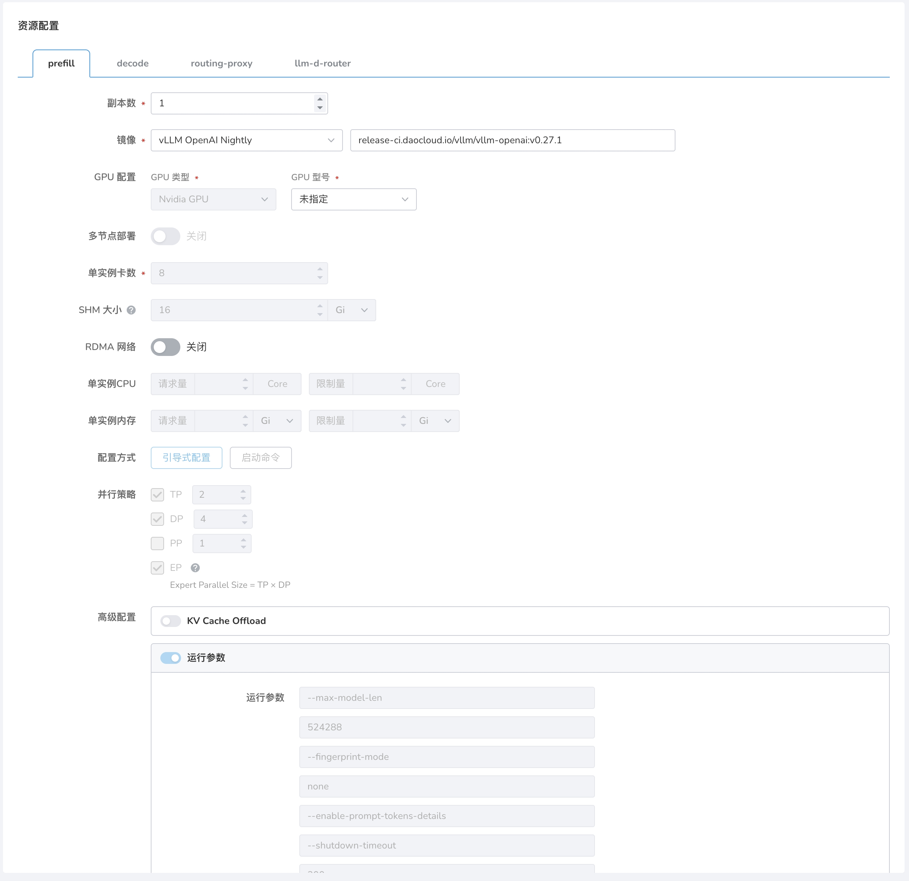

# 优选模板部署 PD 分离的 GLM 5.3 服务

本实践介绍使用已验证的优选模板部署 GLM 5.3 推理服务，编排框架为 llm-d 的 PD 分离模式。完成后，可通过统一服务入口调用模型。

## 前提条件

已完成[部署前准备](../model-services/create-service/prerequisites.md)；

模板库中已有 llm-d PD 分离 的 GLM 5.3 部署模板，如果未找到匹配模板，请联系管理员提供。

## 选择模板

1. 进入“推理加速服务 -> 模型服务”，点击“新建部署”。

2. 在部署方式中选择“优选模板”。

3. 在模板库中搜索目标 GLM 模型，也可按 GPU 类型、编排框架 llm\-d 和推理模式 PD 分离筛选。

## 部署环境配置

- **目标集群**：选择 GPU 资源满足模板配置要求的集群。

- **命名空间**：选择模型权重 PVC 所在的命名空间。

- **服务名称**：例如 glm-53-pd；按需填写别名“GLM-5.3-PD 分离服务”。

- **模型访问名称**：填写本次对外提供的模型 ID。建议与模型官方名称一致。

- **PVC 名称**：选择存储对应 GLM 权重的 PVC。新建 PVC 后可使用刷新按钮更新列表。

- **模型子路径**：填写 PVC 内的实际模型目录；权重位于 PVC 根目录时留空。

## 核对推理模式和资源配置

确认编排框架为 llm-d，推理模式为 PD 分离。

在“资源配置”中依次查看各角色的资源配置。llm-d 的 PD 分离模式下，需要配置的资源角色为 prefill、decode、routing-proxy 和 llm-d-router 。

优选模板中会带有必要的配置信息，如 GPU 类型、单实例卡数、并行策略等推理参数，您只需编辑与此次部署现场环境相关的配置项。

- **prefill**：负责预填充阶段，处理输入并生成 KV Cache。请核对副本数和 vLLM 镜像地址，确保镜像版本满足优选模板说明中的推理引擎版本要求。

- **decode**：负责解码阶段，逐步生成输出 Token。请核对副本数和 vLLM 镜像地址，版本要求同 Prefill。

- **routing-proxy**：协调 Prefill 与 Decode 的请求衔接，随 decode 实例部署，请核对配套镜像地址。

- **llm-d-router**：负责推理请求的路由与调度。请核对副本数和镜像版本，并根据请求并发量及 Prefill / Decode 的处理能力配置副本数，避免成为性能瓶颈。

## 预览并部署

1. 点击“预览 YAML”，核对服务配置，确认无误后点击“提交并部署”按钮。

2. 返回模型服务列表，点击服务卡片进入新服务详情，查看各角色的就绪情况。

## 验证服务

1. 在“拓扑与配置”中确认各角色的配置符合预期。

2. 在“资源列表”中按角色查看资源部署状态；部署过程中可查看 Pod 日志或跳转容器管理页面进行排查。

3. 服务正常运行后，可在详情页“服务观测”页面查看服务监控。

**完成标准**：服务状态变更为“可用”，各角色下的资源达到“运行中”状态。
