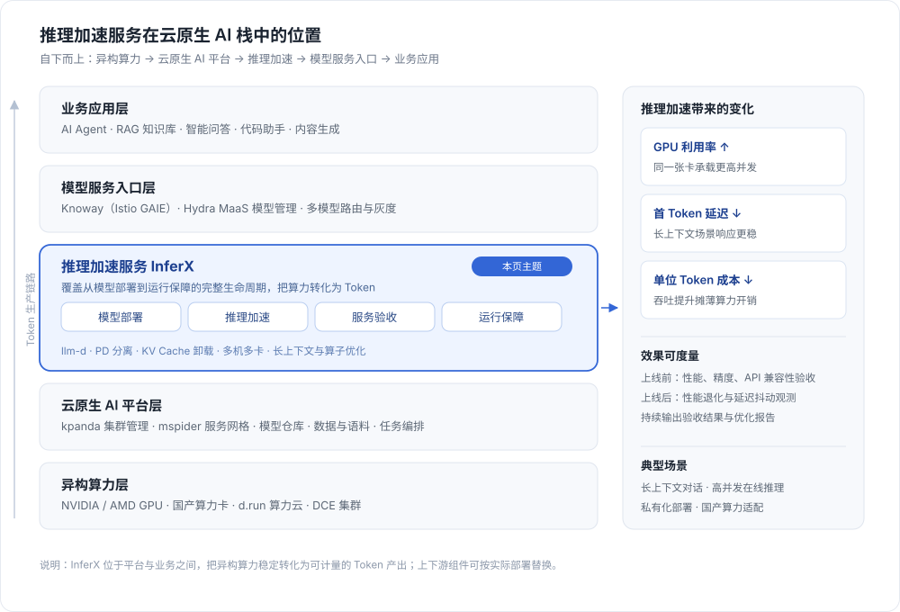

---
hide:
  - toc
---

# 推理加速服务介绍

推理加速服务是面向大模型推理性能优化的一体化平台。基于异构 GPU 算力与云原生底座，持续引入业界前沿的推理架构与性能优化技术，降低推理成本，提升服务效率；同时覆盖从模型部署到运行保障的完整生命周期，助力用户构建更快、更稳、更省的大模型推理服务。

## 架构定位

推理加速服务位于「算力」与「业务」之间的中间层：向下对接 Kubernetes 集群与异构 GPU / 国产算力卡，向上为模型服务入口（Knoway、Hydra）以及 Agent、RAG 等业务应用提供稳定、可计量的 Token 产出。

理解它在栈中的位置，可以抓住三点：

- **不替代推理框架**：在 vLLM、llm-d 等主流推理框架之上，通过 PD 分离、KV Cache 卸载、多机多卡与调度优化提升性能。
- **不绑定单一硬件**：同一套部署方式可运行在 NVIDIA、AMD GPU 和国产异构算力卡上，便于替换与扩容。
- **收益可度量**：上线前给出性能与精度的验收结论，上线后持续观测性能退化与延迟抖动，让加速收益可以被验证和回归。

## 核心能力

- **模型部署 - 快速部署高性能推理服务**: 兼容主流推理框架与异构 GPU，支持 PD 分离、KV Cache 卸载等高性能架构，快速适配新模型、新框架及新型 GPU / 国产算力卡。
- **推理加速 - 持续提升 Token 生产效率**: 基于高性能推理框架，结合并发调优、长上下文及算子优化等技术，提升吞吐与 GPU 利用率、降低延迟和单位 Token 成本。
- **服务验收 - 保障模型服务高质量上线**: 上线前完成推理性能、模型精度、API 兼容性、功能性测试，形成标准化验收结果与性能优化报告。
- **运行保障 - 保障推理服务稳定运行**: 持续观测服务性能与稳定性，及时发现性能退化、延迟抖动、突发流量冲击等问题，快速定位运行风险，保障服务 SLA。

## 产品优势

1. **推理性能全面优化**：通过编排框架到推理引擎的全栈优化，提升同等硬件资源下的推理吞吐与资源利用效率。
2. **国产卡深度调优**：积累多种国产算力卡适配与调优经验，充分释放国产硬件潜能。
3. **全生命周期服务保障**：覆盖交付、运维与运营全流程，为复杂生产环境提供端到端服务保障。
4. **前沿开源生态协同**：深度参与 vLLM 等开源社区，持续推进技术演进与新模型适配，加速前沿能力落地。

## 快速开始

- [离线环境安装推理加速服务](guides/offline.md)
- [启用集群的 Istio GAIE 特性](guides/enable-istio-gaie-with-mspider.md)
- [模型权重下载与配置](guides/model-weights-setup.md)
- [模型服务对外暴露 (Hydra/Knoway)](guides/export-by-hydra.md)
- [常见问题解答 (FAQ)](faqs.md)

[下载中心](https://docs.daocloud.io/download/){ .md-button .md-button--primary }
[了解 Token 工厂效能平台](https://docs.daocloud.io/tf/){ .md-button .md-button--primary }
[了解 d.run AI 操作系统](https://docs.daocloud.io/drun/){ .md-button .md-button--primary }
