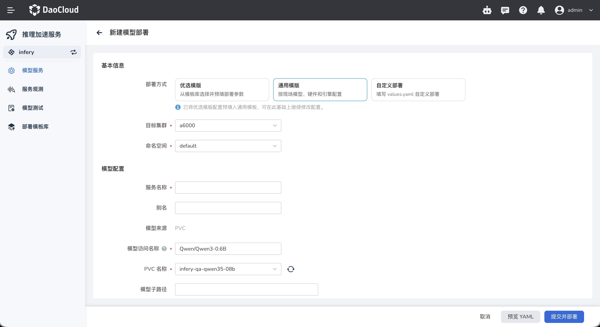
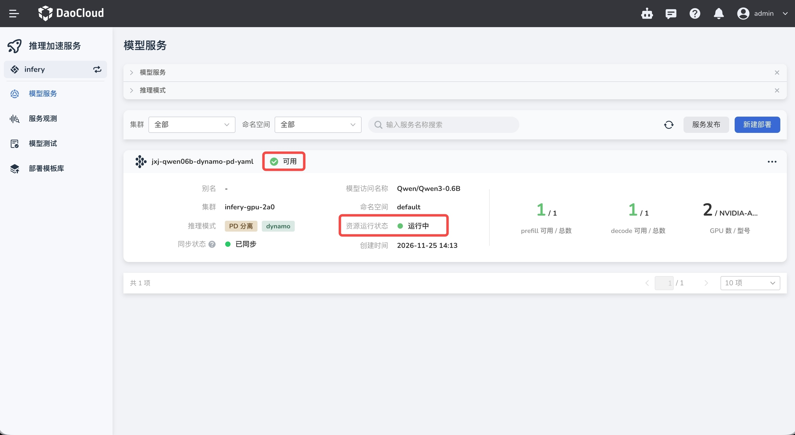
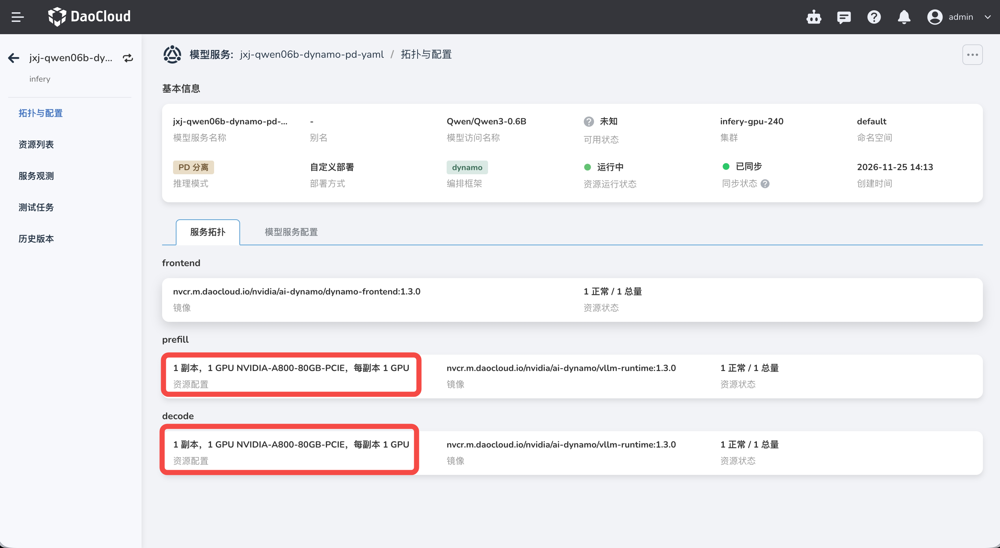
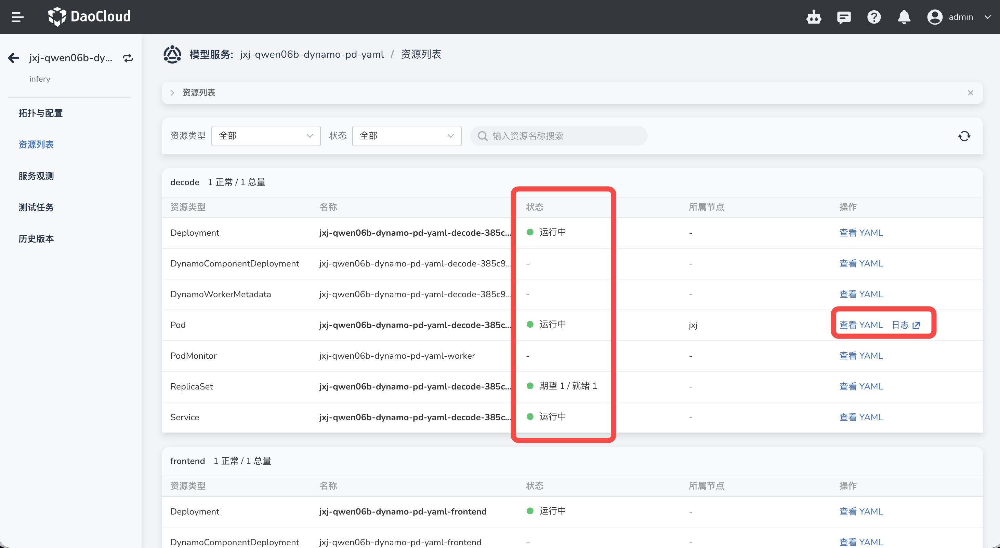
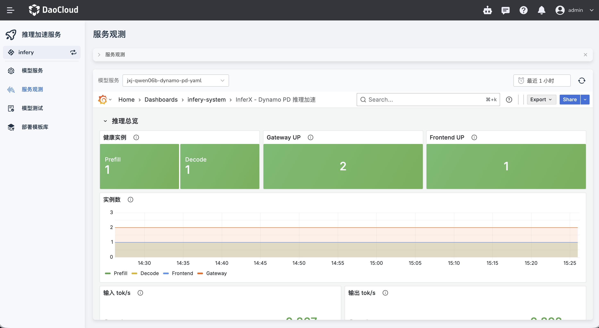

# 使用通用模板部署模型服务

通用模板支持通过表单配置模型、编排框架、推理模式和计算资源，适用于需要根据实际模型和硬件自行配置的场景。

## 前提条件

已完成 [部署前准备](prerequisites.md)，并确认：

- 目标集群已安装推理加速服务所需的系统组件。
- GPU、CPU、内存及命名空间配额满足部署要求。
- 模型权重已存放在目标命名空间的 PVC 中。
- 目标节点可以拉取支持目标模型和硬件的推理镜像。
- 使用多节点部署或 PD 分离时，网络和存储条件满足部署方案要求。

## 操作步骤

1. 从左侧导航栏进入 **推理加速服务** > **模型服务**，点击 **新建部署**。

2. 在 **部署方式** 中选择 **通用模板**。

    

    如已有相近的优选模板，也可先选中该模板，再点击 **复制当前模版参数至通用模版**，基于预填参数继续配置。

3. 选择 **目标集群** 和 **命名空间**。目标集群应具备所需资源，命名空间应与模型权重 PVC 所在的命名空间一致。

4. 填写模型信息。

    | 配置项 | 填写说明 |
    | --- | --- |
    | 服务名称 | 填写本次部署的模型服务名称，用于在平台中识别服务实例。 |
    | 别名 | 可选，填写便于识别的服务说明。 |
    | 模型来源 | 选择 PVC。 |
    | 模型访问名称 | 填写调用接口时使用的模型 ID，建议与模型官方名称一致。 |
    | PVC 名称 | 选择存放模型权重的 PVC；新建 PVC 后可点击刷新按钮更新列表。 |
    | 模型子路径 | 填写 PVC 内的实际模型目录；权重位于根目录时留空。 |
    | 挂载路径 | 默认使用页面展示的路径 /mnt/data。 |

5. 在 **推理模式** 区域选择 **编排框架** 和 **推理模式**。按已安装的组件和部署方案选择 llm-d 或 Dynamo。**PD 一体** 由同一实例处理预填充和解码，**PD 分离** 分别配置预填充和解码实例。

    | 编排框架 | 推理模式 | 需配置的服务角色 |
    | --- | --- | --- |
    | llm-d | PD 一体 | `model-server` 处理预填充和解码。 `llm-d-router` 调度推理请求。 |
    | llm-d | PD 分离 | `prefill` 处理输入并生成 KV Cache，`decode` 逐步生成输出 Token。 `routing-proxy` 随 `decode` 部署，协调两个阶段的请求衔接。 `llm-d-router` 调度推理请求。 |
    | Dynamo | PD 一体 | `Worker Pool` 处理预填充和解码。 `frontend` 提供请求入口，分发请求并返回推理结果。 |
    | Dynamo | PD 分离 | `prefill` 处理输入并生成 KV Cache，`decode` 逐步生成输出 Token。 `frontend` 提供请求入口，协调预填充和解码，返回推理结果。 |

6. 在 **资源配置** 中切换角色标签，分别完成各角色的配置。不同角色的配置字段因任务类型而异，以页面实际展示为准。

    承担推理任务的角色配置较为复杂，直接影响服务性能与稳定性，请仔细核对各项参数。

    

    | 配置项 | 填写说明 |
    | --- | --- |
    | 副本数 | 配置当前角色的资源副本数量。 |
    | 镜像 | 选择预置镜像，或填写自定义镜像地址。注意核对镜像版本与部署方案的兼容性。 |
    | GPU 类型及型号 | 按实际硬件和部署方案选择。 |
    | 多节点部署 | 需要一个推理实例跨节点运行时开启，并配置节点数及单实例（单机）卡数。 |
    | 单实例卡数 | 配置一个计算实例使用的 GPU 数量。如开启多机部署，此处填写每台服务器（每个实例）的 GPU 卡数。 |
    | SHM 大小 | 设置容器内共享内存的容量上限，用于推理进程间通信。 |
    | RDMA 网络 | 根据部署方案开启；开启后填写实际网络资源名称及请求量。 |
    | 单实例 CPU / 内存 | 配置 CPU 和内存的请求量和限制量。按各角色在模型加载和目标负载下的实际用量配置，并核对集群及命名空间配额。 |

7. 为承担推理任务的角色配置推理参数。可选择 **引导式配置** 或 **启动命令**。

    使用 **引导式配置** 时，通过表单配置并行策略及相关参数。

    | 参数 | 说明 |
    | --- | --- |
    | TP | 张量并行，将模型计算拆分到多个设备。 |
    | DP | 数据并行，配置并行处理请求的计算组。 |
    | PP | 流水线并行，将模型按阶段拆分。 |
    | EP | 专家并行，适用于支持该方式的 MoE 模型及引擎。EP 并行数 = TP × DP |

    | 配置项 | 填写说明 |
    | --- | --- |
    | KV Cache Offload | 需要使用 KV Cache 卸载时，展开该选项并开启，填写实际 Redis 实例 URL 地址及每卡本地缓存容量。 |
    | 运行参数 | 可逐项填写必要的推理运行参数。如 `--max-model-len` `--kv-cache-dtype`等。 |

    **推理参数核对**

    - 配置并行策略时，按角色核对并行策略和 GPU 分配。开启并行选项不会自动增加已申请的 GPU 资源。对于每个副本内配置 TP、DP、PP 的并行策略，核对 `TP × DP × PP` 与该副本配置的 GPU 总数是否一致。多节点部署时，该总数按单实例卡数乘以节点数计算。
    - **KV Cache Offload** 使用平台自研的 KV Cache 卸载方案。启用前确认推理实例可以访问配置的 Redis 地址。每卡本地缓存容量乘以单实例卡数，应小于单实例内存，并为推理进程预留足够空间。
    - 填写运行参数时，按实际镜像中的引擎版本核对支持的参数、取值和格式，并在 YAML 预览中复核生成的参数。

    使用 **启动命令** 时，填写所选推理框架与引擎版本支持的完整启动方式。两种配置方式均可按需设置以下选项。

    | 配置项 | 填写说明 |
    | --- | --- |
    | 环境变量 | 根据镜像要求添加环境变量，引用 Secret、ConfigMap 等资源。 |
    | 健康检查 | 按需配置存活、就绪和启动检查，核对检查方式、端口、路径、周期及超时时间。 |

    模型首次加载可能耗时较长，应为启动检查预留足够时间，避免加载期间被反复重启。

8. 点击 **预览 YAML**，核对服务配置后点击 **提交并部署**。

9. **验证服务**。返回 **模型服务** 列表，确认新服务的状态为 **可用**，资源运行状态为 **运行中**。

    

    点击服务卡片进入详情，在 **拓扑与配置** 中核对各角色的副本数、GPU、镜像和资源状态。

    

    在 **资源列表** 中查看各角色的资源和就绪状态。部署异常时，可在对应 Pod 行点击 **日志**。

    

    服务运行后，可在 **服务观测** 中查看健康实例数、实例数趋势和吞吐等指标。

    
